<div align="center">

# Auto-Video

**One idea → 165 visual pipelines → a film you can actually publish.**

Original voice-over script · local voice cloning · deterministic code-rendered frames · subtitles on real speech · delivery gates.<br>
No cloud image or video generation API. Same script, same version, same pixels.

[](https://github.com/DaBaoAgent/Auto-Video/stargazers)
[](https://github.com/DaBaoAgent/Auto-Video/releases/latest)
[](LICENSE)


**English | [简体中文](README.md)**

**[▶ Sample gallery](https://dabaoagent.github.io/Auto-Video/)** · [Pipeline catalogue](docs/pipelines.md) · [Quick start](#quick-start-30-seconds)

<a href="https://dabaoagent.github.io/Auto-Video/media/showreel.mp4">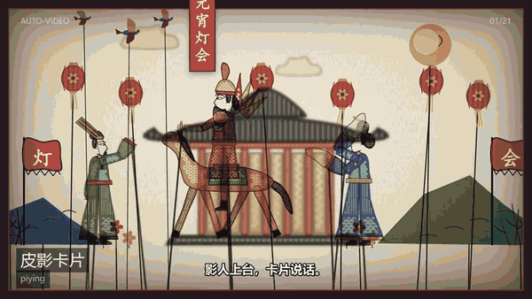</a>

<sub>21 visual styles in 27 seconds — click for the full 45-second cut. Every frame rendered by this repo's own code.</sub>

</div>

## Quick start (30 seconds)

```bash
git clone --depth 1 https://github.com/DaBaoAgent/Auto-Video.git
cd Auto-Video
python demo/run.py            # 15 s, 720p: no voice-over, no downloads, no cloud API
```

Output: `demo/out/demo.mp4`. No Python / Node / Chrome locally? Use Docker — chromium, ffmpeg and Chinese fonts are baked in:

```bash
docker compose run --rm demo
```

Then pick a real pipeline (`check` reports what this machine is missing, `plan` shows the commands):

```bash
python pipelines/pencil/scripts/pencil.py check
python pipelines/pencil/scripts/pencil.py new projects/demo --title "Test"
python pipelines/pencil/scripts/pencil.py render projects/demo
```

## The look

Twenty-one representatives, one per station. **All 165 clips live on the [sample gallery](https://dabaoagent.github.io/Auto-Video/)** — grouped by station, hover to play. Click a still to watch that pipeline's clip.

<div align="center">
<table>
  <tr>
    <td width="33%" align="center" valign="top">
      <a href="https://dabaoagent.github.io/Auto-Video/media/jianying.mp4"></a>
      <br><sub><b>Paper-card Chronicle</b> · 01 Paper & Chronicle</sub>
    </td>
    <td width="33%" align="center" valign="top">
      <a href="https://dabaoagent.github.io/Auto-Video/media/minjian.mp4">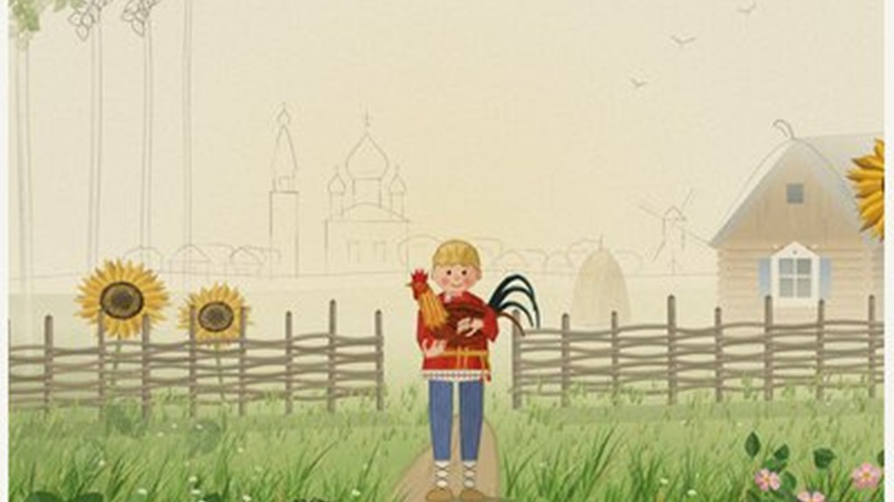</a>
      <br><sub><b>Folk-tale Storybook</b> · 01 Paper & Chronicle</sub>
    </td>
    <td width="33%" align="center" valign="top">
      <a href="https://dabaoagent.github.io/Auto-Video/media/pencil.mp4">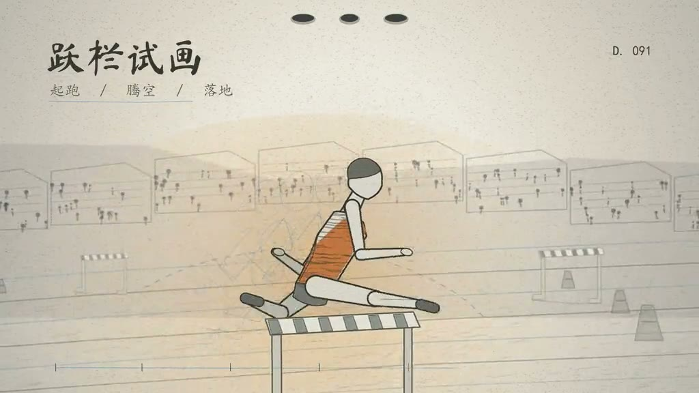</a>
      <br><sub><b>Pencil Test</b> · 02 Hand & Pencil</sub>
    </td>
  </tr>
  <tr>
    <td width="33%" align="center" valign="top">
      <a href="https://dabaoagent.github.io/Auto-Video/media/caiqian.mp4">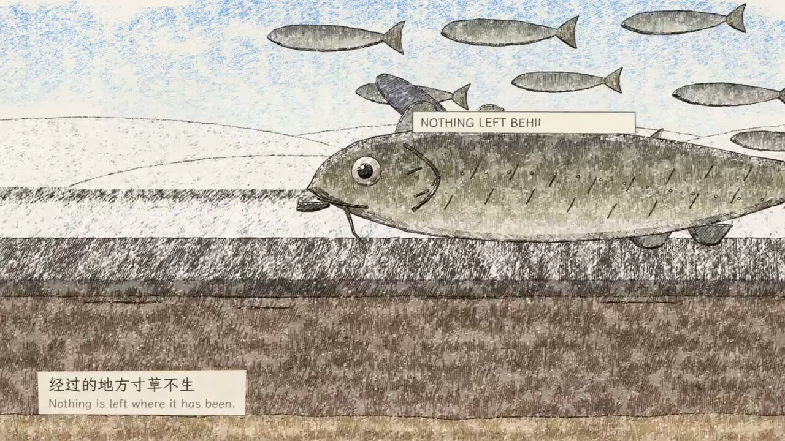</a>
      <br><sub><b>Colored-pencil Science</b> · 02 Hand & Pencil</sub>
    </td>
    <td width="33%" align="center" valign="top">
      <a href="https://dabaoagent.github.io/Auto-Video/media/shouhui.mp4"></a>
      <br><sub><b>Hand-drawn Cel</b> · 02 Hand & Pencil</sub>
    </td>
    <td width="33%" align="center" valign="top">
      <a href="https://dabaoagent.github.io/Auto-Video/media/piying.mp4"></a>
      <br><sub><b>Shadow-puppet Cards</b> · 03 Traditional Crafts</sub>
    </td>
  </tr>
  <tr>
    <td width="33%" align="center" valign="top">
      <a href="https://dabaoagent.github.io/Auto-Video/media/shuimo.mp4">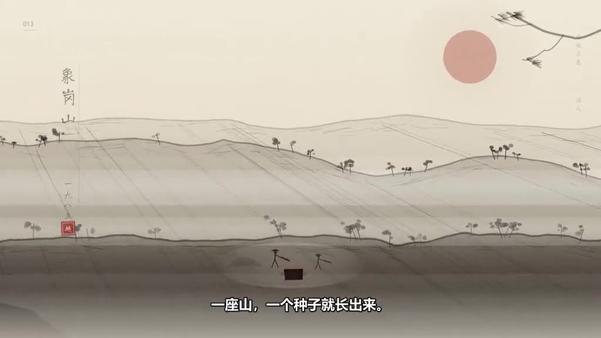</a>
      <br><sub><b>Ink Wash</b> · 03 Traditional Crafts</sub>
    </td>
    <td width="33%" align="center" valign="top">
      <a href="https://dabaoagent.github.io/Auto-Video/media/laolang.mp4">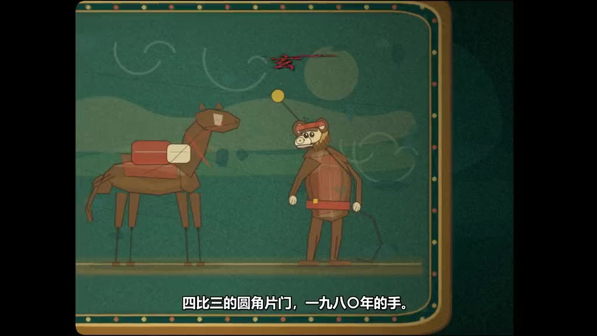</a>
      <br><sub><b>Shanghai Cel</b> · 03 Traditional Crafts</sub>
    </td>
    <td width="33%" align="center" valign="top">
      <a href="https://dabaoagent.github.io/Auto-Video/media/manga.mp4">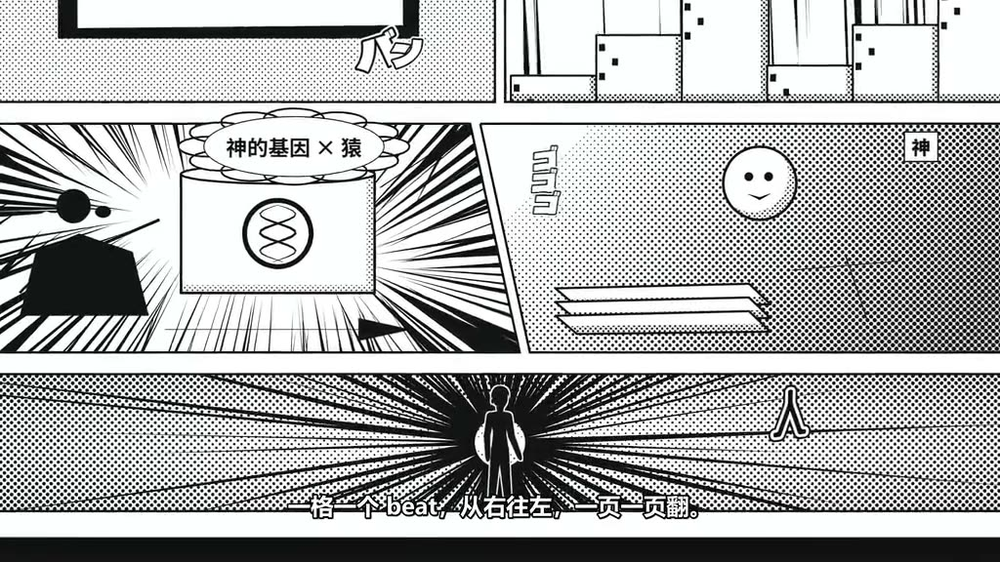</a>
      <br><sub><b>Manga Panels</b> · 04 Cartoons</sub>
    </td>
  </tr>
  <tr>
    <td width="33%" align="center" valign="top">
      <a href="https://dabaoagent.github.io/Auto-Video/media/goldenage.mp4">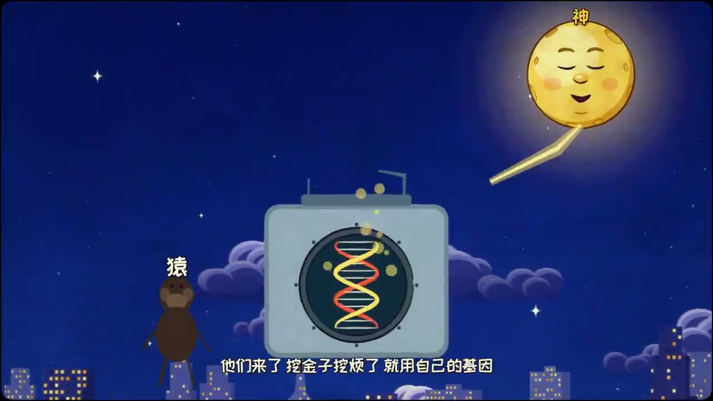</a>
      <br><sub><b>Golden-age Toon</b> · 04 Cartoons</sub>
    </td>
    <td width="33%" align="center" valign="top">
      <a href="https://dabaoagent.github.io/Auto-Video/media/xiangsu.mp4">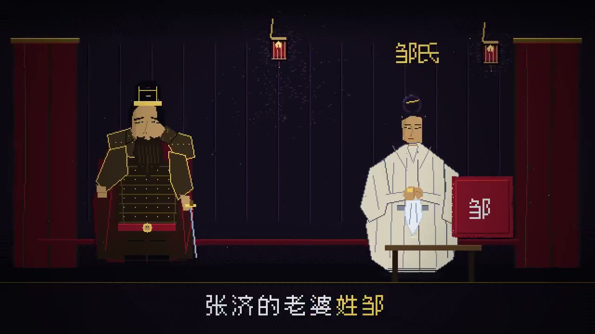</a>
      <br><sub><b>Pixel Art</b> · 04 Cartoons</sub>
    </td>
    <td width="33%" align="center" valign="top">
      <a href="https://dabaoagent.github.io/Auto-Video/media/huixingzhen.mp4">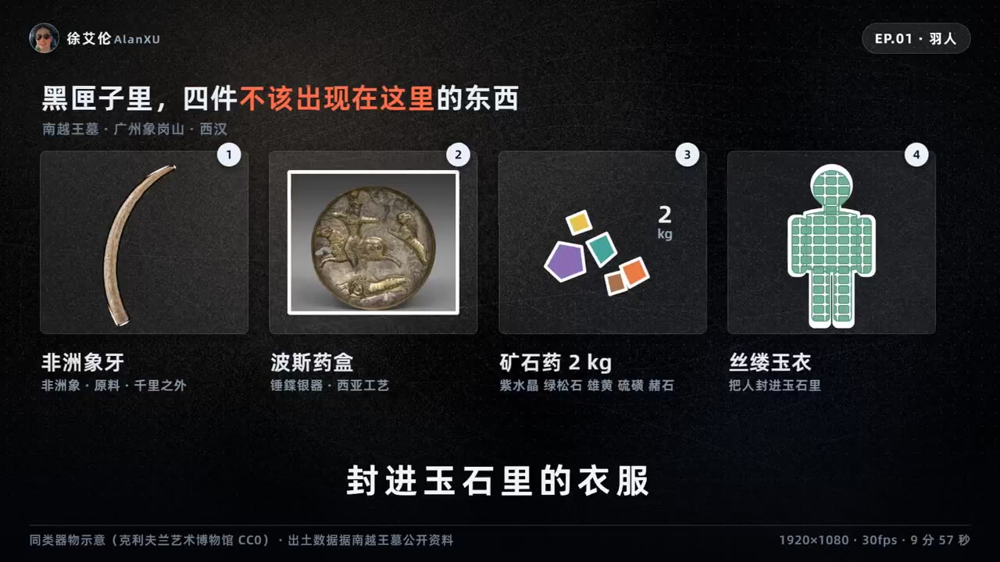</a>
      <br><sub><b>Paperclip Explainer</b> · 05 Graphic & Motion</sub>
    </td>
  </tr>
  <tr>
    <td width="33%" align="center" valign="top">
      <a href="https://dabaoagent.github.io/Auto-Video/media/lvdong.mp4">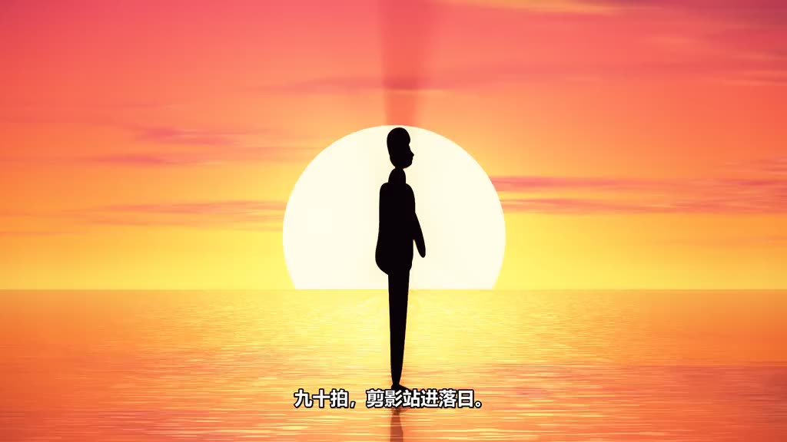</a>
      <br><sub><b>Silhouette Rhythm</b> · 05 Graphic & Motion</sub>
    </td>
    <td width="33%" align="center" valign="top">
      <a href="https://dabaoagent.github.io/Auto-Video/media/xianshiqi.mp4">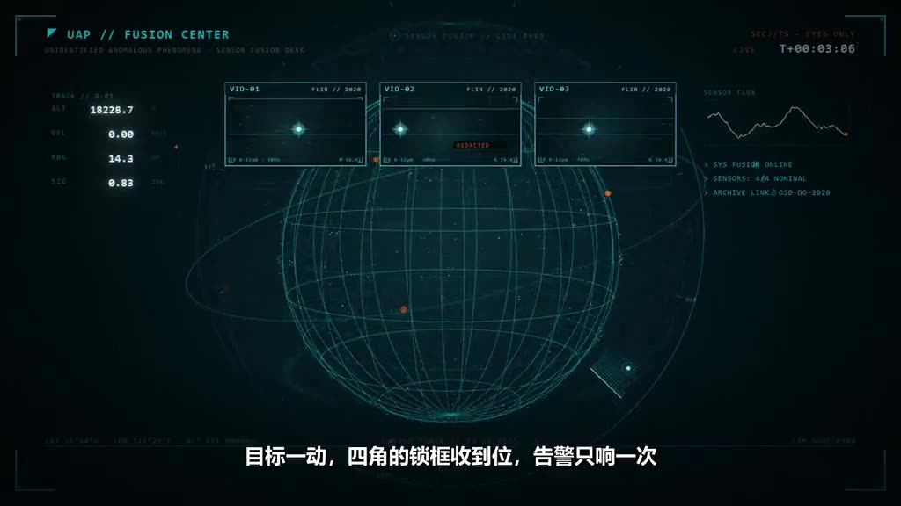</a>
      <br><sub><b>Cyber HUD</b> · 06 Screens & Neon</sub>
    </td>
    <td width="33%" align="center" valign="top">
      <a href="https://dabaoagent.github.io/Auto-Video/media/xuni.mp4">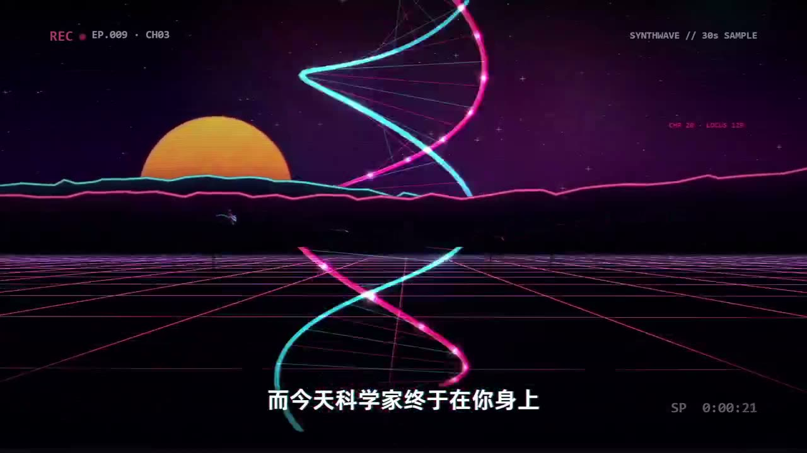</a>
      <br><sub><b>Synthwave VHS</b> · 06 Screens & Neon</sub>
    </td>
  </tr>
  <tr>
    <td width="33%" align="center" valign="top">
      <a href="https://dabaoagent.github.io/Auto-Video/media/chengshi.mp4">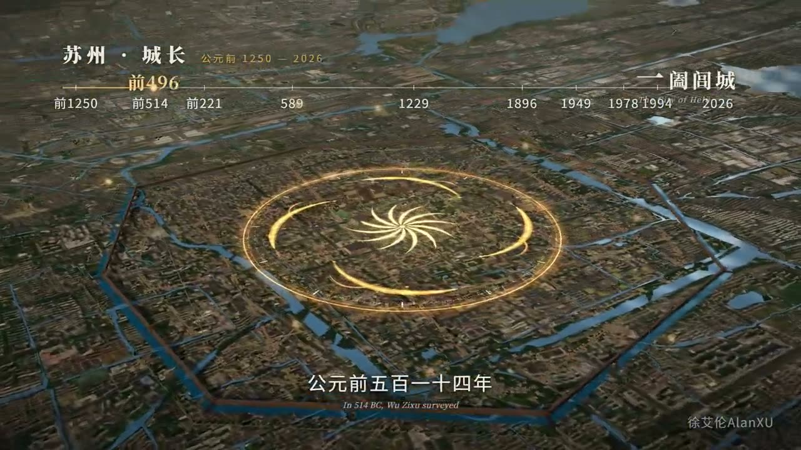</a>
      <br><sub><b>City Rings</b> · 07 3D & Diorama</sub>
    </td>
    <td width="33%" align="center" valign="top">
      <a href="https://dabaoagent.github.io/Auto-Video/media/isometric.mp4">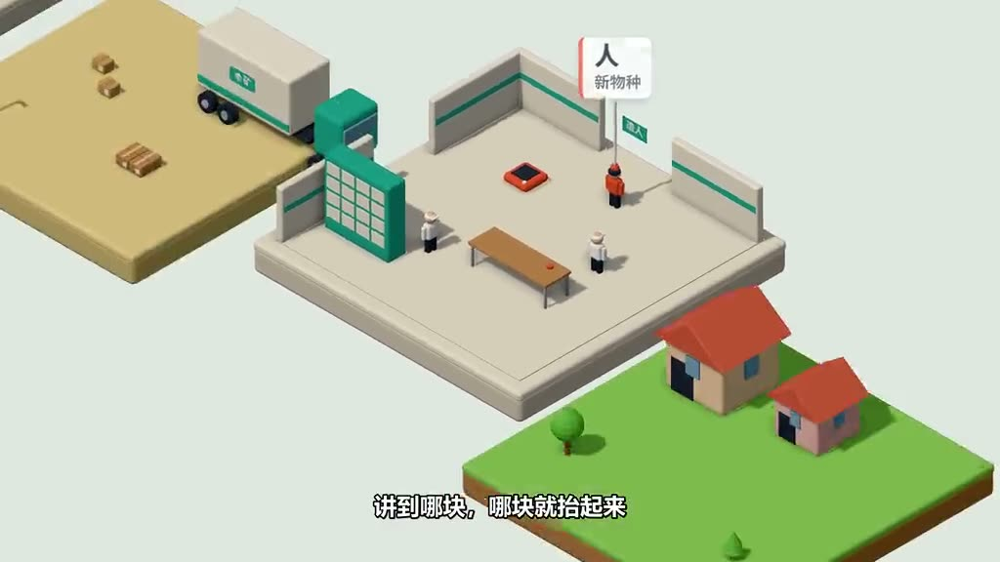</a>
      <br><sub><b>Isometric Diorama</b> · 07 3D & Diorama</sub>
    </td>
    <td width="33%" align="center" valign="top">
      <a href="https://dabaoagent.github.io/Auto-Video/media/map.mp4">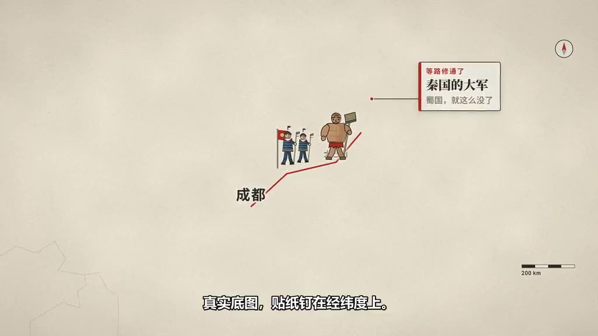</a>
      <br><sub><b>Map Stickers</b> · 08 Maps & Terrain</sub>
    </td>
  </tr>
  <tr>
    <td width="33%" align="center" valign="top">
      <a href="https://dabaoagent.github.io/Auto-Video/media/ditu.mp4">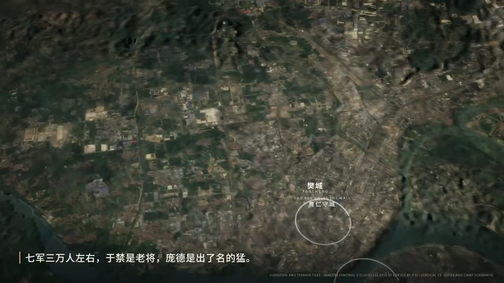</a>
      <br><sub><b>Terrain Map</b> · 08 Maps & Terrain</sub>
    </td>
    <td width="33%" align="center" valign="top">
      <a href="https://dabaoagent.github.io/Auto-Video/media/blueprint.mp4">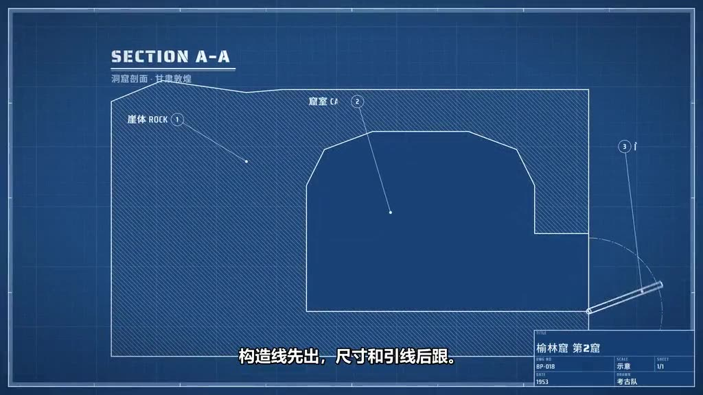</a>
      <br><sub><b>Blueprint</b> · 09 Diagram & Blueprint</sub>
    </td>
    <td width="33%" align="center" valign="top">
      <a href="https://dabaoagent.github.io/Auto-Video/media/parable.mp4">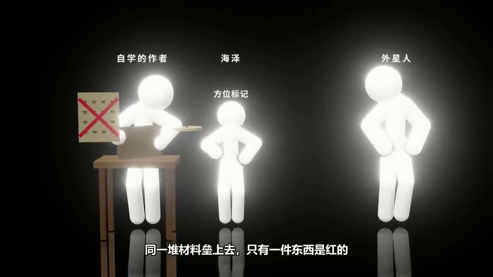</a>
      <br><sub><b>Stick-figure Parable</b> · 09 Diagram & Blueprint</sub>
    </td>
  </tr>
</table>
<sub>Covers are picked from the frame with the most motion and edge density, not a screenshot at second 2.</sub>
</div>

## How it differs

Not stock-footage retrieval plus stitching. The difference is **where the picture comes from**, **whether the same script yields the same frame**, and **what gates run before delivery**.

| | Typical auto-editor / AI video tool | Auto-Video |
| --- | --- | --- |
| Footage | Stock retrieval, or a cloud generation call per render | Code drawing, template rendering, local models; no per-render billing |
| Reproducibility | Random every run | Same script + same version → same pixels (no `Date.now` / `Math.random`, seeded by pipeline id) |
| Gates | Usually none | Contract check + motion audit + full subtitle coverage + flicker budget + loudness normalization |
| Scale | One generic template | 165 visual lineages / 11 stations sharing one runtime and contract |

Honest breakdown of the 165: **41** hand-built pipelines with their own project and runtime, **77** sharing the in-repo style kernel [`vendor/runtime/stylekit.js`](vendor/runtime/stylekit.js) (14 style families), **47** self-contained local runtimes.

## Stations

A station is a family of drawing methods. Numbers are the order used on the site and in the docs. Full per-pipeline status, engine, entry point and clip length: [`docs/pipelines.md`](docs/pipelines.md), generated from `catalog/pipelines.json`.

| Station | Pipelines | Representatives | What it draws |
| --- | --- | --- | --- |
| 01 Paper & Chronicle | 4 | jianying · lishi · zhidiao · minjian | Silk, paper, silhouettes, folk storybooks; card motion grammar |
| 02 Hand & Pencil | 33 | pencil · caiqian · shouhui · shuicai | Frame-by-frame drawing, pencil tests, colored-pencil hatching |
| 03 Traditional Crafts | 19 | piying · shuimo · laolang · fushihui | Shadow puppetry, ink, light-box, embroidery, ukiyo-e woodblock |
| 04 Cartoons | 15 | goldenage · manga · xiangsu · tianshu | Golden-age cartoon, comic panels, pixel art, folk cel animation |
| 05 Graphic & Motion | 27 | shiliang · lvdong · huixingzhen | Flat vector, silhouette rhythm, clip-art charts, scale journeys |
| 06 Screens & Neon | 23 | xianshiqi · xuni · dianzhen | Cyan neon HUD, synthwave / VHS / Y2K, dot-matrix screens |
| 07 3D & Diorama | 11 | tuiyan · chengshi · isometric | Wargame table, data-grown city, isometric pastel dioramas |
| 08 Maps & Terrain | 10 | map · ditu · weixing | Natural Earth sticker maps, satellite terrain, elevation water |
| 09 Diagram & Blueprint | 12 | blueprint · parable · chaijie | Cyanotype engineering drawings, matchstick parables, cutaways |
| 10 Live Footage | 11 | shipai · jilupian | Pixabay vertical voice-over, source-list documentary explainers |
| 11 Front of House | 1 | peiyin | Topic, script audit, batch cloned voice-over (no film) |

## How a film gets made


| Stage | In | Out | Gate |
| --- | --- | --- | --- |
| Script | Topic / reference link | Original voice-over script | AI-flavour audit, pronunciation fixes |
| Voice-over | Script, cloned timbre | Per-sentence audio + timeline | Breathing, pauses, broken words pass |
| Assembly | Timeline, shot list, template, fonts | Scene clips | Shot/scene count and duration match, params reproducible |
| QC | Film, timeline, render data | Check report | Subtitles, flicker, tweening, frame extraction, loudness |
| Delivery | Film, covers, release info | Publishable folder | `out/<no_title>/` has all four parts |

## Requirements

| Need | When |
| --- | --- |
| Python 3.10+ (stdlib only) | All pipelines and tooling |
| Node 18+ | The Canvas / Remotion frame-by-frame batch |
| Chrome / Edge / Chromium | Frame capture (`CHROME_PATH` override, auto-detected) |
| ffmpeg / ffprobe | Muxing, loudness normalization, frame extraction |
| edge-tts (free) or GPT-SoVITS | When you need voice-over; cloning needs the latter |
| Local ComfyUI + Wan2.2 | Only the `tianshu` pipeline |

`python tools/validate.py` checks all 166 pipelines and 11 stations: unique ids, entry files, SKILL.md frontmatter, and that the catalogue and directories agree both ways.

## Contract: parameters are the config

Every `pipeline.json` follows one additive contract — historical flat keys untouched, only `schema` + `meta` added:

```jsonc
{
  "schema": "auto-video/pipeline@2",
  "meta": {
    "id": "lishi", "no": "02", "station": "paper",
    "name_zh": "纸本史话", "aspect": "16:9", "fps": 30,
    "status": "live", "entry": "scripts/lishi.py"
  },
  "paths": { ... }
}
```

| File / command | Purpose |
| --- | --- |
| [`catalog/pipelines.json`](catalog/pipelines.json) | Registry of all 166 pipelines; the site is generated from it |
| [`catalog/stations.json`](catalog/stations.json) | The 11 stations: number, names, blurb |
| [`schema/pipeline.schema.json`](schema/pipeline.schema.json) | JSON Schema (draft 2020-12) |
| `python tools/validate.py` | Contract, entry files, frontmatter and registry consistency |
| `python tools/build_samples.py` | Compress raw clips for web + pick covers → `site/assets/samples.json` |
| `python tools/build_site.py` | Catalogue + samples → site data; Pages redeploys on push |

Adding a pipeline: create `pipelines/<id>/` (`SKILL.md` + `pipeline.json`) → register it in `catalog/pipelines.json` → `python tools/normalize_pipelines.py` → `python tools/validate.py`.

## Optional frontend

`frontend/` is optional; every pipeline works without it. It chains topic → script → free TTS → pipeline render → covers + release info:

```bash
python frontend/frontend.py run --pipeline laolang --topic "Why Xuanzang went west" --title "Xuanzang"
```

**Honest part**: **10 of 166** pipelines run end to end today (`pencil` `shadow` `tapestry` `laolang` `goldenage` `manga` `isometric` `map` `blueprint` `parable`). The other 156 have their blocker documented per pipeline in [`frontend/targets.json`](frontend/targets.json).

## Repository layout

```text
Auto-Video/
├── demo/                    # 15-second zero-dependency demo
├── docker/                  # demo image: chromium + ffmpeg + CJK fonts
├── pipelines/               # 166 directories: SKILL.md + pipeline.json + scripts/
├── catalog/                 # pipelines.json (single source of truth) + stations.json
├── vendor/runtime/          # shared drawing kernel for the 77 style pipelines
├── frontend/                # optional: topic → script → TTS → render → covers
├── site/                    # sample gallery (Pages) + media/ (165 clips)
├── tools/                   # gates, site build, sample packaging
├── docs/                    # delivery spec, sample workflow, pipeline catalogue
└── .github/workflows/       # contract gate + Pages deploy
```

## FAQ

<details>
<summary>Where does the voice-over come from?</summary>

**GPT-SoVITS** locally by default (bring your own weights), or **edge-tts** (Microsoft online voices, free, no key). Model weights are never committed.

</details>

<details>
<summary>Why are models, fonts and finished films left out of the repo?</summary>

Code and config are committed; heavy, regenerable assets are documented and downloaded separately. `git clone --depth 1` stays small and history stays clean.

</details>

<details>
<summary>What is the difference between a clip and a finished film?</summary>

`site/media/` holds compressed **style segments** (163 ten-second clips plus two film openings). Finished films (2–13 min) stay in local archives or Release assets, never in the repo.

</details>

## Contributing

The most welcome contribution is not a feature: it is **making one pipeline runnable by anyone, not just its author** — add a clip, remove hard-coded drive paths, make Chrome detection cross-platform, implement a gate that `SKILL.md` promises but never ran.

Rules and the minimal mergeable template: [`CONTRIBUTING.md`](CONTRIBUTING.md). Then:

```bash
python tools/validate.py && python tools/check_links.py
```

## Credits & license

- **styles** (synthwave / flat vector / HUD / isometric motion-graphics engines): [Vincentwei1021/styles](https://github.com/Vincentwei1021/styles), MIT
- **huashu-art-motion** (source of 31 self-contained drawing pipelines): [alchaincyf/huashu-art-motion](https://github.com/alchaincyf/huashu-art-motion), MIT
- **MoneyPrinterTurbo** (footage generation for `shipai`): [harry0703/MoneyPrinterTurbo](https://github.com/harry0703/MoneyPrinterTurbo)
- **GPT-SoVITS** (local cloned voice-over): [RVC-Boss/GPT-SoVITS](https://github.com/RVC-Boss/GPT-SoVITS)

Code is released under [MIT](LICENSE); third-party components keep their own licenses — see [`THIRD_PARTY_NOTICES.md`](THIRD_PARTY_NOTICES.md). Sample clips remain copyright of the author.
