<div align="center">

# Auto-Video

**一句选题 → 165 条画法管线 → 一部能发的片**

原创口播稿 · 本地克隆音色 · 代码逐帧渲染 · 字幕贴真实语音 · 交付门禁
不调云端生图 / 生视频 API，同一稿同一版，出同一帧。

[](https://github.com/DaBaoAgent/Auto-Video/stargazers)
[](https://github.com/DaBaoAgent/Auto-Video/releases/latest)
[](LICENSE)


**[▶ 在线样片站](https://dabaoagent.github.io/Auto-Video/)** · [166 条管线清单](docs/pipelines.md) · [30 秒跑通](#30-秒跑通) · [English](README-en.md)

<a href="https://dabaoagent.github.io/Auto-Video/media/showreel.mp4"></a>

<sub>21 条画法，27 秒一次看完 —— 点开是 45 秒完整版，全部由本仓库代码渲出。</sub>

</div>

## 30 秒跑通

```bash
git clone --depth 1 https://github.com/DaBaoAgent/Auto-Video.git
cd Auto-Video
python demo/run.py            # 15 秒 720p：不配音、不下载素材、不调云端 API
```

产物 `demo/out/demo.mp4`。本机没有 Python / Node / Chrome？用 Docker，镜像里已装好 chromium + ffmpeg + 中文字体：

```bash
docker compose run --rm demo
```

跑通 demo，再挑一条真管线（`check` 看这台机器缺什么，`plan` 看它会跑哪些命令）：

```bash
python pipelines/pencil/scripts/pencil.py check
python pipelines/pencil/scripts/pencil.py new projects/demo --title "试片"
python pipelines/pencil/scripts/pencil.py render projects/demo
```

## 画法一览

下面 21 条是每条工位的代表，**165 段样片全在[在线样片站](https://dabaoagent.github.io/Auto-Video/)**，悬停即播、按工位分组。点图直接看这条管线的样片。

<div align="center">
<table>
  <tr>
    <td width="33%" align="center" valign="top">
      <a href="https://dabaoagent.github.io/Auto-Video/media/jianying.mp4"></a>
      <br><sub><b>纸本卡片</b> · 01 纸本叙事</sub>
    </td>
    <td width="33%" align="center" valign="top">
      <a href="https://dabaoagent.github.io/Auto-Video/media/minjian.mp4"></a>
      <br><sub><b>民间故事绘本</b> · 01 纸本叙事</sub>
    </td>
    <td width="33%" align="center" valign="top">
      <a href="https://dabaoagent.github.io/Auto-Video/media/pencil.mp4">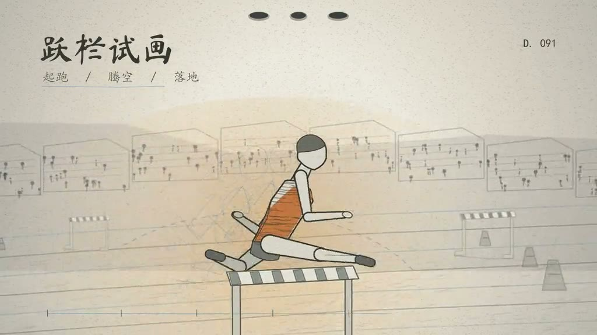</a>
      <br><sub><b>铅笔测试</b> · 02 手绘笔触</sub>
    </td>
  </tr>
  <tr>
    <td width="33%" align="center" valign="top">
      <a href="https://dabaoagent.github.io/Auto-Video/media/caiqian.mp4"></a>
      <br><sub><b>彩铅科普</b> · 02 手绘笔触</sub>
    </td>
    <td width="33%" align="center" valign="top">
      <a href="https://dabaoagent.github.io/Auto-Video/media/shouhui.mp4"></a>
      <br><sub><b>逐帧手绘</b> · 02 手绘笔触</sub>
    </td>
    <td width="33%" align="center" valign="top">
      <a href="https://dabaoagent.github.io/Auto-Video/media/piying.mp4"></a>
      <br><sub><b>皮影卡片</b> · 03 传统工艺</sub>
    </td>
  </tr>
  <tr>
    <td width="33%" align="center" valign="top">
      <a href="https://dabaoagent.github.io/Auto-Video/media/shuimo.mp4">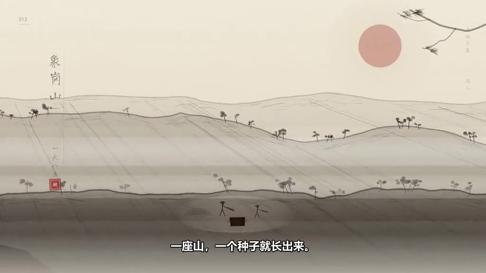</a>
      <br><sub><b>纸本水墨</b> · 03 传统工艺</sub>
    </td>
    <td width="33%" align="center" valign="top">
      <a href="https://dabaoagent.github.io/Auto-Video/media/laolang.mp4"></a>
      <br><sub><b>上美影手绘</b> · 03 传统工艺</sub>
    </td>
    <td width="33%" align="center" valign="top">
      <a href="https://dabaoagent.github.io/Auto-Video/media/manga.mp4">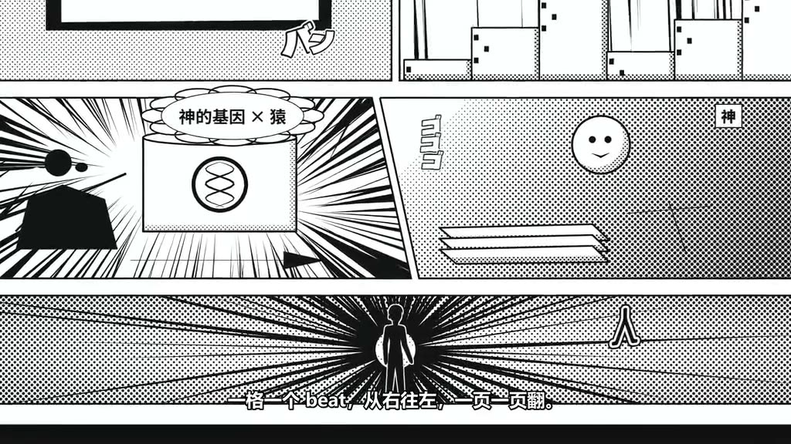</a>
      <br><sub><b>漫画分格</b> · 04 卡通动画</sub>
    </td>
  </tr>
  <tr>
    <td width="33%" align="center" valign="top">
      <a href="https://dabaoagent.github.io/Auto-Video/media/goldenage.mp4"></a>
      <br><sub><b>黄金卡通</b> · 04 卡通动画</sub>
    </td>
    <td width="33%" align="center" valign="top">
      <a href="https://dabaoagent.github.io/Auto-Video/media/xiangsu.mp4"></a>
      <br><sub><b>像素风</b> · 04 卡通动画</sub>
    </td>
    <td width="33%" align="center" valign="top">
      <a href="https://dabaoagent.github.io/Auto-Video/media/huixingzhen.mp4">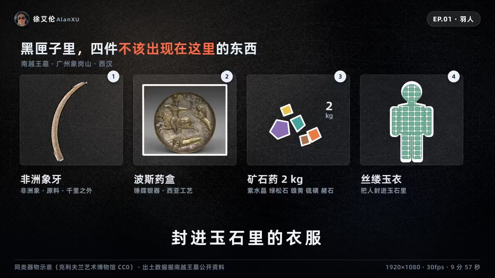</a>
      <br><sub><b>回形针风</b> · 05 平面图形</sub>
    </td>
  </tr>
  <tr>
    <td width="33%" align="center" valign="top">
      <a href="https://dabaoagent.github.io/Auto-Video/media/lvdong.mp4"></a>
      <br><sub><b>剪影律动</b> · 05 平面图形</sub>
    </td>
    <td width="33%" align="center" valign="top">
      <a href="https://dabaoagent.github.io/Auto-Video/media/xianshiqi.mp4">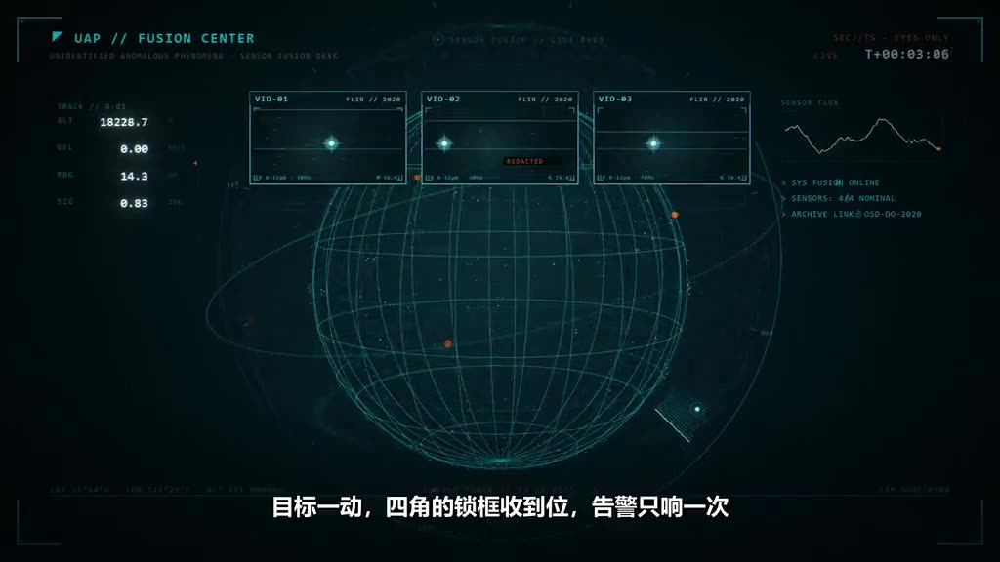</a>
      <br><sub><b>赛博 HUD</b> · 06 屏幕赛博</sub>
    </td>
    <td width="33%" align="center" valign="top">
      <a href="https://dabaoagent.github.io/Auto-Video/media/xuni.mp4">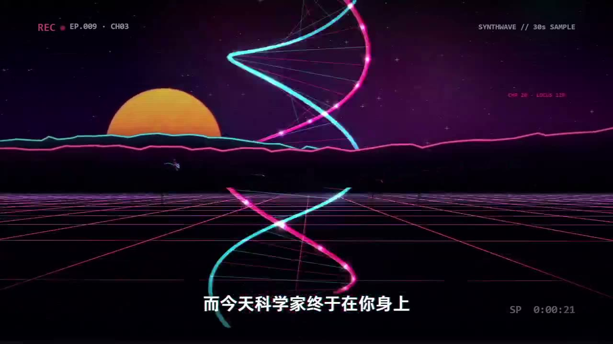</a>
      <br><sub><b>合成波 VHS</b> · 06 屏幕赛博</sub>
    </td>
  </tr>
  <tr>
    <td width="33%" align="center" valign="top">
      <a href="https://dabaoagent.github.io/Auto-Video/media/chengshi.mp4"></a>
      <br><sub><b>城市年轮</b> · 07 三维推演</sub>
    </td>
    <td width="33%" align="center" valign="top">
      <a href="https://dabaoagent.github.io/Auto-Video/media/isometric.mp4">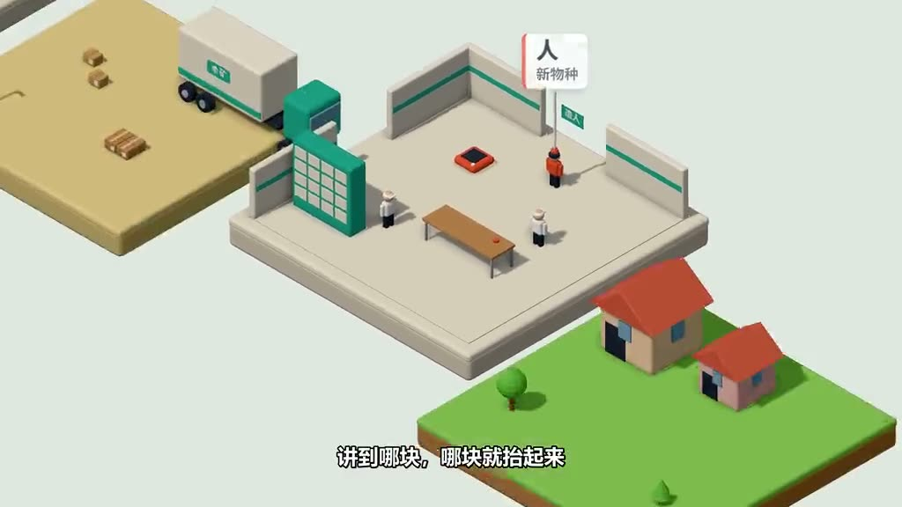</a>
      <br><sub><b>等距微缩</b> · 07 三维推演</sub>
    </td>
    <td width="33%" align="center" valign="top">
      <a href="https://dabaoagent.github.io/Auto-Video/media/map.mp4">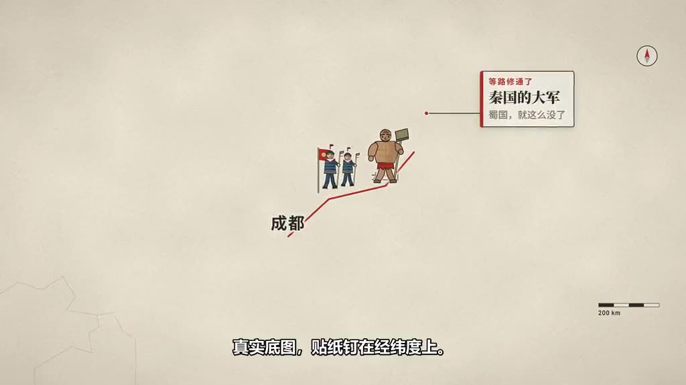</a>
      <br><sub><b>地图贴纸</b> · 08 地图地理</sub>
    </td>
  </tr>
  <tr>
    <td width="33%" align="center" valign="top">
      <a href="https://dabaoagent.github.io/Auto-Video/media/ditu.mp4">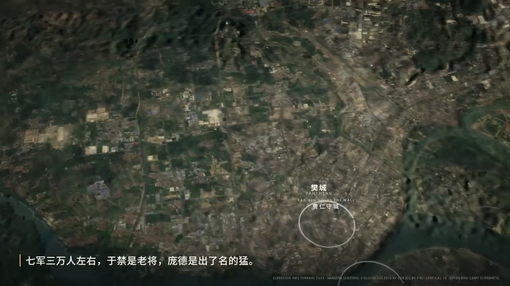</a>
      <br><sub><b>真实地形</b> · 08 地图地理</sub>
    </td>
    <td width="33%" align="center" valign="top">
      <a href="https://dabaoagent.github.io/Auto-Video/media/blueprint.mp4">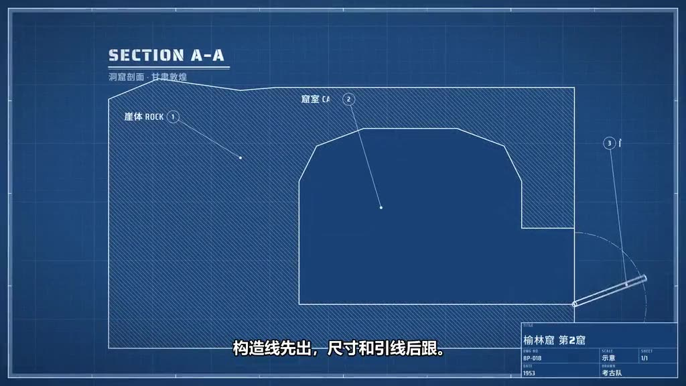</a>
      <br><sub><b>工程蓝图</b> · 09 图纸说明</sub>
    </td>
    <td width="33%" align="center" valign="top">
      <a href="https://dabaoagent.github.io/Auto-Video/media/parable.mp4">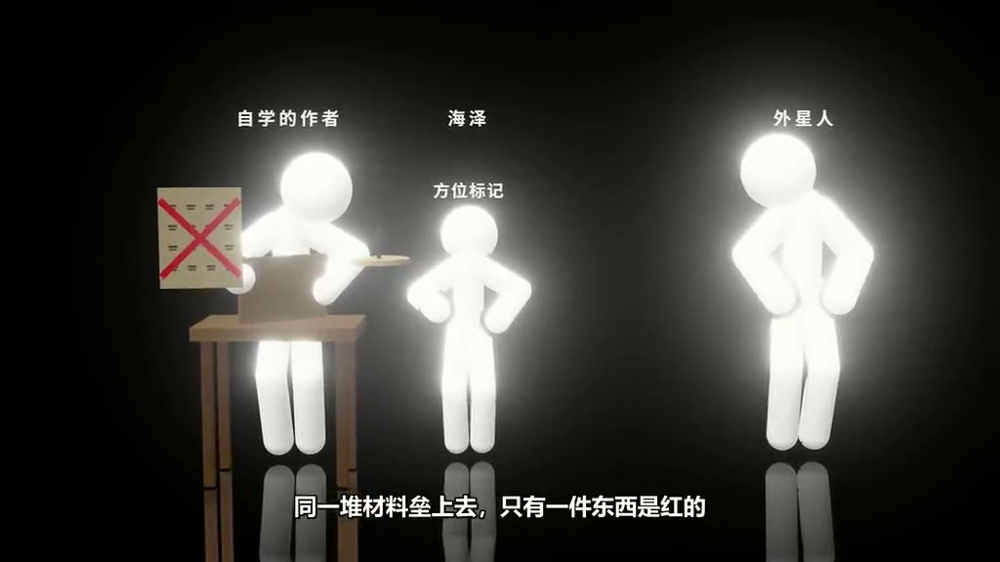</a>
      <br><sub><b>火柴人寓言</b> · 09 图纸说明</sub>
    </td>
  </tr>
</table>
<sub>封面取自画面运动最丰富的一帧，不是第 2 秒截图。</sub>
</div>

## 它和「自动剪辑器」的区别

不是「素材库检索 + 拼接」，区别在**画面怎么来**、**同一稿能不能出同一帧**、**出厂前过哪些门禁**。

| 维度 | 常见自动剪辑 / AI 视频工具 | Auto-Video |
| --- | --- | --- |
| 画面来源 | 素材库拼接，或调云端生图生视频 | 代码绘制、模板渲染、本地模型；不搬原片，不逐次计费 |
| 可复现性 | 每次结果带随机性 | 同稿同版 → 同像素（禁 `Date.now` / `Math.random`，按 id 播种） |
| 质量门禁 | 基本没有 | 契约校验 + 动效审计 + 字幕全量 + 频闪预算 + 响度归一 + 交付结构 |
| 规模 | 一套通用模板 | 165 条画法 / 11 工位，共用一套运行时与契约 |

165 条的实现来源分开说：**41 条**自带工程与运行时，**77 条**共用风格内核 [`vendor/runtime/stylekit.js`](vendor/runtime/stylekit.js)（14 个风格族），**47 条**是自包含的本地运行时封装。

## 工位地图

工位是「同一套画法血统」的一族，编号即站点与文档里的排序。**166 条的逐条状态、引擎、入口、样片时长在 [`docs/pipelines.md`](docs/pipelines.md)**，由 `catalog/pipelines.json` 生成，不会走样。

| 工位 | 条数 | 代表管线 | 画什么 |
| --- | --- | --- | --- |
| 01 纸本叙事 | 4 | [jianying](pipelines/jianying/SKILL.md) · [lishi](pipelines/lishi/SKILL.md) · [zhidiao](pipelines/zhidiao/SKILL.md) · [minjian](pipelines/minjian/SKILL.md) | 绢本、纸本、剪影、民间绘本，卡片运动语法讲历史 |
| 02 手绘笔触 | 33 | [pencil](pipelines/pencil/SKILL.md) · [caiqian](pipelines/caiqian/SKILL.md) · [shouhui](pipelines/shouhui/SKILL.md) · [shuicai](pipelines/shuicai/SKILL.md) | 逐帧手绘、铅笔测试、彩铅排线、平板速写、铅黄剪影 |
| 03 传统工艺 | 19 | [piying](pipelines/piying/SKILL.md) · [shuimo](pipelines/shuimo/SKILL.md) · [laolang](pipelines/laolang/SKILL.md) · [fushihui](pipelines/fushihui/SKILL.md) | 皮影、水墨、灯影、刺绣、上美影手绘、浮世绘木版 |
| 04 卡通动画 | 15 | [goldenage](pipelines/goldenage/SKILL.md) · [manga](pipelines/manga/SKILL.md) · [xiangsu](pipelines/xiangsu/SKILL.md) · [tianshu](pipelines/tianshu/SKILL.md) | 美式黄金卡通、漫画分格、像素、民间志怪赛璐璐 |
| 05 平面图形 | 27 | [shiliang](pipelines/shiliang/SKILL.md) · [lvdong](pipelines/lvdong/SKILL.md) · [huixingzhen](pipelines/huixingzhen/SKILL.md) | 扁平矢量、剪影律动、回形针图表、尺度漫游 |
| 06 屏幕赛博 | 23 | [xianshiqi](pipelines/xianshiqi/SKILL.md) · [xuni](pipelines/xuni/SKILL.md) · [dianzhen](pipelines/dianzhen/SKILL.md) | 深青霓虹 HUD、合成波 / VHS / Y2K、点阵屏 |
| 07 三维推演 | 11 | [tuiyan](pipelines/tuiyan/SKILL.md) · [chengshi](pipelines/chengshi/SKILL.md) · [isometric](pipelines/isometric/SKILL.md) | 兵棋战场、数据生长的城市、等轴粉彩微缩 |
| 08 地图地理 | 10 | [map](pipelines/map/SKILL.md) · [ditu](pipelines/ditu/SKILL.md) · [weixing](pipelines/weixing/SKILL.md) | Natural Earth 贴纸地图、卫星地形、高程水面 |
| 09 图纸说明 | 12 | [blueprint](pipelines/blueprint/SKILL.md) · [parable](pipelines/parable/SKILL.md) · [chaijie](pipelines/chaijie/SKILL.md) | 蓝晒工程图、火柴人寓言、原理拆解 |
| 10 实拍混剪 | 11 | [shipai](pipelines/shipai/SKILL.md) · [jilupian](pipelines/jilupian/SKILL.md) | Pixabay 竖屏口播、片源清单驱动的纪录片解说 |
| 11 前端工位 | 1 | [peiyin](pipelines/peiyin/SKILL.md) | 选题、口播稿审计、批量克隆配音（不出片） |

## 一条片怎么生产


| 阶段 | 输入 | 产出 | 通过条件 |
| --- | --- | --- | --- |
| 选题与口播稿 | 选题 / 对标链接 | 原创口播稿 | 过 AI 味审计，多音字与外文人名读音校正 |
| 本地配音 | 口播稿、克隆音色 | 分句配音、时间轴 | 呼吸、幕间停顿、崩词全部过审 |
| 分镜与组装 | 时间轴、分镜表、模板、字体 | 分段视频 | 镜数、场景数、时长一致，参数可复现 |
| 质检 | 成片、时间轴、渲染数据 | 检查结果 | 字幕、频闪、补间、抽帧、响度全过 |
| 交付 | 成片、封面、发布信息 | 可直接发布的目录 | `out/<编号_片名>/` 四件套齐全 |

## 你需要什么

| 依赖 | 什么时候要 |
| --- | --- |
| Python 3.10+（只用标准库） | 全部管线与工具链 |
| Node 18+ | Canvas / Remotion 逐帧那批管线 |
| Chrome / Edge / Chromium | 抓帧（`CHROME_PATH` 可覆盖，自动探测） |
| ffmpeg / ffprobe | 合流、响度归一、抽帧 |
| edge-tts（免费）或 GPT-SoVITS | 需要配音时；克隆音色才用后者 |
| 本地 ComfyUI + Wan2.2 | 只有 `tianshu` 一条 |

`python tools/validate.py` 一次性告诉你这台机器上 166 条管线、11 个工位是否对齐，入口和 SKILL.md 有没有脱漏。

## 参数即配置

每条管线的 `pipeline.json` 统一是同一份**加性契约**——老键一个不动，只补 `schema` + `meta`：

```jsonc
{
  "schema": "auto-video/pipeline@2",
  "meta": {
    "id": "lishi", "no": "02", "station": "paper",
    "name_zh": "纸本史话", "aspect": "16:9", "fps": 30,
    "status": "live", "entry": "scripts/lishi.py"
  },
  "paths": { ... }
}
```

| 文件 / 命令 | 作用 |
| --- | --- |
| [`catalog/pipelines.json`](catalog/pipelines.json) | 166 条管线的登记表，站点的数据从它生成 |
| [`catalog/stations.json`](catalog/stations.json) | 11 个工位：编号、中英名、说明 |
| [`schema/pipeline.schema.json`](schema/pipeline.schema.json) | JSON Schema（draft 2020-12） |
| `python tools/validate.py` | 查契约、入口文件、frontmatter 与登记表是否双向对齐 |
| `python tools/build_samples.py` | 原始样片压成网页短片 + 抽封面 → `site/assets/samples.json` |
| `python tools/build_site.py` | catalog + samples → 站点数据，推上去 Pages 自动更新 |

加一条新管线：建 `pipelines/<id>/`（`SKILL.md` + `pipeline.json`）→ 在 `catalog/pipelines.json` 登记 → `python tools/normalize_pipelines.py` → `python tools/validate.py`。

## 可选前端：一个选题走完五步

`frontend/` 不装也能单独用任何管线。装上以后：

```bash
python frontend/frontend.py run --pipeline laolang --topic "玄奘为什么要西行" --title "玄奘西行"
```

| 阶段 | 产出 | 依赖 |
| --- | --- | --- |
| 01 选题 | `01-选题.md` | 无 |
| 02 文案 | `02-文案.txt` | 无 |
| 03 配音 | `03-配音.mp3` + `03-字幕.srt` | edge-tts（免费、无需 key）或系统 SAPI + ffmpeg |
| 04 渲染 | `04-成片/` | 目标管线的运行时 |
| 05 发布 | `05-发布/发布信息.txt` + 两张封面 | 出图需 `ARK_API_KEY`，没有 key 也照常出发布信息 |

**要诚实的一点**：166 条里目前有 **10 条**能从选题一路跑到成片（`pencil` `shadow` `tapestry` `laolang` `goldenage` `manga` `isometric` `map` `blueprint` `parable`），其余 156 条在 [`frontend/targets.json`](frontend/targets.json) 里逐条写明为什么接不上最后一步。

## 仓库结构

```text
Auto-Video/
├── demo/                    # 15 秒零依赖 demo
├── docker/                  # demo 镜像：chromium + ffmpeg + 中文字体
├── pipelines/               # 166 个目录：SKILL.md + pipeline.json + scripts/
├── catalog/                 # pipelines.json（唯一事实来源）+ stations.json
├── vendor/runtime/          # 77 条风格管线共用的绘制内核
├── frontend/                # 可选前端：选题 → 文案 → 配音 → 出片 → 封面
├── site/                    # 样片站（Pages 直出）+ media/（165 段样片）
├── tools/                   # 门禁 + 站点构建 + 样片固化
├── docs/                    # 交付规范、样片固化流程、管线清单
└── .github/workflows/       # 契约门禁 + Pages 部署
```

## 常见问题

<details>
<summary>配音是怎么来的？</summary>

默认走 **GPT-SoVITS 本地服务**（自备模型权重），也可以切 **edge-tts**（微软在线音色，免费、无需 key）。模型权重体积大且可再生成，一律不入库。

</details>

<details>
<summary>为什么模型、字体、成片都不入库？</summary>

一贯政策是**代码与配置入库，重量级资产引导下载**：引擎、TTS 权重、字体走官方渠道，完整成片留在本地归档。这样 `git clone --depth 1` 不被几百 MB 媒体拖住。

</details>

<details>
<summary>样片和完整成片有什么区别？</summary>

`site/media/` 里是为站点压过的**风格段**（163 段 10 秒短片，另两段取完整成片的片头）；完整成片（2 到 13 分钟）只在本地归档或 Release 资产里。

</details>

<details>
<summary>很多管线名字看着像同一类，有什么区别？</summary>

它们共用「确定性渲染」这一层，但画法与镜头语法不同。`isometric` 与 `dengju` 都画等距世界，前者是地块 / 路线运行时，后者是瓦片波浪运镜；`shadow` 与 `piying` 都做皮影，前者是透光牛皮 + 操纵杆，后者是剪影 + 卡片讲解。同类之间的取舍写在各自 `SKILL.md` 第一节。

</details>

## 参与贡献

最欢迎的贡献不是「加功能」，而是**让某一条管线从「作者能跑」变成「谁都能跑」**：补样片、删掉写死的盘符路径、把 Windows-only 的 Chrome 探测改成跨平台、补上 `SKILL.md` 承诺了却没做的门禁。

规则与最小可合并模板在 [`CONTRIBUTING.md`](CONTRIBUTING.md)；改完跑一遍：

```bash
python tools/validate.py && python tools/check_links.py
```

## 鸣谢与许可

- **styles**（合成波 / 扁平矢量 / HUD / 等轴等 MG 引擎）：[Vincentwei1021/styles](https://github.com/Vincentwei1021/styles)，MIT
- **huashu-art-motion**（31 条自包含管线的画法来源）：[alchaincyf/huashu-art-motion](https://github.com/alchaincyf/huashu-art-motion)，MIT
- **MoneyPrinterTurbo**（`shipai` 的底片生成）：[harry0703/MoneyPrinterTurbo](https://github.com/harry0703/MoneyPrinterTurbo)
- **GPT-SoVITS**（本地克隆配音）：[RVC-Boss/GPT-SoVITS](https://github.com/RVC-Boss/GPT-SoVITS)
- **风格模板工程**（goldenage / manga / tapestry / pencil / isometric / parable / shadow / blueprint / laolang 的运行时），出处记在各管线 `CREDITS.md`

**许可**：代码以 [MIT](LICENSE) 发布；第三方组件遵循各自协议，汇总见 [`THIRD_PARTY_NOTICES.md`](THIRD_PARTY_NOTICES.md)。成片与样片版权归作者本人。

---

<sub>如果你在找 AI 视频生成、程序化动画、TTS 配音、字幕对齐或 ffmpeg 自动交付的实践，欢迎 Star 或 Watch。</sub>
