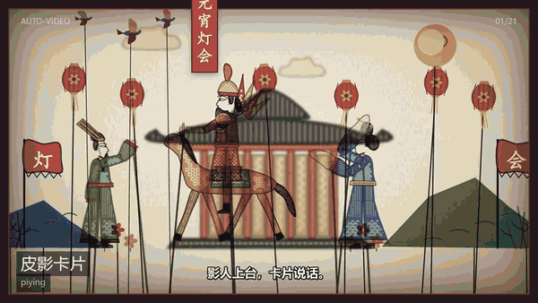
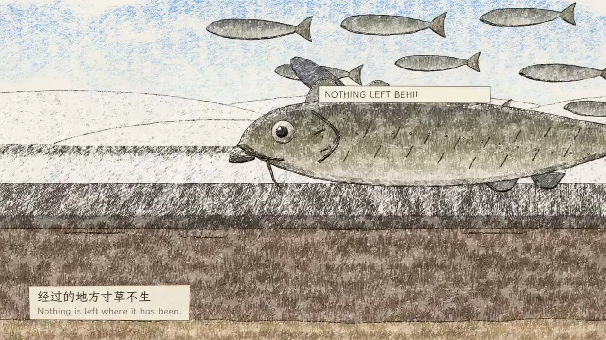
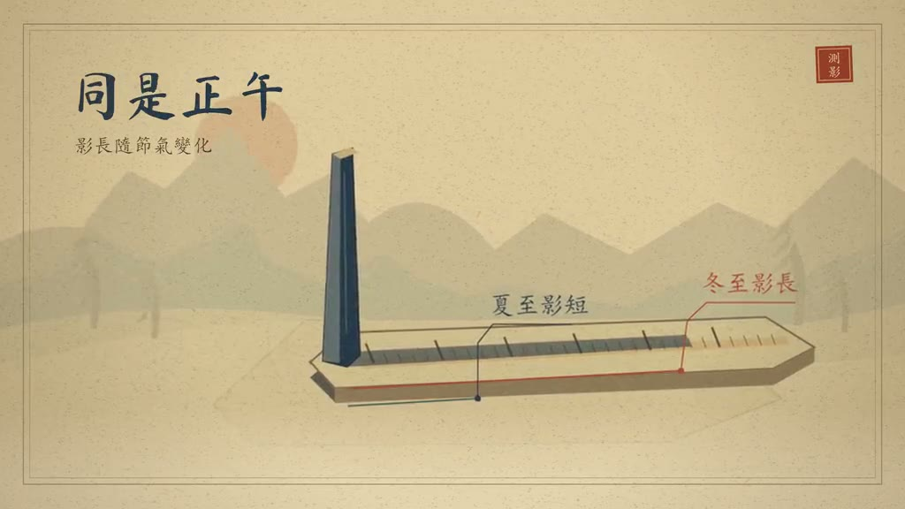

<div align="center">

# Auto-Video 🎬

### 一个想法 → 155 条管线 · 11 个工位 · 一部能发的片

Auto-Video 是一套**把想法变成成片的工程**：原创口播稿、本地克隆音色配音、154 条成片管线出片（40 条本仓库自研 + 77 条自研内核渲染 + 6 条本地运行时封装 + 31 条 huashu 引擎封装），外加 1 个配音前端（[peiyin](pipelines/peiyin/SKILL.md)）。每条管线是一套**画法 + 镜头语法 + 交付门禁**，参数写死在 `pipeline.json` 里可复现，画面由代码、模板或本机模型确定性渲染，不依赖云端生图 / 生视频 API，也没有按次调用费用。

> **77 条自研内核渲染（2026-11-20）**：绘制内核是仓库自己的 `vendor/runtime/stylekit.js`，14 个风格族——刻印 / 网点 / 霓虹 / 屏幕 / 像素 / 立体 / 图纸 / 地图 / 摄影 / 纸艺 / 板写 / 平面 / 赛璐珞 / 场。
> 每条管线的形状坐标、色板、节拍写在 `pipelines/<id>/projects/demo/main.js` 的 `SPEC` 里（生成时按 id 播种定死），
> 抓帧走 `vendor/runtime/style-frames.mjs`（puppeteer-core + 本机 Edge），合流走 ffmpeg；入口统一是
> `python pipelines/<id>/scripts/<id>.py --check / --stills / --render`，本机可自己出帧，不调任何外部脚本。
> 演示站卡片里的短片现阶段是早期外部样片，换成自研成片只需重跑 `--render` 后重编站点。
>
> **6 条本地运行时封装（2026-11-20）**：聊天叙事 / 扁平颗粒插画 / 暗调励志 / 悬疑探秘 / 欧普艺术 / 电影预告。
> 运行时、共享内核、渲染链、起步工程与风格规范都已复制进 `pipelines/<id>/`，入口只调本地 `runtime/render.mjs`，
> 不依赖任何外部 checkout。
>
> **31 条自包含封装（2026-11-20）**：从 [huashu-art-motion](https://github.com/alchaincyf/huashu-art-motion) 的 53 张风格配方里，
> 逐条去掉 12 条同族等价与 10 条同族变体，接进 31 条（23 条实做 + 8 条研究配方），id 按仓库传统取中文名双拼
> （撞车只有 `liti2`）。每条管线自带 `runtime/`：自研画帧器、舞台、播放协议，加画法脚本、按需库与字体子集；
> 入口只调本地 `runtime/render.py`，运行时不读 `vendor/`、不读上游仓库。画法脚本按 MIT 移植并在 `CREDITS.md` 注明。
> 入口是 `python pipelines/<id>/scripts/<id>.py --stills 0.5,2.5 --out review/<id>` 或 `--seconds 6`；
> 去重表见 [`tools/huashu_style_map.json`](tools/huashu_style_map.json)，记录见 [`docs/huashu接入记录.md`](docs/huashu接入记录.md)。

[](https://github.com/DaBaoAgent/Auto-Video/stargazers)
[](https://github.com/DaBaoAgent/Auto-Video/commits/main)
[](https://github.com/DaBaoAgent/Auto-Video/releases)


**[▶ 在线样片站](https://dabaoagent.github.io/Auto-Video/)** —— 悬停即播、按工位分组、按横屏/竖屏和时长筛，点开有声播放。



<sub>↑ 8 秒、2.3 MB，四条管线各取两秒 —— 彩铅 · 漫画分格 · 水墨 · 三维城市，全是本仓库代码渲的。</sub>

</div>

<div align="center">

<a href="https://dabaoagent.github.io/Auto-Video/"></a> <a href="https://dabaoagent.github.io/Auto-Video/"></a> <a href="https://dabaoagent.github.io/Auto-Video/"></a>

<sub>三条真实成片：彩铅科普 · 漫画分格 · 三维城市 —— 都是本仓库代码渲的，点开进样片站悬停即播。</sub>

</div>

**目录**：[三张入场券](#start) · [工位地图](#stations) · [统一契约](#contract) · [样片](#showcase) · [怎么生产一条片](#flow) · [快速开始](#quickstart) · [仓库结构](#layout) · [技术栈](#stack) · [常见问题](#faq) · [路线图](#roadmap) · [鸣谢与许可](#credits)

> **仓库结构（2026-11 起）**：155 条管线全部收在 `pipelines/` 下，根目录只留基础设施
> （`assets` `catalog` `docs` `out` `tools` `vendor` `site` `demo` `docker` `frontend` `projects` `samples-v2` `schema`）。
> 各管线入口一律按 `python pipelines/<管线名>/scripts/<管线名>.py ...` 调用；`out/<编号_片名>/` 放定稿的成片、字幕、封面与发布信息。
>
> **定稿归档**：用户说「定稿」后，成片 + 字幕 + 3:4 封面 + 4:3 封面 + 发布信息（只有一个标题、四个标签）统一搬进
> `out/<编号_片名>/`，旧版下沉 `out/_archive/`。细则见 [`docs/交付规范.md`](docs/交付规范.md)。
>
> **多机同步**：三台机器同路径作业，推拉命令、GitHub 断线与证书吊销的排查顺序见
> [`docs/多机同步.md`](docs/多机同步.md)。

## 30 秒先看到东西 ⏱️

```bash
git clone https://github.com/DaBaoAgent/Auto-Video.git
cd Auto-Video
python demo/run.py            # 15 秒 960×540：不配音、不下载素材、不调云端 API
python tools/sync_fonts.py --fetch   # 要跑真实管线时再执行：下载 5 款免费商用字体并复制到各工程
```

本机没有 Python / Node / Chrome？用 Docker，镜像里全带了（chromium + ffmpeg + 中文字体）：

```bash
docker compose run --rm demo
```

产物 `demo/out/demo.mp4`。这条路径走的是「模板 + 任意行数稿子」：分幕从 `timeline.json` 长出来
（[`vendor/runtime/autoscene.js`](vendor/runtime/autoscene.js)），模板派生管线
不再写死 8 句旁白，5 句、12 句都能渲。

<a id="start"></a>
## 三张入场券 🎟️

| 你想干什么 | 从哪儿进 | 一句话说明 |
| --- | --- | --- |
| 先看看长什么样 | [在线样片站](https://dabaoagent.github.io/Auto-Video/) | 155 张管线卡、146 段可播样片，按工位排开；鼠标停住就播，点开插入灯箱有声播放 |
| 想做一条片 | 下面的[工位地图](#stations) → 点管线 → 读 `SKILL.md` | 每条 SKILL.md 是完整流程：入口脚本、参数、验收条件、已知坑 |
| 想加 / 改一条管线 | [统一契约](#contract) | `catalog/pipelines.json` 是唯一事实来源，`tools/validate.py` 负责不许走样 |

<a id="stations"></a>
## 工位地图 🗺️ 154 条成片 + 1 个前端

管线按**工位**分组：工位是「同一套画法血统」的一族，编号即站点与文档中的排序。

### 01 · 纸本叙事　*Paper & Chronicle*

<sub>绢本、纸本、剪影，用卡片的运动语法讲历史：一镜 2–4 秒，字幕贴着真实语音走。</sub>

| 管线 | 样片 | 适合的内容 | 视觉与生产方法 |
| --- | --- | --- | --- |
| [jianying](pipelines/jianying/SKILL.md) | 《刘秀·位面之子》 3:31 | 绢本纸本美术 + 卡片运动语法，2–4 秒一镜，字幕贴着从句走。 | Remotion |
| [lishi](pipelines/lishi/SKILL.md) | 《朱元璋·碽妃疑案》 2:25 | AI 静帧底图 + 代码运镜，句级全量字幕与纸色衬底常驻。 | Remotion |
| [zhidiao](pipelines/zhidiao/SKILL.md) | 《鲤鱼》 0:21 | 词级转写与拼音 DP 对齐，HyperFrames 渲一张会动的纸雕灯箱。 | HyperFrames |

### 02 · 手绘笔触　*Hand & Pencil*

<sub>一笔一笔画出来的画面：逐帧手绘、铅笔测试、彩铅排线、平板速写。</sub>

| 管线 | 样片 | 适合的内容 | 视觉与生产方法 |
| --- | --- | --- | --- |
| [shouhui](pipelines/shouhui/SKILL.md) | 《商纣王》 3:26 | 纸纹、墨线 boil、墨字书写，cel 火焰与火星，24 fps 线条沸腾。 | Canvas 逐帧 · 浏览器渲染 |
| [pencil](pipelines/pencil/SKILL.md) | 《阿努纳奇》 0:30 | 蓝线起稿、石墨勾线、橡皮修改，画与画之间 morph。 | Canvas · Chrome 逐帧 |
| [caiqian](pipelines/caiqian/SKILL.md) | 《鳕鱼》 0:27 | 四张 G-buffer 由后处理叠成彩铅排线，锚定坐标防漂移。 | G-buffer + 后处理 |
| [pingban](pipelines/pingban/SKILL.md) | 《关羽》 0:39 | 六格手卷，铅笔一笔一笔现场画，镜头跟着笔尖走。 | 纯 Canvas · 零依赖 |
| [gangbi](pipelines/gangbi/SKILL.md) | 《风去了哪里》 0:33 | 钢笔线先走，水彩跟着到；镜头在整页纸上跟着草帽走。 | Canvas 逐帧 · 钢笔 + 水彩双层 |
| [labi](pipelines/labi/SKILL.md) | 《月亮睡不着》 0:52 | 一页绘本当着你的面画出来：蜡笔先走，水彩最后把藏起来的星星洗出来。 | WebGL2 合成 + Canvas 逐帧 |
| [shuicai](pipelines/shuicai/SKILL.md) | 《从旱到涝》 1:54 | 一笔一笔湿接湿的水彩，颜色在纸上自己走、自己干、自己留边。 | Canvas 2D · 湿画法笔刷 + 纸张吸收 |
| [qianhuang](pipelines/qianhuang/SKILL.md) | 《血之海滩 · 第一段》 0:21 | 一页手绘浓彩被红蓝两盏色片灯夹住，刀落下去有声音。 | Canvas 逐帧 · 钢笔浓彩 + 色片光 |

### 03 · 传统工艺　*Traditional Crafts*

<sub>老手艺的样子和节奏：皮影、水墨、灯影、刺绣、上美影手绘赛璐璐。</sub>

| 管线 | 样片 | 适合的内容 | 视觉与生产方法 |
| --- | --- | --- | --- |
| [piying](pipelines/piying/SKILL.md) | 《波斯湾伊甸园》 4:32 | 皮影剪影配卡片式讲解，分镜生成与四查门禁。 | Playwright + Canvas 逐帧 |
| [shuimo](pipelines/shuimo/SKILL.md) | 《羽人》 0:30 | 宣纸底、生成式 SVG 山水、墨渗转场、竖排题记与朱砂印。 | SVG + Canvas |
| [shadow](pipelines/shadow/SKILL.md) | 《玄奘》 3:23 | 素白幕、木质台框、透光牛皮影人，灯暗换场。 | Canvas · Chrome 逐帧 |
| [tapestry](pipelines/tapestry/SKILL.md) | 《阿努纳奇》 0:30 | 亚麻底、羊毛绣线、茎针绣与铺线，长卷滚动推进。 | Canvas · Chrome 逐帧 |
| [laolang](pipelines/laolang/SKILL.md) | 《玄奘》 1:02 | 1980 上美影式手绘赛璐璐，4:3 圆角片门，定稿 toon 人物 24 动作。 | Canvas · Chrome 逐帧 |
| [fushihui](pipelines/fushihui/SKILL.md) | 《向山》 0:44 | 一张木版画：墨线、几个色块各自错开半格印上去，纸在吃墨。 | Canvas 2D · 分色版块 + 错版套印 |
| [shuimo2](pipelines/shuimo2/SKILL.md) | 《剑客与河》 0:48 | 一张宣纸：墨分五色，一笔下去有骨有肉，朱砂只在印章和一个点上。 | Canvas 2D · 墨的浓淡/飞白/渗化 + 程序化宣纸 |

### 04 · 卡通动画　*Cartoons*

<sub>经典卡通的角色与节奏：美式黄金卡通、漫画分格、像素、天书奇谭式的民间志怪。</sub>

| 管线 | 样片 | 适合的内容 | 视觉与生产方法 |
| --- | --- | --- | --- |
| [goldenage](pipelines/goldenage/SKILL.md) | 《阿努纳奇》 0:30 | 手绘城市背景 + 墨线赛璐璐角色，15 张/秒的抽搐墨线。 | Canvas · Chrome 逐帧 |
| [manga](pipelines/manga/SKILL.md) | 《阿努纳奇》 0:30 | 黑墨线、网点、分格、拟声词，镜头按阅读顺序读页。 | Canvas · Chrome 逐帧 |
| [xiangsu](pipelines/xiangsu/SKILL.md) | 《曹操》 0:29 | 640×360 索引色帧缓冲逐像素绘制，×3 最近邻放大并在输出分辨率做 CRT。 | Canvas · Puppeteer 逐帧 |
| [tianshu](pipelines/tianshu/SKILL.md) | 《镇魔塔》 0:41 | 本地 ComfyUI 出定帧、Wan2.2 出氛围动态，逐镜锚定原片亮度与饱和。 | ComfyUI + Wan2.2 |

### 05 · 平面图形　*Graphic & Motion*

<sub>图形和字当主角：扁平矢量、剪影律动、回形针式图表、尺度漫游。</sub>

| 管线 | 样片 | 适合的内容 | 视觉与生产方法 |
| --- | --- | --- | --- |
| [shiliang](pipelines/shiliang/SKILL.md) | 《扁平矢量》 0:30 | 纯色几何世界、弹性入场、元素驱动转场，纯标准库合成 MG-pop 配乐。 | SVG 单页 · 逐帧确定性渲染 |
| [lvdong](pipelines/lvdong/SKILL.md) | 《玛雅文明》 0:58 | 纯黑剪影站在落日与水面前，姿势落在 90 BPM 的拍上，关键一拍拍冻结。 | Canvas + 着色器 · 代码合成配乐 |
| [huixingzhen](pipelines/huixingzhen/SKILL.md) | 《羽人》 9:57 | 实拍照片贴纸化、精确图表、大画布连续运镜。 | HTML 逐帧 · 确定性渲染 |
| [bianping](pipelines/bianping/SKILL.md) | 《僵尸地球》 0:36 | 从彗星撞木星连续推到黑洞事件视界，Orbi 小眼睛角色做引导。 | SVG 代码绘制 · 仓库内抓帧 |
| [zhuangshi](pipelines/zhuangshi/SKILL.md) | 《星光酒店午夜》 0:39 | 金线、漆面黑、阶梯边：酒店大堂在午夜亮起来，一切都从中心展开。 | Canvas 2D · 金色渐变线 + 灯泡招牌 |

### 06 · 屏幕赛博　*Screens & Neon*

<sub>屏幕本身的质感：深青霓虹的 HUD 界面，与合成波 / VHS / Y2K 的年代噪点。</sub>

| 管线 | 样片 | 适合的内容 | 视觉与生产方法 |
| --- | --- | --- | --- |
| [xianshiqi](pipelines/xianshiqi/SKILL.md) | 《UAP · 赛博》 0:30 | 深青黑底、青色霓虹线框、雷达扫掠与目标锁定。 | Three.js + Canvas FUI 覆盖层 |
| [xuni](pipelines/xuni/SKILL.md) | 《朊病毒》 0:30 | 霓虹网格、日落、铬字、扫描线、Y2K 窗口。 | Three.js + Canvas + VHS 后处理 |

### 07 · 三维推演　*3D & Diorama*

<sub>真三维与微缩模型：兵棋推演的战场、生长的城市、等轴正交的粉彩世界。</sub>

| 管线 | 样片 | 适合的内容 | 视觉与生产方法 |
| --- | --- | --- | --- |
| [tuiyan](pipelines/tuiyan/SKILL.md) | 《赤壁之战》 9:00 | 全 3D 兵棋推演，稳帧 1080p，音效与 BGM 按关键镜挂。 | 3D 兵棋引擎 · 逐帧稳帧渲染 |
| [chengshi](pipelines/chengshi/SKILL.md) | 《苏州 · 城长》 2:41 | OSM/Esri/SRTM 真实数据驱动的白模 3D 城市，确定性生长。 | Three.js + Remotion |
| [dengju](pipelines/dengju/SKILL.md) | 《羽人》 0:30 | 粉彩微缩模型、真正等轴正交相机、地面瓦片波浪与滑轨运镜。 | Three.js 正交场景 |
| [isometric](pipelines/isometric/SKILL.md) | 《阿努纳奇》 0:30 | 45° 等距微缩世界，带厚底座的方形地块组成系统，镜头连续滑行、讲到哪块就抬起哪块。 | Canvas · Chrome 逐帧 |
| [weisuo](pipelines/weisuo/SKILL.md) | 《柚子镇四季》 0:45 | 一座 2D 形状搭起来的 3D 微缩小镇，一年四季在框里转，人在一格一格走。 | three.js 3D 微缩 + 描边后处理 |

### 08 · 地图地理　*Maps & Terrain*

<sub>真实地理数据：Natural Earth 贴纸地图，与卫星地形上按高程起伏的水面。</sub>

| 管线 | 样片 | 适合的内容 | 视觉与生产方法 |
| --- | --- | --- | --- |
| [map](pipelines/map/SKILL.md) | 《张骞寻路》 9:04 | Natural Earth 真实底图上，人物贴纸与标注卡锚定经纬度。 | Chrome 逐帧 + ffmpeg |
| [ditu](pipelines/ditu/SKILL.md) | 《关羽》 0:39 | 卫星地形 + terrarium 高程，按高程起伏的三维水面从 84 km 推到 26 km。 | WebGL · 高程驱动水面 |

### 09 · 图纸说明　*Diagram & Blueprint*

<sub>用图纸讲原理：蓝晒工程图的构造线与标注，黑虚空里的火柴人对比寓言。</sub>

| 管线 | 样片 | 适合的内容 | 视觉与生产方法 |
| --- | --- | --- | --- |
| [blueprint](pipelines/blueprint/SKILL.md) | 《玄奘 · 前 10 秒》 0:12 | 蓝晒图纸、白色细线，构造线先出、尺寸与 leader 标注跟进，红铅笔唯一强调。 | Canvas · Chrome 逐帧 |
| [parable](pipelines/parable/SKILL.md) | 《阿努纳奇》 2:58 | 黑虚空里的白色火柴人，两个角色同一堆材料，一个红色物件承载意义，无切镜。 | Three.js · 固定广角 |

### 10 · 实拍混剪　*Live Footage*

<sub>真画面进场：Pixabay 素材按 id 拼接的竖屏口播，与片源 URL 清单驱动的纪录片解说。</sub>

| 管线 | 样片 | 适合的内容 | 视觉与生产方法 |
| --- | --- | --- | --- |
| [shipai](pipelines/shipai/SKILL.md) | 《玛雅》 0:18 | Pixabay 按 id 下载、固定顺序拼接，MoneyPrinterTurbo 出底片，一行式字幕烧入。 | MoneyPrinterTurbo + ffmpeg |
| [jilupian](pipelines/jilupian/SKILL.md) | 《一口气看完日本3000年》 13:38 | 给一份片源 URL 清单，核验、下载、口播、配音、影子匹配、自动剪辑到发布资料。 | S1–S9 流水线 |

### 11 · 前端工位　*Front of House*

<sub>不成片，但决定片子的前半程：选题、口播稿审计、批量克隆配音与时间轴。</sub>

| 管线 | 样片 | 适合的内容 | 视觉与生产方法 |
| --- | --- | --- | --- |
| [peiyin](pipelines/peiyin/SKILL.md) | 配音模块 · 无样片 | 选题、口播稿审计、批量克隆配音与时间轴，成片之前的两个阶段。 | GPT-SoVITS · 长稿分段合成 |

<a id="contract"></a>
## 统一契约 📐

过去每条管线的 `pipeline.json` 各写各的：有的 13 个键，有的 19 个键带 `locked` 段落，有的干脆没有这个文件。现在统一成**一份加性契约**：老键一个不动（脚本还在读），只补两块新东西。

```jsonc
{
  "schema": "auto-video/pipeline@2",     // 新增：契约版本
  "meta": {                               // 新增：登记信息，与 catalog 逐字段相等
    "id": "lishi",
    "no": "02",
    "station": "paper",
    "name_zh": "纸本史话",
    "aspect": "16:9", "fps": 30, "status": "live",
    "entry": "scripts/lishi.py"
  },
  "paths": { ... },                       // 历史扁平键：原地保留，一个没动
}
```

| 文件 | 作用 |
| --- | --- |
| [`catalog/pipelines.json`](catalog/pipelines.json) | 155 条管线的登记表：id / 工位 / 中英名 / 一句话 / 引擎 / 画幅 / 帧率 / 入口 / 状态 / 样片。站点的数据从它生成 |
| [`catalog/stations.json`](catalog/stations.json) | 11 个工位：编号、中英名、说明、段末诗意句 |
| [`schema/pipeline.schema.json`](schema/pipeline.schema.json) | JSON Schema（draft 2020-12）：`schema` + `meta` 必填；顶层 `additionalProperties: true`，历史扁平键合法 |
| `*/pipeline.json` | 每条管线自己的定版参数：新增 `schema` + `meta`，其余键原样保留 |

### 工具链（纯标准库 + 本机 ffmpeg）

| 命令 | 干什么 |
| --- | --- |
| `python tools/validate.py` | 查契约：id 唯一、工位存在、`SKILL.md` frontmatter 对得上目录、`meta` 与 catalog 逐字段相等、入口文件真实存在、仓库里的目录与 catalog 双向不脱漏 |
| `python tools/validate.py --samples-dir "<样片目录>"` | 顺带核对 catalog 里登记的样片文件是否都在 |
| `python tools/normalize_pipelines.py` | 幂等补齐：给缺 `pipeline.json` 的管线建骨架、给已有文件补 `schema` + `meta`（保持原键顺序）、给缺 frontmatter 的 SKILL.md 补头 |
| `python tools/build_samples.py` | 把原始样片压成网页用短片（**一律从片头取前 30 秒**，片短于 30 秒就整条；管线 1280 长边 / crf 30，风格 640 / crf 32）+ 抽封面，写 `site/assets/samples.json`（改规则后要加 `--force`） |
| `python tools/build_samples.py --posters-only` | 只重挑封面帧、不重切短片：逐帧算运动 + 边缘密度，避开白屏 / 黑场 / 空镜，取动作最丰富的一帧；`tools/poster_overrides.json` 里手工钉秒的优先 |
| `python tools/build_site.py` | catalog + samples → `site/assets/data.js` |
| `python tools/build_fonts.py` | 按站点实际用字子集化思源宋 / 黑，出 woff2（约 600 KB，站点离线也有中文字形） |

### 单一入口：一条管线一个命令

155 条管线里 155 条都有 `entry`，`tools/validate.py` 会验证它真实存在。约定是 `python <管线>/scripts/<管线>.py <阶段>`，任何一条都能先 `check` 再 `--plan` 看命令：

| 管线 | 入口 | 最常用的三步 |
| --- | --- | --- |
| [piying](pipelines/piying/SKILL.md) | `scripts/piying.py` | `check` → `plan full` → `full`（六步 node 串成一条） |
| [xiangsu](pipelines/xiangsu/SKILL.md) | `scripts/xiangsu.py` | `check` → `plan demo` → `demo`（bash 缺失会明确报错） |
| [tuiyan](pipelines/tuiyan/SKILL.md) | `scripts/tuiyan.py` | `check` → `plan all` → `all --out <目录>` |
| [jilupian](pipelines/jilupian/SKILL.md) | `scripts/jilupian.py` | `check` → `--batch <批> --manifest <清单>`（转发给 `autoup.run`） |

这五条原先各自散着：皮影是六条 node 命令、像素是两条 bash 链、推演要在 `vendor/battlefield-editor` 里换目录跑、纪录片只能 `python -m autoup.run`。现在入口只做三件事——找对解释器/工作目录、按顺序串联、缺依赖时把缺什么说清楚；渲染参数与定版数值一个没改。

### 加一条新管线要做的四件事

1. 建目录 `mynew/`，写 `SKILL.md`（开头 YAML frontmatter：`name` 必须等于目录名）与 `mynew/pipeline.json`；
2. 在 `catalog/pipelines.json` 登记一条，指定 `station`（没有合适工位就新开一个并写进 `catalog/stations.json`）；
3. `python tools/normalize_pipelines.py` 让 `pipeline.json` 的 `meta` 与登记表对齐；
4. `python tools/validate.py` 过一遍，把样片丢进源目录后 `python tools/build_samples.py && python tools/build_site.py`，推上去站点自动更新。

<a id="flow"></a>
## 一条片怎么生产 🔄


| 阶段 | 输入 | 产出 | 通过条件 |
| --- | --- | --- | --- |
| 选题与口播稿 | 选题 / 对标链接、内容规约 | 原创口播稿 | 过 AI 味审计，多音字 / 外文人名读音校正 |
| 本地配音 | 口播稿、克隆音色 | 分句配音、时间轴 | 审查门禁通过（呼吸、幕间停顿、崩词） |
| 配音对齐 | 口播稿、配音 | 词级或句级时间轴 | 字幕切点贴着真实语音 |
| 分镜 | 时间轴、分镜表 | 镜头计划与素材映射 | 镜数、场景数、时长一致 |
| 组装渲染 | 分镜、模板、字体、素材 | 分段视频或完整成片 | 参数可复现，画面无结构性错误 |
| 质检 | 成片、时间轴、渲染数据 | 检查结果 | 字幕、频闪、补间、抽帧、响度通过 |
| 交付 | 成片、封面、发布信息 | 可直接发布的目录 | 文件结构、尺寸、元信息符合规则 |

<a id="frontend"></a>
## 可选前端：一个选题走完五步 🚪

`frontend/` 是一个**可选**的前端模块，不装也能单独用任何管线。它把「选题 → 文案 → 免费 TTS 配音 → 风格管线出片 → 封面 + 发布信息」串成一条命令：

```bash
python frontend/frontend.py run \
  --pipeline laolang \
  --topic "玄奘为什么要西行" \
  --title "玄奘西行"
```

产物落在一个任务目录里，每步都有可见文件，某步失败就停在那步并保留前面全部产出：

| 阶段 | 做什么 | 产出 | 依赖 |
| --- | --- | --- | --- |
| 01 选题 | 归一选题、给出钩子与关键词，写进 `01-选题.json` | `01-选题.md` / `.json` | 无（本地模板，可换成自己写） |
| 02 文案 | 按 `prompts/script.md` 的口播规约成稿，压成纯文本 | `02-文案.md` / `02-文案.txt` | 无 |
| 03 配音 | **免费** 的 edge-tts（微软在线音色，无需 key）或 Windows SAPI 本地音色 | `03-配音.mp3` / `03-字幕.srt` / `03-配音.json` | `edge-tts` 或系统 SAPI + ffmpeg |
| 04 渲染 | 调目标管线：`new` 建工程 → `vo` 灌文案与配音 → `render` 出片 | `04-成片/` | 目标管线的运行时（Chrome / ffmpeg 等） |
| 05 发布 | 调仓库内的 `fengmian/`：两张封面（4:3 / 3:4）+ 两行制发布信息 + 交付门禁 | `05-发布/发布信息.txt`、封面提示词 / 成图 | 出图需 `ARK_API_KEY`；**没有 key 也照常出发布信息** |
| 06 清单 | 汇总本次所有产物与下一步 | `06-交付清单.md` | 无 |

要点：

- **不接 peiyin 也能用**：03 阶段用的是免费的 edge-tts / 系统音色，克隆音色（peiyin、GPT-SoVITS）是可选的加分项，不是前置条件；
- **`fengmian/` 是上游原样导入**（`DaBaoAgent/fengmian`，见 `fengmian/VENDORED.md`），本仓库只改调用方式，不改它的规则：标题两段式、≤25 字、含阿拉伯数字、恰好 4 个话题，任一不过就直接报错；
- **哪些管线能被 04 自动出片**：`frontend/targets.json` 逐条登记。现在是 **10 / 155 一条龙**：`pencil`、`shadow`、`tapestry`、`laolang`、`goldenage`、`manga`、`isometric`、`map`、`blueprint`、`parable`。这几条的模板已改成**数据驱动分幕**（`vendor/runtime/autoscene.js`：一句旁白一张卡，片头卡 + 序号 + 强调线，5 句、12 句都能渲），所以 `new → vo → render` 可以一口气走完，不再出现「文案行数一变就报 `timeline: narration line id "l2" not found`」。模板保底的是排版，不是原来那支片的手绘美术——要原画级的片子，仍走 `projects/` 里手写的 `index.html`；
- 剩下 31 条在 `targets.json` 里写明为什么不能自动接最后一步：要真实素材（`shipai`、`jilupian`）、要高程与路线（`chengshi`、`ditu`）、要本地模型（`zhidiao` 的 ComfyUI、`tianshu`）、要管线内 TTS 时间轴（`shiliang`、`xuni`、`dengju`、`xianshiqi`），或者输入根本不是文案（`tuiyan` 的兵棋、`huixingzhen` 的剧本）；
- 校验：`python tools/validate.py` 会检查 `modules` 登记、`frontend.json` 契约、`targets.json` 是否覆盖全部管线，并打印「frontend 覆盖 155 条管线，可直接渲染 10 条」；
- 实跑记录（2026-11-17）：`laolang` 一条 33 字短稿从 01 跑到 05，exit 0，拿到 `04-成片/工程/out/video-16x9.mp4`（1920×1080 / 6.2 s / 带旁白）与 `05-发布/发布信息.txt`（标题两段式 + 4 个话题）。

<a id="showcase"></a>
## 样片 🖼️ 146 段，可在站点播

`site/media/` 里是压过的网页短片（**每部样片只取片头前 30 秒**，片短于 30 秒就整条；管线 1280 长边，风格 640），原片不动，仍留在作者的同步盘里。

**封面不是片头截图**：早期统一抽第 2 秒，结果一堆卡片是空镜、白屏、纯文字卡。现在的规则是「样片里人物动作最丰富的一幕」——逐帧统计运动（YDIF）与边缘密度，排除 `YAVG>205 且 SATAVG<12`（白屏）、`YAVG<16`（黑场）、边缘密度低于全片中位 35% 分位的帧（空镜），首尾各 0.7 秒不选，评分 `0.68·z(运动) + 0.32·z(边缘)`。对整片空镜 / 白屏 / 纯文字卡的样片（地图、极简、品牌卡这类），自动算法挑不出来，用 `tools/poster_overrides.json` 人工钉秒。46 条已逐张目视复核过一遍；新登记的 77 条用上游封面 + 自动选帧，本次 6 条 BB 样片已逐张目视，**其余尚未逐张复核**。

**管线样片 146 条**（点管线看文档，点片名去站点看）：

| 工位 | 管线 | 样片 | 原片时长 |
| --- | --- | --- | --- |
| 01 纸本叙事 | [jianying](pipelines/jianying/SKILL.md) | 《刘秀·位面之子》 | 3:31（1920×1080） |
| 01 纸本叙事 | [lishi](pipelines/lishi/SKILL.md) | 《朱元璋·碽妃疑案》 | 2:25（1920×1080） |
| 01 纸本叙事 | [zhidiao](pipelines/zhidiao/SKILL.md) | 《鲤鱼》 | 0:21（1920×1080） |
| 02 手绘笔触 | [shouhui](pipelines/shouhui/SKILL.md) | 《商纣王》 | 3:26（1920×1080） |
| 02 手绘笔触 | [pencil](pipelines/pencil/SKILL.md) | 《阿努纳奇》 | 0:30（1920×1080） |
| 02 手绘笔触 | [caiqian](pipelines/caiqian/SKILL.md) | 《鳕鱼》 | 0:27（1920×1080） |
| 02 手绘笔触 | [pingban](pipelines/pingban/SKILL.md) | 《关羽》 | 0:39（1920×1080） |
| 02 手绘笔触 | [gangbi](pipelines/gangbi/SKILL.md) | 《风去了哪里》 | 0:33（1920×1080） |
| 02 手绘笔触 | [labi](pipelines/labi/SKILL.md) | 《月亮睡不着》 | 0:52（1920×1080） |
| 02 手绘笔触 | [shuicai](pipelines/shuicai/SKILL.md) | 《从旱到涝》 | 1:54（1920×1080） |
| 02 手绘笔触 | [qianhuang](pipelines/qianhuang/SKILL.md) | 《血之海滩 · 第一段》 | 0:21（1920×1080） |
| 03 传统工艺 | [piying](pipelines/piying/SKILL.md) | 《波斯湾伊甸园》 | 4:32（1920×1080） |
| 03 传统工艺 | [shuimo](pipelines/shuimo/SKILL.md) | 《羽人》 | 0:30（1920×1080） |
| 03 传统工艺 | [shadow](pipelines/shadow/SKILL.md) | 《玄奘》 | 3:23（960×540） |
| 03 传统工艺 | [tapestry](pipelines/tapestry/SKILL.md) | 《阿努纳奇》 | 0:30（1920×1080） |
| 03 传统工艺 | [laolang](pipelines/laolang/SKILL.md) | 《玄奘》 | 1:02（1920×1080） |
| 03 传统工艺 | [fushihui](pipelines/fushihui/SKILL.md) | 《向山》 | 0:44（1920×1080） |
| 03 传统工艺 | [shuimo2](pipelines/shuimo2/SKILL.md) | 《剑客与河》 | 0:48（1920×1080） |
| 04 卡通动画 | [goldenage](pipelines/goldenage/SKILL.md) | 《阿努纳奇》 | 0:30（1920×1080） |
| 04 卡通动画 | [manga](pipelines/manga/SKILL.md) | 《阿努纳奇》 | 0:30（1920×1080） |
| 04 卡通动画 | [xiangsu](pipelines/xiangsu/SKILL.md) | 《曹操》 | 0:29（1920×1080） |
| 04 卡通动画 | [tianshu](pipelines/tianshu/SKILL.md) | 《镇魔塔》 | 0:41（960×720） |
| 05 平面图形 | [shiliang](pipelines/shiliang/SKILL.md) | 《扁平矢量》 | 0:30（1920×1080） |
| 05 平面图形 | [lvdong](pipelines/lvdong/SKILL.md) | 《玛雅文明》 | 0:58（1920×1080） |
| 05 平面图形 | [huixingzhen](pipelines/huixingzhen/SKILL.md) | 《羽人》 | 9:57（1920×1080） |
| 05 平面图形 | [bianping](pipelines/bianping/SKILL.md) | 《僵尸地球》 | 0:36（1920×1080） |
| 05 平面图形 | [zhuangshi](pipelines/zhuangshi/SKILL.md) | 《星光酒店午夜》 | 0:39（1920×1080） |
| 06 屏幕赛博 | [xianshiqi](pipelines/xianshiqi/SKILL.md) | 《UAP · 赛博》 | 0:30（1920×1080） |
| 06 屏幕赛博 | [xuni](pipelines/xuni/SKILL.md) | 《朊病毒》 | 0:30（1920×1080） |
| 07 三维推演 | [tuiyan](pipelines/tuiyan/SKILL.md) | 《赤壁之战》 | 9:00（1920×1080） |
| 07 三维推演 | [chengshi](pipelines/chengshi/SKILL.md) | 《苏州 · 城长》 | 2:41（1920×1080） |
| 07 三维推演 | [dengju](pipelines/dengju/SKILL.md) | 《羽人》 | 0:30（1920×1080） |
| 07 三维推演 | [isometric](pipelines/isometric/SKILL.md) | 《阿努纳奇》 | 0:30（1920×1080） |
| 07 三维推演 | [weisuo](pipelines/weisuo/SKILL.md) | 《柚子镇四季》 | 0:45（1920×1080） |
| 08 地图地理 | [map](pipelines/map/SKILL.md) | 《张骞寻路》 | 9:04（1280×720） |
| 08 地图地理 | [ditu](pipelines/ditu/SKILL.md) | 《关羽》 | 0:39（1920×1080） |
| 09 图纸说明 | [blueprint](pipelines/blueprint/SKILL.md) | 《玄奘 · 前 10 秒》 | 0:12（1920×1080） |
| 09 图纸说明 | [parable](pipelines/parable/SKILL.md) | 《阿努纳奇》 | 2:58（1280×720） |
| 10 实拍混剪 | [shipai](pipelines/shipai/SKILL.md) | 《玛雅》 | 0:18（1080×1920） |
| 10 实拍混剪 | [jilupian](pipelines/jilupian/SKILL.md) | 《一口气看完日本3000年》 | 13:38（1920×1080） |

上表是 40 条本仓库自研管线的样片；其余 77 条（自研内核渲染）、6 条本地运行时封装与 31 条 huashu 引擎封装的样片在站点对应卡片里，不在这张表里重复。

**可播 146 条**：155 条管线里 146 条有可播样片，最短 1.07 秒（huashu 上游速通节选），最长 13:38（`jilupian`《一口气看完日本3000年》）；8 条 huashu 研究配方上游没有成片，站点只出封面卡。

另有一条 [`peiyin`](pipelines/peiyin/SKILL.md) **不算缺样片**：它是配音前端，只出口播稿与配音，不出片，所以本来就不该有片子可播；站点上它的卡片标「配音模块 · 无样片」并直接指向文档。

### 完整成片（本地归档，未入库）

本批完整成片存于作者本地同步盘（`1 MG 动画/管线样片/`）与 `out/<编号_片名>/`，不随仓库提交；片名与时长取自交付文件。

| 管线 | 成片 | 时长 | 画面 |
| --- | --- | --- | --- |
| [jianying](pipelines/jianying/SKILL.md) | 刘秀·位面之子 | 211.0 s | 1920×1080 / 30 fps |
| [lishi](pipelines/lishi/SKILL.md) | 朱元璋·碽妃疑案 | 144.9 s | 1920×1080 / 30 fps |
| [piying](pipelines/piying/SKILL.md) | 波斯湾伊甸园 | 272.2 s | 1920×1080 / 30 fps |
| [shouhui](pipelines/shouhui/SKILL.md) | 商纣王 | 205.7 s | 1920×1080 / 24 fps |
| [tuiyan](pipelines/tuiyan/SKILL.md) | 3D 赤壁之战 | 539.8 s | 1920×1080 / 30 fps |
| [huixingzhen](pipelines/huixingzhen/SKILL.md) | 羽人 | 597.3 s | 1920×1080 / 30 fps |
| [chengshi](pipelines/chengshi/SKILL.md) | 苏州·城长 | 160.7 s | 1920×1080 / 30 fps |
| [jilupian](pipelines/jilupian/SKILL.md) | 一口气看完日本3000年 | 818.4 s | 1920×1080 / 30 fps |
| [qianhuang](pipelines/qianhuang/SKILL.md) | 血之海滩（插图重画版） | 219.5 s | 1920×1080 / 30 fps |

### 更多画面



<sub>`lishi` 的纸本视觉系统：楷体纪年、绢本底图、代码运镜与句级字幕（《建安十三年 · 我五十三岁》）。</sub>
<a id="quickstart"></a>
## 跑一条真片 🚀

155 条管线的入口、引擎、样片时长都在 **[docs/pipelines.md](docs/pipelines.md)**；每条管线一条命令，参数与验收条件写在各自的 `SKILL.md`。

最短的一条（不配音、不出封面，只为确认链路通）：

```bash
python pipelines/pencil/scripts/pencil.py new projects/demo --title "试片"
node pipelines/pencil/runtime/render.mjs projects/demo --scale 0.6 --no-audio
```

> 渲染需要 Chrome/Chromium（`CHROME_PATH` 可指定）和 `ffmpeg`；`python tools/validate.py` 会一次性告诉你
> 这台机器上哪 155 条管线、11 个工位、146 份样片是否对齐。


## 仓库结构 🗂️

```text
Auto-Video/
├── README.md                 # 本文件
├── .gitignore
├── .github/workflows/
│   └── pages.yml             # 校验 + 建站 + 部署 GitHub Pages
├── catalog/
│   ├── pipelines.json        # 155 条管线的登记表（唯一事实来源）
│   └── stations.json         # 11 个工位
├── schema/
│   └── pipeline.schema.json  # pipeline.json 的 JSON Schema（schema + meta 必填）
├── tools/
│   ├── av/                   # 共用小工具（读 JSON、探片、跑命令、解析 frontmatter）
│   ├── validate.py           # 契约校验 + 反向目录检查（可带 --samples-dir）
│   ├── normalize_pipelines.py# 幂等补齐 schema + meta 与 SKILL.md frontmatter
│   ├── build_samples.py      # 压网页样片 + 挑封面帧 → site/media + samples.json
│   ├── poster_overrides.json # 人工挑帧表：自动选帧挑到空镜 / 白屏的片子在这里钉秒
│   ├── build_site.py         # catalog + samples → site/assets/data.js
│   └── build_fonts.py        # 字体子集化 → site/fonts/*.woff2
├── docs/
│   └── AUDIT.md              # 仓库审查记录：不统一点、改了什么、还剩什么
├── site/                     # 样片站（静态，无构建依赖）
│   ├── index.html
│   ├── assets/               # app.css / app.js / data.js / samples.json
│   ├── fonts/                # 思源宋 600 + 思源黑 400 子集
│   └── media/                # 146 段网页短片 + 封面
├── frontend/                 # 可选前端：选题 → 文案 → 免费 TTS → 管线 → 封面与发布信息
│   ├── frontend.json         # 模块契约（五阶段 + 目标管线声明）
│   ├── targets.json          # 155 条管线逐条登记：new / ingest / render 命令或跳过理由
│   ├── frontend.py           # 一条命令跑完闭环（check / plan / run）
│   ├── prompts/script.md     # 02 阶段的口播稿模板
│   ├── SKILL.md              # 给 Agent 用的入口说明
│   └── jobs/                 # 每次任务的中间产物（已 gitignore）
├── fengmian/                 # 上游 DaBaoAgent/fengmian 原样导入：封面 + 发布信息 + 交付门禁
├── out/                      # 定稿归档：<编号_片名>/ 成片 + 字幕 + 3:4 / 4:3 封面 + 发布信息（成片 mp4 不入库）
├── projects/
│   └── suzhou/               # chengshi 示例工程：苏州《城长》160.7 s（data/ + film.json）
│   ├── showcase-grid.gif     # 9 条管线样片九宫格
│   ├── showcase-poster.jpg   # 样片拼图封面
│   └── *_30s.mp4             # 早先的 30 秒原片（站点已改用 site/media/ 的压片）
│   └── frames/               # 样片抽帧与 README 配图
├── samples-v2/               # 10 秒站点样片源片、字幕与制作进度（压片进 site/media/）
└── pipelines/                # 155 条管线，一条一个目录：SKILL.md + pipeline.json + scripts/ + references/ + projects/
    ├── paper/                # 01 纸本叙事：jianying · lishi · zhidiao
    ├── hand/                 # 02 手绘笔触：shouhui · pencil · caiqian · pingban · gangbi · labi · shuicai · qianhuang
    ├── craft/                # 03 传统工艺：piying · shuimo · shadow · tapestry · laolang · fushihui · shuimo2
    ├── toon/                 # 04 卡通动画：goldenage · manga · xiangsu · tianshu
    ├── graphic/              # 05 平面图形：shiliang · lvdong · huixingzhen · bianping · zhuangshi
    ├── screen/               # 06 屏幕赛博：xianshiqi · xuni
    ├── d3/                   # 07 三维推演：tuiyan · chengshi · dengju · isometric · weisuo
    ├── map/                  # 08 地图地理：map · ditu
    ├── diagram/              # 09 图纸说明：blueprint · parable
    ├── live/                 # 10 实拍混剪：shipai · jilupian
    └── front/                # 11 前端工位：peiyin（配音前端，不出片）
```

<a id="stack"></a>
## 和同类项目的差别 🧭

这不是「再做一个 MoneyPrinterTurbo」。同类项目解决的是**「给我一段能看的自动视频」**；这个仓库解决的是
**「一条片该怎么画、怎么剪、怎么验」**——把工艺写成可复现的代码和门禁。

| 维度 | 同类（MoneyPrinterTurbo / 剪映类自动化） | 本项目 |
| --- | --- | --- |
| 产出 | 一条通用解说片 | 154 种**画法血统**（40 种自研 + 77 种自研内核渲染 + 6 种本地运行时封装 + 31 种 huashu 引擎封装）（剪影 / 皮影 / 彩铅 / 挂毯 / 三维城市 / 蓝图……） |
| 画面来源 | 素材库检索拼接 | 代码绘制、模板渲染、本地模型；**不搬原片** |
| 可复现性 | 每次结果有随机性 | 同稿同版 → 同像素（禁 `Date.now` / `Math.random`） |
| 质量门禁 | 基本没有 | 契约校验 + 动效检查 + 事实核对 + 节奏扫描 + 字幕全量 |
| 上手成本 | `pip install` 一条命令 | 要 Chrome/ffmpeg/本地模型 —— 所以有 `demo/run.py` 与 Docker 兜第一公里 |
| 规模 | 单管线 | 155 条管线 / 11 工位，共用一套运行时与契约 |

**差距也要说清楚**：真正的高星标项目（Remotion 7.3 万★、MoneyPrinterTurbo 14 万★）靠的是「任何人 10 分钟能出片」的
最低门槛 + 生态（模板市场、API、Colab、镜像、插件）。本仓库内容层已经很硬，但包装层还在补：默认分支体积、
Release 与版本、英文门面、贡献漏斗。这些正在按 `docs/高星标差距复核-2026-11-17.md` 逐条落地。

## 技术栈 🧰

| 环节 | 使用到的技术 |
| --- | --- |
| 内容与时间轴 | Python、GPT-SoVITS、Faster-Whisper、拼音 DP 对齐 |
| 画面工程 | TypeScript、Remotion、HTML、CSS、SVG、GSAP |
| 逐帧手绘 | Canvas、puppeteer-core、simplex-noise、opentype.js |
| 皮影剪影 | Playwright、Canvas、逐帧截图、ffmpeg |
| MG 短片渲染 | Node.js、three.js、styles、Edge 无头逐帧渲染 |
| 像素风 | 640×360 索引色帧缓冲、×3 整数最近邻、输出分辨率 CRT 后处理 |
| 3D 战场 | battlefield-editor（Three.js 兵棋引擎）、稳帧逐帧渲染 |
| 立体地图 | three.js、terrarium 高程 + Sentinel-2 底图、playwright-core 逐帧、贴地经纬度标注 |
| 平板速写 | Canvas 2D 逐笔笔触 + 纸纹阈值、手势相机跟笔尖、playwright-core 逐帧 |
| 彩铅科普 | three.js 四张 G-buffer（albedo+id / light+depth+normal / 排线方向 / 锚点+reveal）、后处理分层排线 + 纸齿阈值、锚定坐标防漂移、逐帧轮廓 boil、playwright-core 逐帧 |
| 地理与地形 | OSM 建筑/道路/水系、Esri 卫星影像、SRTM 高程、Remotion + three.js |
| 长视频渲染 | HyperFrames、浏览器逐帧渲染 |
| 音频与交付 | ffmpeg、ffprobe、响度归一、两遍压缩 |
| 自动质检 | 字幕重叠检查、补间审计、频闪检测、成品抽帧 |
| 模板库 风格运行时 | Canvas 2D / SVG / Three.js 纯函数逐帧、Chrome DevTools Protocol、代码合成配乐与音效 |

<a id="faq"></a>
## 常见问题 ❓

<details>
<summary>配音是怎么来的？</summary>

各管线默认走 **GPT-SoVITS 本地服务**（自备模型权重），也支持切 **Edge TTS** 免费方案（如 `jilupian --set voice.engine=edge_tts`）。配音模型权重体积大且可再生成，一律不进入仓库，只做安装引导——见各管线 `MIGRATION.md`。

</details>

<details>
<summary>styles 是什么？为什么不在仓库里？</summary>

`styles` 是 shouhui / xuni / shiliang / xianshiqi / dengju / huixingzhen / shuimo / xiangsu 共用的外部渲染引擎（MIT 协议，含 node_modules 约 1.2GB）。仓库只保留管线代码与示例工程，引擎按引导 clone + `npm install` + junction 安装（见上方针式安装命令或各管线 README）。

</details>

<details>
<summary>模型、权重、字体、大文件为什么都不入库？</summary>

这是本项目的一贯政策：**代码与配置入库，重量级资产引导下载**。渲染引擎、TTS 模型、音色权重、字体（如 `AlibabaPuHuiTi`，免费商用）等都可通过官方渠道下载，完整成片只做本地归档（`out/<编号_片名>/`，成片 mp4 不入库），避免仓库膨胀和不可再生成产物污染版本历史。

</details>

<details>
<summary>样片和完整成片有什么区别？</summary>

`site/media/` 里是 146 段网页样片（GitHub Pages 直接播放，每段取片头前 30 秒）；原片与完整成片只在作者本地归档、或挂到 Release assets，不随仓库提交（早先的 `showcase/` 已从仓库删除，见 `docs/素材与体积.md`）。需要原片时从归档取，不必重渲染；`zhidiao`《鲤鱼》只有 21 秒，所以整条都在。

</details>

<details>
<summary>新风格九条管线和已有的 MG 管线有什么区别？</summary>

九条新管线来自 模板库 的风格运行时（模板库 共 33 种风格），画面是浏览器里的纯函数（Canvas / SVG / Three.js），同一帧永远渲染同一画面；它们和 `xuni` / `shiliang` / `dengju` 等 styles 管线不是一套引擎。`isometric` 与 `dengju` 都画等距世界，但 `isometric` 是地块/路线/连续镜头运行时，`dengju` 是 styles 的瓦片波浪运镜。`shadow` 与 `piying` 都做皮影，但 `shadow` 是 模板库 的透光牛皮+操纵杆，`piying` 是 Playwright/Canvas 剪影+卡片讲解。`blueprint` 是蓝晒工程图，专门讲机构/机器/系统原理。`laolang` 是 1980 上美影手绘赛璐璐（老狼请客式），4:3 片门、定稿 toon 人物与 24 动作，适合中国历史/民间故事。

</details>

<details>
<summary>怎么新增一条管线？</summary>

按「完成一条，迁移一条」：新管线必须带自己的流程说明（`SKILL.md`）、执行脚本、可复用资源（模板/字体/示例工程）和验收条件，才算完成迁移。参见下方路线图。

</details>

<a id="roadmap"></a>
## 路线图 🧭

当前：`154 / 99` 成片管线（40 条自研 + 77 条自研内核渲染 + 6 条本地运行时封装 + 31 条 huashu 引擎封装）（`peiyin` 是前端模块，不计入风格数）。

Auto-Video 会按「完成一条，迁移一条」的方式持续扩展。新管线必须带自己的流程说明、脚本、可复用资源和验收条件，才算完成迁移。

99 条是长期目标，也就是 99 套能独立完成视频的生产方法。路线图会继续吸收不同题材、画风、媒介和平台需求，让更多人找到一条能直接开工的路径。

<a id="credits"></a>
## 鸣谢与许可 🙏

- **styles**（合成波 / 扁平矢量 / HUD / 等轴等 MG 风格引擎）：[Vincentwei1021/styles](https://github.com/Vincentwei1021/styles)，MIT
- **AlibabaPuHuiTi-3-85-Bold**（示例工程字体）：阿里巴巴普惠体，免费商用
- **GPT-SoVITS**（配音方案）：[RVC-Boss/GPT-SoVITS](https://github.com/RVC-Boss/GPT-SoVITS)
- **模板库**（goldenage / manga / tapestry / pencil / isometric / parable / shadow / blueprint / laolang 九条风格运行时与渲染链）：模板库，MIT
- **battlefield-editor**（3D 兵棋渲染引擎）：随 `tuiyan` 迁移自 alannew 项目
- 本仓库管线由 `AutoUP`、`AutoJY`、`alannew` 等历史项目迁移归纳而来，出处与迁移说明见各管线 `MIGRATION.md` / `CREDITS.md`
- **许可**：本仓库代码以 [MIT License](LICENSE) 发布（见根目录 `LICENSE`）；第三方组件遵循各自协议（见上）。

## English

Auto-Video is a one-stop video production workflow that turns an idea — or a reference video link — into finished animation in 154 styles (40 built in this repo, 77 rendered by the in-repo style kernel, 6 self-vendored with a local runtime, 31 vendored from huashu-art-motion), plus an optional `frontend/` module that runs topic → script → free edge-tts voice-over (with SRT) → any style lane → covers and publish copy through the vendored `fengmian/` project, so a clone of your own voice (`peiyin`, GPT-SoVITS) is optional rather than required. It writes original voice-over scripts, clones your voice locally, and renders every frame deterministically (Remotion / Canvas / Three.js / 3D battle engine) — or, in the `tianshu` lane, generates plates and ambient motion with local ComfyUI models (Qwen-Image 2.1 + Wan2.2 TI2V-5B) — without calling any cloud image or video API. The 40 built-in film pipelines cover paper-style historical shorts (Remotion), paper-style historical explainers, paper-cut silhouette videos (HyperFrames), frame-by-frame hand-drawn animation, pencil test, colored-pencil science, tablet sketch, pen-and-wash, crayon picture book, wet-brush watercolor, and giallo gouache; shadow-puppet crafts, ink wash, Bayeux tapestry, Shanghai-era hand-drawn cel, ukiyo-e woodblock, and a second Chinese ink-wash lane; golden-age toon, manga panels, pixel art, and a local-model cel lane; flat vector, silhouette rhythm, paperclip explainer, scale-zoom, and Art Deco; cyberpunk HUD and synthwave VHS; 3D battle sim, city growth, isometric 2.5D, isometric diorama, and Memphis diorama; sticker maps and real-terrain maps; blueprint and stick-figure parable; plus footage-based vertical shorts and a documentary pipeline. 146 pipeline samples are playable online; full films are archived locally and not committed. More visual and production styles are on the way, with a long-term roadmap of 99 pipelines.

## 关注更新

如果你正在寻找 AI 视频生成、自动剪辑、历史纪录片、纸雕动画、TTS 配音、字幕对齐或 ffmpeg 自动交付的实践，可以 Star 或 Watch 这个仓库。新管线完成后会直接进入项目。
