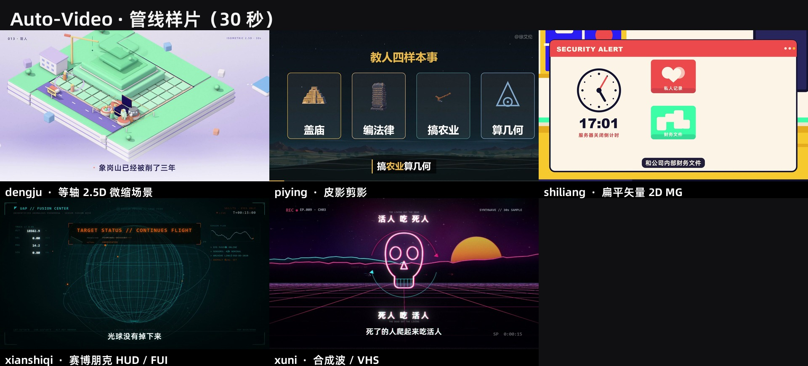

<div align="center">

# Auto-Video 🎬

### 把口播稿变成成片，把创作经验变成可复用管线

面向 AI 视频、知识科普、历史叙事和自动化内容生产的**可运行管线集合**——挑一条，看 SKILL.md，跑示例工程，即可开工。

[](https://github.com/DaBaoAgent/Auto-Video/stargazers)
[](https://github.com/DaBaoAgent/Auto-Video/commits/main)


</div>

一条视频最耗时的地方，常常是配音、字幕、分镜、渲染和交付之间的反复接线。Auto-Video 把这条重复劳动沉淀成**可直接运行的工程**：每条管线都带执行脚本、模板、定版参数和验收条件，下一支片子仍能沿用。

## 功能特性 ✨

- [x] **11 条可运行管线**：纸本历史短片、历史纪录片、纸雕剪影、逐帧手绘、皮影剪影、3D 战争推演、纪录片解说、合成波、扁平矢量、赛博 HUD、等轴 2.5D，共 11 种成片风格
- [x] **统一工程规范**：每条管线自带 `SKILL.md`（完整流程与已知坑）、定版参数、示例工程与验收条件
- [x] **确定性逐帧渲染**：Remotion / Canvas / Three.js / 3D 兵棋引擎，参数可复现，画面无结构性错误
- [x] **自动化质检**：字幕切点与重叠检查、频闪预算、补间审计、成品抽帧、响度 LUFS 归一
- [x] **统一交付包**：封面、发布信息与成片按规则打包，可直接发布
- [x] **外部依赖引导下载**：配音模型、渲染引擎、字体一律不入库（见下方 FAQ）
- [x] **路线图 99 种风格**：按「完成一条，迁移一条」持续扩充

## 管线总览 📊

| 管线 | 适合的内容 | 视觉与生产方法 | 状态 |
| --- | --- | --- | --- |
| [jianying](jianying/SKILL.md) | 历史叙事、人物独白、悬案考据 | 绢本/纸本、卡片运动语法、Remotion 渲染 | 已上线 |
| [lishi](lishi/SKILL.md) | 历史人物、战事、悬案、纪年叙事 | 纸本/绢本、AI 静帧底图、代码运镜、Remotion 渲染 | 已上线 |
| [piying](piying/SKILL.md) | 历史神话、皮影剪影、卡片式讲解 | Playwright、Canvas 逐帧渲染、ffmpeg 音频合成 | 已上线 |
| [shouhui](shouhui/SKILL.md) | 手绘历史科普、短叙事、动作转场 | Canvas 手绘、线条沸腾、逐帧浏览器渲染 | 已上线 |
| [zhidiao](zhidiao/SKILL.md) | 长视频、历史图说、纸雕剪影解说 | TTS、词级转写、拼音 DP 对齐、HyperFrames 渲染 | 已上线 |
| [tuiyan](tuiyan/SKILL.md) | 历史战争推演、全 3D 战场重现、战役解说 | 3D 兵棋推演引擎、稳帧逐帧渲染、ffmpeg 音效/BGM 合成 | 已上线 |
| [jilupian](jilupian/SKILL.md) | 纪录片解说、历史/自然/社会题材成片 | 片源核验→下载→口播→配音→影子匹配→渲染，S1–S9 流水线 | 已上线 |
| [xuni](xuni/SKILL.md) | 合成波 / VHS / Y2K 口播样片与短片 | mg-styles-15 10-synthwave、Three.js 逐帧确定性渲染、合成波配乐 | 已上线 |
| [shiliang](shiliang/SKILL.md) | 扁平矢量 2D MG 口播短片 | mg-styles-15 01-flat-vector、逐帧渲染、MG-pop 配乐 | 已上线 |
| [xianshiqi](xianshiqi/SKILL.md) | 赛博朋克 HUD / FUI 口播短片 | mg-styles-15 22-hud、深青霓虹线框、Three.js 全息体 | 已上线 |
| [dengju](dengju/SKILL.md) | 等轴 2.5D 微缩场景口播短片 | mg-styles-15 03-isometric、等距正交相机、瓦片波浪运镜 | 已上线 |

## 一条视频怎么生产 🔄


| 阶段 | 输入 | 产出 | 通过条件 |
| --- | --- | --- | --- |
| 配音对齐 | 口播稿、配音 | 词级或句级时间轴 | 字幕切点贴近真实语音 |
| 分镜 | 时间轴、分镜表 | 镜头计划与素材映射 | 镜数、场景数、时长一致 |
| 组装渲染 | 分镜、模板、字体、素材 | 分段视频或完整成片 | 参数可复现，画面无结构性错误 |
| 质检 | 成片、时间轴、渲染数据 | 检查结果 | 字幕、频闪、补间和抽帧检查通过 |
| 交付 | 成片、封面、发布信息 | 可直接发布的目录 | 文件结构、尺寸和元信息符合规则 |

内容如何进入画面也写进了流程：口播稿如何对齐字幕，分镜如何锁定时间，素材如何对应镜头，成片如何检查，封面和发布信息如何打包。`lishi` 会检查字幕切点、镜数分组、全片频闪预算和成片响度；`zhidiao` 会断言场景数与 manifest 一致，检查 SVG 补间、字幕重叠和成品抽帧，再输出专用发布目录。

## 效果展示 🖼️



<sub>当前 5 条管线的 30 秒样片（来自 `D:\BaiduSyncdisk\MG 动画\管线样片`，会持续同步）。点击下方样片名可播放。</sub>

| 管线 | 30 秒样片 | 示例内容 |
| --- | --- | --- |
| [xuni](xuni/SKILL.md) | [合成波 / VHS 样片](showcase/xuni_30s.mp4) | 009《朊病毒·同类相食》 |
| [shiliang](shiliang/SKILL.md) | [扁平矢量 2D MG 样片](showcase/shiliang_30s.mp4) | 010《生命 3.0》 |
| [xianshiqi](xianshiqi/SKILL.md) | [赛博朋克 HUD 样片](showcase/xianshiqi_30s.mp4) | UAP / FUSION CENTER |
| [dengju](dengju/SKILL.md) | [等轴 2.5D 样片](showcase/dengju_30s.mp4) | 013《羽人》 |
| [piying](piying/SKILL.md) | [皮影剪影样片](showcase/piying_30s.mp4) | 波斯湾伊甸园 |

<sub>更多管线成片画面：</sub>


<sub>`lishi` 的纸本视觉系统：楷体纪年、绢本底图、代码运镜与句级字幕。</sub>

## 快速开始 🚀

```bash
git clone https://github.com/DaBaoAgent/Auto-Video.git
cd Auto-Video
```

仓库保存管线、模板和少量示例成片，不包含模型权重、外部渲染运行时或完整的私有素材库。

### lishi

需要 Python 3.11+、Node.js 18+、ffmpeg 和 ffprobe。选题目录准备好 `film.json`、分镜表和底图后，可从探针与整链开始：

```bash
python lishi/scripts/lishi.py probe --project <slug>
python lishi/scripts/lishi.py all --project <slug>
```

完整入口与参数见 [lishi/SKILL.md](lishi/SKILL.md) 和 [lishi/pipeline.json](lishi/pipeline.json)。

### jianying

需要 Python 3.11+、Node.js 18+、ffmpeg、numpy 和 ffprobe。新选题从 `new` 开始，`init` 会把模板和依赖链接到选题目录：

```bash
python jianying/scripts/jianying_shotcraft.py new myfilm --title "标题"
python jianying/scripts/jianying_shotcraft.py init --project myfilm
python jianying/scripts/jianying_shotcraft.py all --project myfilm
```

逐行配音还需要 GPT-SoVITS。完整入口、镜头卡和验收规则见 [jianying/SKILL.md](jianying/SKILL.md)。

### shouhui

需要 Python 3.10+、Node.js 18+、Edge 和 ffmpeg。仓库带有完整的商纣王示例工程；渲染前还要按迁移说明安装 `mg-styles-15` 渲染引擎：

```bash
python shouhui/scripts/shouhui.py probe 012_shangzhouwang
python shouhui/scripts/shouhui.py stills 012_shangzhouwang --times 1,3,5,7,9
python shouhui/scripts/shouhui.py render 012_shangzhouwang
```

完整环境和外部依赖见 [shouhui/MIGRATION.md](shouhui/MIGRATION.md)，手绘管线规则见 [shouhui/SKILL.md](shouhui/SKILL.md)。

### piying

需要 Node.js 20+、Edge 或 Chrome、ffmpeg 和 ffprobe。渲染示例页前先安装 Playwright：

```bash
cd piying
npm ci
cd render/piying
node gen_full_yandi.js
node qc_full_yandi.js
node audit_yandi.js full
```

迁移后的素材路径已经改为模块内相对路径。完整规格与门禁说明见 [piying/SKILL.md](piying/SKILL.md) 和 [piying/MIGRATION.md](piying/MIGRATION.md)。

### zhidiao

首次运行前要先准备 GPT-SoVITS、Faster-Whisper、HyperFrames，以及单片 composition 使用的共享样式、GSAP 和字体。迁移与依赖说明见 [zhidiao/MIGRATION.md](zhidiao/MIGRATION.md)。

```bash
cd zhidiao
python scripts/zhidiao_make_audio.py
python scripts/zhidiao_assemble.py --slug <slug>
```

封面、分镜素材和交付打包工具都在 `zhidiao/tools/`。完整七阶段流程见 [zhidiao/references/pipeline.md](zhidiao/references/pipeline.md)。

### tuiyan

需要 Node.js 18+、Python 3.10+、ffmpeg 和 Edge/Chrome。渲染引擎与赤壁之战 46 幕完整包在 `vendor/battlefield-editor/`（迁移自 alannew 项目，只保留最终成片管线），首次运行先装节点依赖：

```bash
cd tuiyan/vendor/battlefield-editor
npm ci
node tools/validate-data.mjs --pkg packages/chibi-full/battlefield.json   # 数据校验
PROXY=1 node tools/verify-zh.mjs                                          # 中文残留门禁（errors: 0）
node tools/render-film.mjs --pkg packages/chibi-full/battlefield.json --out <输出目录>  # 全片稳帧渲染
```

TTS 配音、影视原声 OST 为本机自备项；完整说明与依赖见 [tuiyan/SKILL.md](tuiyan/SKILL.md)、[tuiyan/MIGRATION.md](tuiyan/MIGRATION.md)。

### jilupian

需要 Python 3.11+、uv、ffmpeg/ffprobe，以及一个 OpenAI 兼容模型服务（默认智谱 GLM）。给一份片源 URL 清单即可自动出片：

```bash
cd jilupian
uv sync --all-extras --locked
$env:GLM_API_KEY = "你的 API Key"
python -m autoup.run --manifest urls.txt --batch 202611-A
```

配音默认走 GPT-SoVITS 本地服务（可自备，或 `--set voice.engine=edge_tts` 切免费方案）。配音模块、模型、字体等外部依赖一律引导下载，见 [jilupian/MIGRATION.md](jilupian/MIGRATION.md)；完整规则见 [jilupian/SKILL.md](jilupian/SKILL.md)。

### xuni / shiliang / xianshiqi / dengju

四条 MG 风格短片管线（合成波、扁平矢量、赛博 HUD、等轴 2.5D），从 `AutoJY` 迁移，名字不变。需要 Node.js 18+、Python 3.11+、ffmpeg 和 Edge；渲染引擎 `mg-styles-15` 未随仓库提交（与 shouhui 共用），首次先安装：

```bash
git clone --depth 1 https://github.com/Vincentwei1021/mg-styles-15.git vendor/mg-styles-15
cd vendor/mg-styles-15 && npm install && cd ..
New-Item -ItemType Junction -Path 'xuni/node_modules' -Target 'vendor/mg-styles-15/node_modules'   # 四个管线各自建联接
```

以 xuni 为例（其余管线入口同名，见各自 README）：

```bash
python xuni/scripts/xuni.py probe 009_prion30
python xuni/scripts/xuni.py stills 009_prion30 --times 0.3,7.7,13.5,27.8
python xuni/scripts/xuni.py audio 009_prion30
python xuni/scripts/xuni.py render 009_prion30
python xuni/scripts/xuni.py mux 009_prion30
python xuni/scripts/xuni.py qa 009_prion30
python xuni/scripts/xuni.py publish 009_prion30
```

每条管线自带示例工程（xuni=009_prion30、shiliang=010_shengming30、xianshiqi=UAP30、dengju=yuren30）与定版参数；完整说明见各管线 [SKILL.md](xuni/SKILL.md)。

## 仓库结构 🗂️

```text
Auto-Video/
├── jianying/
│   ├── SKILL.md              # 纸本历史短片入口
│   ├── scripts/              # 七阶段编排与制作脚本
│   ├── cards/                # 镜头运动语法
│   ├── references/           # 流程、主题、声音与验收规则
│   └── template/             # Remotion 画面工程
├── lishi/
│   ├── SKILL.md              # 历史科普短片入口
│   ├── pipeline.json         # 定版参数
│   ├── scripts/              # 对齐、分镜、音轨、渲染、封装
│   └── template/             # Remotion 画面工程
├── piying/
│   ├── SKILL.md              # 皮影剪影管线入口
│   ├── render/piying/        # 分镜、渲染、QC 与交付门禁
│   ├── output/               # 炎帝示例输入与素材
│   └── tools/                # 配音、转写与素材处理
├── shouhui/
│   ├── SKILL.md              # 逐帧手绘短片入口
│   ├── scripts/              # 编排、逐帧渲染与音效
│   └── projects/             # 示例工程与可直接查看的样片
├── zhidiao/
│   ├── SKILL.md              # 纸雕剪影长视频入口
│   ├── references/           # 目录契约、渲染、质检与交付规则
│   ├── scripts/              # 配音对齐、组装、审计、抽帧
│   └── tools/                # TTS、分镜素材、封面与交付打包
├── tuiyan/
│   ├── SKILL.md              # 历史战争推演视频入口（全 3D 战场重现）
│   ├── pipeline/laorou/      # 口播稿子管线（机检 + 中文去味）
│   ├── scripts/              # 封面、试听、抽帧审核、发布校验
│   ├── references/           # 开发报告总纲
│   └── vendor/battlefield-editor/  # 3D 兵棋引擎 + 赤壁之战 46 幕完整包
├── jilupian/
│   ├── SKILL.md              # 纪录片解说流水线入口（S1–S9）
│   ├── autoup/               # 主包：阶段、TTS 适配器、配置
│   ├── references/           # 内容风格、下载规则、流程规格
│   ├── docs/                 # 产品规则、剪辑策略、开发记录
│   └── tests/                # 测试与 CI 门禁
├── xuni/
│   ├── SKILL.md              # 合成波 / VHS / Y2K 短片入口
│   ├── scripts/              # 编排、配乐、混音、逐帧渲染
│   └── projects/             # 009 朊病毒样片工程
├── shiliang/
│   ├── SKILL.md              # 扁平矢量 2D MG 短片入口
│   ├── scripts/              # 编排、配乐、混音、逐帧渲染
│   └── projects/             # 010 生命 3.0 样片工程
├── xianshiqi/
│   ├── SKILL.md              # 赛博朋克 HUD / FUI 短片入口
│   ├── scripts/              # 编排、配乐、混音、逐帧渲染
│   └── projects/             # UAP 样片工程
└── dengju/
    ├── SKILL.md              # 等轴 2.5D 短片入口
    ├── scripts/              # 编排、配乐、混音、逐帧渲染
    └── projects/             # 013 羽人样片工程
```

## 技术栈 🧰

| 环节 | 使用到的技术 |
| --- | --- |
| 内容与时间轴 | Python、GPT-SoVITS、Faster-Whisper、拼音 DP 对齐 |
| 画面工程 | TypeScript、Remotion、HTML、CSS、SVG、GSAP |
| 逐帧手绘 | Canvas、puppeteer-core、simplex-noise、opentype.js |
| 皮影剪影 | Playwright、Canvas、逐帧截图、ffmpeg |
| MG 短片渲染 | Node.js、three.js、mg-styles-15、Edge 无头逐帧渲染 |
| 长视频渲染 | HyperFrames、浏览器逐帧渲染 |
| 音频与交付 | ffmpeg、ffprobe、响度归一、两遍压缩 |
| 自动质检 | 字幕重叠检查、补间审计、频闪检测、成品抽帧 |

## 常见问题 ❓

<details>
<summary>配音是怎么来的？</summary>

各管线默认走 **GPT-SoVITS 本地服务**（自备模型权重），也支持切 **Edge TTS** 免费方案（如 `jilupian --set voice.engine=edge_tts`）。配音模型权重体积大且可再生成，一律不进入仓库，只做安装引导——见各管线 `MIGRATION.md`。

</details>

<details>
<summary>mg-styles-15 是什么？为什么不在仓库里？</summary>

`mg-styles-15` 是 shouhui / xuni / shiliang / xianshiqi / dengju 共用的外部渲染引擎（MIT 协议，含 node_modules 约 1.2GB）。仓库只保留管线代码与示例工程，引擎按引导 clone + `npm install` + junction 安装（见上方针式安装命令或各管线 README）。

</details>

<details>
<summary>模型、权重、字体、大文件为什么都不入库？</summary>

这是本项目的一贯政策：**代码与配置入库，重量级资产引导下载**。渲染引擎、TTS 模型、音色权重、字体（如 `AlibabaPuHuiTi`，免费商用）等都可通过官方渠道下载，避免仓库膨胀和不可再生成产物污染版本历史。

</details>

<details>
<summary>怎么新增一条管线？</summary>

按「完成一条，迁移一条」：新管线必须带自己的流程说明（`SKILL.md`）、执行脚本、可复用资源（模板/字体/示例工程）和验收条件，才算完成迁移。参见下方路线图。

</details>

## 路线图 🗺️

当前：`11 / 99`

Auto-Video 会按「完成一条，迁移一条」的方式持续扩展。新管线必须带自己的流程说明、脚本、可复用资源和验收条件，才算完成迁移。

99 条是长期目标，也就是 99 套能独立完成视频的生产方法。路线图会继续吸收不同题材、画风、媒介和平台需求，让更多人找到一条能直接开工的路径。

## 鸣谢与许可 🙏

- **mg-styles-15**（合成波 / 扁平矢量 / HUD / 等轴等 MG 风格引擎）：[Vincentwei1021/mg-styles-15](https://github.com/Vincentwei1021/mg-styles-15)，MIT
- **AlibabaPuHuiTi-3-85-Bold**（示例工程字体）：阿里巴巴普惠体，免费商用
- **GPT-SoVITS**（配音方案）：[RVC-Boss/GPT-SoVITS](https://github.com/RVC-Boss/GPT-SoVITS)
- **battlefield-editor**（3D 兵棋渲染引擎）：随 `tuiyan` 迁移自 alannew 项目
- 本仓库管线由 `AutoUP`、`AutoJY`、`alannew` 等历史项目迁移归纳而来，出处与迁移说明见各管线 `MIGRATION.md` / `CREDITS.md`

## English

Auto-Video is a growing collection of repeatable video production pipelines for AI-assisted storytelling. The current 11 pipelines cover paper-style historical shorts (Remotion), historical documentaries, paper-cut silhouette videos (HyperFrames), frame-by-frame hand-drawn animation, Canvas shadow-puppet animation (Playwright), 3D battle simulations, plus four MG short-film styles (synthwave / flat-vector / cyberpunk HUD / isometric). More visual and production styles are on the way, with a long-term roadmap of 99 pipelines.

## 关注更新

如果你正在寻找 AI 视频生成、自动剪辑、历史纪录片、纸雕动画、TTS 配音、字幕对齐或 ffmpeg 自动交付的实践，可以 Star 或 Watch 这个仓库。新管线完成后会直接进入项目。
