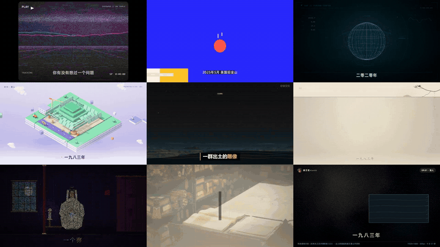
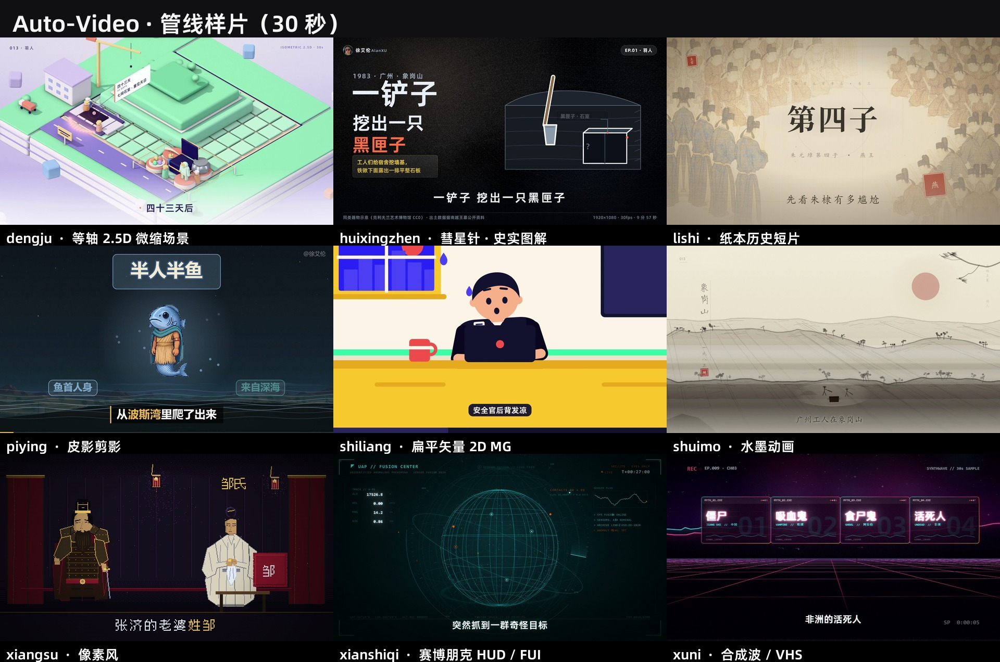

<div align="center">

# Auto-Video 🎬

### 一个想法（或一个对标视频链接）→ 24 种风格的动画成片

Auto-Video 是**把想法变成成片的一站式工作流**：原创口播稿、本地克隆音色配音、24 条成片管线出片，一条流水线替你跑完所有做视频的流程——挑一条管线，看 SKILL.md，备好素材即可开工。

[](https://github.com/DaBaoAgent/Auto-Video/stargazers)
[](https://github.com/DaBaoAgent/Auto-Video/commits/main)


</div>

做一条视频最耗时的，是把口播稿、配音、分镜、画面、字幕、渲染和交付反复接线。Auto-Video 把这套流程沉淀成**开箱即用的工程**：你只负责给出选题，或丢来一个优质对标视频链接，工作流会拆解结构、产出原创口播稿、用本地克隆音色完成配音，再按你选定的风格渲染成片——一个想法变成成片，全程不依赖生图、生视频大模型 API，也没有按次计费的调用成本。每条管线都带执行脚本与验收条件（其中 8 条另有定版参数），下一支片子直接沿用。

**目录**：[功能特性](#features) · [管线总览](#pipelines) · [一条视频怎么生产](#flow) · [效果展示](#showcase) · [快速开始](#quickstart) · [仓库结构](#layout) · [技术栈](#stack) · [常见问题](#faq) · [路线图](#roadmap) · [鸣谢与许可](#credits)

<div align="center">



<sub>9 条管线样片九宫格：合成波 / 扁平矢量 / 赛博 HUD / 等轴 2.5D / 皮影剪影 / 水墨动画 / 像素风 / 纸本历史 / 回形针风。想看 30 秒有声样片，点下方效果展示区的样片名；另有 8 部完整成片在本地归档，未随仓库提交。</sub>

</div>

<a id="features"></a>
## 功能特性 ✨

- [x] **对标复刻，一条链接起步**：给一个优质对标视频链接或选题，即可拆解结构、产出原创口播稿，套用 24 条成片管线做成成片（[jilupian](jilupian/SKILL.md) 直接吃片源 URL 清单自动出片）
- [x] **选题 → 口播稿 → 配音 → 出片，四步闭环**：[peiyin](peiyin/SKILL.md) 承载前端三模块（选题规约、AI 味审计门禁、GPT-SoVITS 克隆音色批量合成），24 条成片管线负责画面与成片
- [x] **不依赖生图 / 生视频大模型 API**：画面由 Remotion / Canvas / Three.js / 3D 兵棋引擎确定性逐帧渲染，配音由本地 GPT-SoVITS 克隆合成——参数可复现，无按次 API 费用
- [x] **24 条成片管线 + 1 个前端模块**：纸本历史短片、纸本历史科普、皮影剪影、逐帧手绘、纸雕剪影、3D 战争推演、纪录片解说、合成波、扁平矢量、赛博 HUD、等轴 2.5D、回形针科普、纸本水墨山水、像素风、城市年轮、地图动画、美式黄金卡通、日漫漫画分镜、贝叶挂毯、铅笔手绘、等距微缩世界、3D 火柴人寓言、皮影戏（透光牛皮）、蓝图工程图；[peiyin](peiyin/SKILL.md) 不计入成片风格，负责选题、出稿与配音
- [x] **统一工程规范**：24 个模块各自带 `SKILL.md`（完整流程与已知坑）与验收条件；16 条另有 `pipeline.json` / `FREEZE.json` 定版参数，MG 组与八条 BB-Video 风格组都附带可运行示例工程
- [x] **自动化质检**：字幕切点与重叠检查、频闪预算、补间审计、成品抽帧、响度 LUFS 归一
- [x] **统一交付包**：封面、发布信息与成片按规则打包，可直接发布
- [x] **样片与成片分层**：14 条 30 秒样片公开可播，8 条新风格样片 + 8 部完整成片本地归档（不随仓库提交）
- [x] **外部依赖引导下载**：配音模型、渲染引擎、字体一律不入库（见下方 FAQ）
- [x] **路线图 99 种风格**：按「完成一条，迁移一条」持续扩充

<a id="pipelines"></a>
## 管线总览 📊

24 条成片管线 + 1 个前端模块（`peiyin`）。成片管线负责画面与交付，`peiyin` 负责选题、口播稿与配音。

| 管线 | 类型 | 适合的内容 | 视觉与生产方法 | 状态 |
| --- | --- | --- | --- | --- |
| [jianying](jianying/SKILL.md) | 成片 | 历史叙事、人物独白、悬案考据 | 绢本/纸本、卡片运动语法、Remotion 渲染 | 已上线 |
| [lishi](lishi/SKILL.md) | 成片 | 历史人物、战事、悬案、纪年叙事 | 纸本/绢本、AI 静帧底图、代码运镜、Remotion 渲染 | 已上线 |
| [shouhui](shouhui/SKILL.md) | 成片 | 手绘历史科普、短叙事、动作转场 | Canvas 手绘、线条沸腾、逐帧浏览器渲染 | 已上线 |
| [piying](piying/SKILL.md) | 成片 | 历史神话、皮影剪影、卡片式讲解 | Playwright、Canvas 逐帧渲染、ffmpeg 音频合成 | 已上线 |
| [zhidiao](zhidiao/SKILL.md) | 成片 | 长视频、历史图说、纸雕剪影解说 | TTS、词级转写、拼音 DP 对齐、HyperFrames 渲染 | 已上线 |
| [tuiyan](tuiyan/SKILL.md) | 成片 | 历史战争推演、全 3D 战场重现、战役解说 | 3D 兵棋推演引擎、稳帧逐帧渲染、ffmpeg 音效/BGM 合成 | 已上线 |
| [jilupian](jilupian/SKILL.md) | 成片 | 纪录片解说、历史/自然/社会题材成片 | 片源核验→下载→口播→配音→影子匹配→渲染，S1–S9 流水线 | 已上线 |
| [xuni](xuni/SKILL.md) | 成片 | 合成波 / VHS / Y2K 口播样片与短片 | mg-styles-15 10-synthwave、Three.js 逐帧确定性渲染、合成波配乐 | 已上线 |
| [shiliang](shiliang/SKILL.md) | 成片 | 扁平矢量 2D MG 口播短片 | mg-styles-15 01-flat-vector、逐帧渲染、MG-pop 配乐 | 已上线 |
| [xianshiqi](xianshiqi/SKILL.md) | 成片 | 赛博朋克 HUD / FUI 口播短片 | mg-styles-15 22-hud、深青霓虹线框、Three.js 全息体 | 已上线 |
| [dengju](dengju/SKILL.md) | 成片 | 等轴 2.5D 微缩场景口播短片 | mg-styles-15 03-isometric、等距正交相机、瓦片波浪运镜 | 已上线 |
| [huixingzhen](huixingzhen/SKILL.md) | 成片 | 回形针风科普、知识区/财经解释类 MG 短片 | mg-styles-15 19-paperclip、实拍照片贴纸化、大画布连续运镜 | 已上线 |
| [shuimo](shuimo/SKILL.md) | 成片 | 纸本水墨山水口播样片与短片 | kalpa-shan 生成式 SVG 山水、Canvas 墨渗/印章、古琴拨弦配乐 | 已上线 |
| [xiangsu](xiangsu/SKILL.md) | 成片 | 像素风历史/科普短片、像素风解说 | 640×360 索引色栅格 ×3 整数最近邻 + 输出分辨率 CRT、Canvas 逐像素、Puppeteer 逐帧渲染 | 已上线 |
| [chengshi](chengshi/SKILL.md) | 成片 | 城市年轮、地标演进、城市史航拍短片 | OSM/Esri/SRTM 真实地理数据、Three.js+Remotion 3D 城市、确定性生长 | 已上线 |
| [map](map/SKILL.md) | 成片 | 地图解说、路线与迁徙、历史地理、贸易与交通 | Natural Earth 真实底图、SVG 漫画贴纸锚定经纬度、Chrome 逐帧 + ffmpeg | 已上线 |
| [goldenage](goldenage/SKILL.md) | 成片 | 因果连锁、橡皮物理、轻科普、娱乐产品 | 手绘城市背景 + 墨线赛璐璐、15 张/秒抽搐、卡通物理、Chrome 逐帧 | 已上线 |
| [manga](manga/SKILL.md) | 成片 | 科学对抗、反转故事、年轻向角色宣传 | 漫画分格/网点/拟声词、RTL 阅读、punch-in、splash | 已上线 |
| [tapestry](tapestry/SKILL.md) | 成片 | 编年史、工艺史、航程/战争、温暖品牌故事 | 亚麻羊毛刺绣、茎针绣/铺线、长卷滚动、推近看针脚 | 已上线 |
| [pencil](pencil/SKILL.md) | 成片 | 人物生平、运动/时间、机器演化、情绪科普 | 石墨铅笔测试纸、蓝线起稿、on twos、morph、暖色 bloom | 已上线 |
| [isometric](isometric/SKILL.md) | 成片 | 流程与系统、跟着一个东西走完系统、B2B 产品 | 45° 等距微缩世界、地块/路线/传送带、连续镜头、focus 抬升 | 已上线 |
| [parable](parable/SKILL.md) | 成片 | 一个道理的两种做法对比、15–45 s 社媒短片、一个卖点 | 黑虚空白色火柴人、道具生长、一个红色符号、固定广角 | 已上线 |
| [shadow](shadow/SKILL.md) | 成片 | 历史典故、人物冲突、传统民俗、非遗叙事 | 素白幕/木质台框、透光牛皮影人、操纵杆道具、红纸签、灯暗换场 | 已上线 |
| [blueprint](blueprint/SKILL.md) | 成片 | 机构/机器/装置/系统原理、硬件拆解、工程产品 | 蓝晒图纸、构造线→终线→标注、真实啮合机构、红铅笔唯一强调 | 已上线 |
| [peiyin](peiyin/SKILL.md) | 前端 | 选题-出稿-配音（口播稿批量配音、前端三模块） | GPT-SoVITS 克隆音色、长稿分段合成、审查门禁、权重/音色引导下载 | 已上线 |

<a id="flow"></a>
## 一条视频怎么生产 🔄


| 阶段 | 输入 | 产出 | 通过条件 |
| --- | --- | --- | --- |
| 选题与口播稿 | 选题 / 对标视频链接、内容规约 | 原创口播稿 | 通过 AI 味审计，多音字 / 外文人名读音校正 |
| 本地配音 | 口播稿、克隆音色 | 分句配音、时间轴 | 审查门禁通过（呼吸、幕间停顿、崩词） |
| 配音对齐 | 口播稿、配音 | 词级或句级时间轴 | 字幕切点贴近真实语音 |
| 分镜 | 时间轴、分镜表 | 镜头计划与素材映射 | 镜数、场景数、时长一致 |
| 组装渲染 | 分镜、模板、字体、素材 | 分段视频或完整成片 | 参数可复现，画面无结构性错误 |
| 质检 | 成片、时间轴、渲染数据 | 检查结果 | 字幕、频闪、补间和抽帧检查通过 |
| 交付 | 成片、封面、发布信息 | 可直接发布的目录 | 文件结构、尺寸和元信息符合规则 |

内容如何进入画面也写进了流程：口播稿如何对齐字幕，分镜如何锁定时间，素材如何对应镜头，成片如何检查，封面和发布信息如何打包。前端三模块由 [peiyin](peiyin/SKILL.md) 承载（选题规约、口播稿审计、批量配音），[jilupian](jilupian/SKILL.md) 支持直接吃片源 URL 清单自动出片。`lishi` 会检查字幕切点、镜数分组、全片频闪预算和成片响度；`zhidiao` 会断言场景数与 manifest 一致，检查 SVG 补间、字幕重叠和成品抽帧，再输出专用发布目录。`goldenage` / `manga` / `tapestry` / `pencil` / `isometric` / `parable` 八条管线都带 `--check`、抽帧复核、响度与黑帧 QA。

<a id="showcase"></a>
## 效果展示 🖼️



<sub>14 条 30 秒样片（来自 DabaoAgent 的实操管线，会持续同步）。点击样片名直接播放。</sub>

### 30 秒公开样片

| 管线 | 30 秒样片 | 示例内容 |
| --- | --- | --- |
| [jianying](jianying/SKILL.md) | [纸本卡片样片](https://dabaoagent.github.io/Auto-Video/showcase/jianying_30s.mp4) | 刘秀·位面之子（“3,000 撤回的救兵”） |
| [lishi](lishi/SKILL.md) | [纸本历史短片样片](https://dabaoagent.github.io/Auto-Video/showcase/lishi_30s.mp4) | 朱元璋 · 碽妃疑案 |
| [shouhui](shouhui/SKILL.md) | [逐帧手绘样片](https://dabaoagent.github.io/Auto-Video/showcase/shouhui_30s.mp4) | 商纣王（《史记》卡片 + 人物） |
| [piying](piying/SKILL.md) | [皮影剪影样片](https://dabaoagent.github.io/Auto-Video/showcase/piying_30s.mp4) | 波斯湾伊甸园 |
| [tuiyan](tuiyan/SKILL.md) | [3D 战场样片](https://dabaoagent.github.io/Auto-Video/showcase/tuiyan_30s.mp4) | 赤壁之战·火烧连船 |
| [xuni](xuni/SKILL.md) | [合成波 / VHS 样片](https://dabaoagent.github.io/Auto-Video/showcase/xuni_30s.mp4) | 009《朊病毒·同类相食》 |
| [shiliang](shiliang/SKILL.md) | [扁平矢量 2D MG 样片](https://dabaoagent.github.io/Auto-Video/showcase/shiliang_30s.mp4) | 010《生命 3.0》 |
| [xianshiqi](xianshiqi/SKILL.md) | [赛博朋克 HUD 样片](https://dabaoagent.github.io/Auto-Video/showcase/xianshiqi_30s.mp4) | UAP / FUSION CENTER |
| [dengju](dengju/SKILL.md) | [等轴 2.5D 样片](https://dabaoagent.github.io/Auto-Video/showcase/dengju_30s.mp4) | 013《羽人》 |
| [huixingzhen](huixingzhen/SKILL.md) | [回形针风样片](https://dabaoagent.github.io/Auto-Video/showcase/huixingzhen_30s.mp4) | 南越王·丝缕玉衣（黑匣子里的四件文物） |
| [shuimo](shuimo/SKILL.md) | [水墨动画样片](https://dabaoagent.github.io/Auto-Video/showcase/shuimo_30s.mp4) | 013《羽人》（水墨版） |
| [xiangsu](xiangsu/SKILL.md) | [像素风样片](https://dabaoagent.github.io/Auto-Video/showcase/xiangsu_30s.mp4) | 曹操 · 官渡 / 赤壁（“那一晚”） |
| [chengshi](chengshi/SKILL.md) | [城市年轮样片](https://dabaoagent.github.io/Auto-Video/showcase/chengshi_30s.mp4) | 苏州·城长（北寺塔 / 平江路水巷） |
| youxi（待封装） | [像素游戏风样片](https://dabaoagent.github.io/Auto-Video/showcase/youxi_30s.mp4) | 仁德天皇陵（开棺定年） |

<sub>`xiangsu` 实测 29.4 秒，其余 30.0–30.1 秒；`zhidiao`、`jilupian` 两条长视频管线暂无 30 秒样片。</sub>

### 完整成片（本地归档，未入库）

本批 8 部完整成片共约 2.2 GB（全部 14 个文件约 2.3 GB），存于作者本地同步盘（`1 MG 动画/管线样片/`），不随仓库提交；片名与时长取自交付文件。

| 管线 | 成片 | 时长 | 画面 | 体积 |
| --- | --- | --- | --- | --- |
| [jianying](jianying/SKILL.md) | 刘秀·位面之子 | 211.0 s | 1920×1080 / 30 fps | 135 MB |
| [lishi](lishi/SKILL.md) | 朱元璋·碽妃疑案 | 144.9 s | 1920×1080 / 30 fps | 177 MB |
| [piying](piying/SKILL.md) | 波斯湾伊甸园 | 272.2 s | 1920×1080 / 30 fps | 130 MB |
| [shouhui](shouhui/SKILL.md) | 商纣王 | 205.7 s | 1920×1080 / 24 fps | 444 MB |
| [tuiyan](tuiyan/SKILL.md) | 3D 赤壁之战 | 539.8 s | 1920×1080 / 30 fps | 467 MB |
| [huixingzhen](huixingzhen/SKILL.md) | 羽人 | 597.3 s | 1920×1080 / 30 fps | 345 MB |
| [chengshi](chengshi/SKILL.md) | 苏州·城长 | 160.7 s | 1920×1080 / 30 fps | 383 MB |
| youxi（待封装） | 仁德天皇陵 | 192.7 s | 1920×1080 / 30 fps | 138 MB |

<sub>`zhidiao`、`jilupian` 两条长视频管线本批没有归档成片；其余管线的完整片源见各自 README 与归档记录。</sub>

### 新风格样片（本地归档，未入库）

前七条用同一段 044《阿努纳奇》口播（第一段 28.5 s）做成样片；《3D 火柴人寓言》另做了 3 分钟版；blueprint 用 018《玄奘》前 10 秒。文件存于作者本地归档，不随仓库提交。

| 管线 | 样片 | 时长 | 画面 | 体积 |
| --- | --- | --- | --- | --- |
| [goldenage](goldenage/SKILL.md) | 阿努纳奇 · 第一段 | 30.3 s | 1920×1080 / 30 fps | 46.0 MB |
| [manga](manga/SKILL.md) | 阿努纳奇 · 第一段 | 30.4 s | 1920×1080 / 30 fps | 38.2 MB |
| [tapestry](tapestry/SKILL.md) | 阿努纳奇 · 第一段 | 30.5 s | 1920×1080 / 30 fps | 23.9 MB |
| [pencil](pencil/SKILL.md) | 阿努纳奇 · 第一段 | 30.4 s | 1920×1080 / 30 fps | 12.9 MB |
| [isometric](isometric/SKILL.md) | 阿努纳奇 · 第一段 | 30.4 s | 1920×1080 / 30 fps | 14.0 MB |
| [parable](parable/SKILL.md) | 阿努纳奇 · 3 分钟样片 | 178.3 s | 1280×720 / 30 fps | 34.3 MB |
| [shadow](shadow/SKILL.md) | 阿努纳奇 · 第一段 | 30.3 s | 1920×1080 / 30 fps | 14.3 MB |
| [blueprint](blueprint/SKILL.md) | 玄奘 · 前 10 秒 | 12.1 s | 1920×1080 / 30 fps | 6.4 MB |

### 更多画面


<sub>`lishi` 的纸本视觉系统：楷体纪年、绢本底图、代码运镜与句级字幕（《建安十三年 · 我五十三岁》）。</sub>

<a id="quickstart"></a>
## 快速开始 🚀

```bash
git clone https://github.com/DaBaoAgent/Auto-Video.git
cd Auto-Video
```

仓库保存管线、模板和 14 条 30 秒样片（约 260 MB）；模型权重、外部渲染运行时与完整成片不在仓库内（见 [效果展示](#showcase)）。

<details>
<summary>环境与外部依赖总表（按管线）</summary>

| 管线 | Python | Node | 浏览器 | ffmpeg | 外部引擎与其他 |
| --- | --- | --- | --- | --- | --- |
| jianying | 3.11+ | 18+ | — | ffmpeg、ffprobe、numpy | Remotion、GPT-SoVITS |
| lishi | 3.11+ | 18+ | — | ffmpeg、ffprobe | Remotion、GPT-SoVITS |
| piying | — | 20+ | Edge 或 Chrome | ffmpeg、ffprobe | Playwright |
| shouhui | 3.10+ | 18+ | Edge | ffmpeg | mg-styles-15 |
| zhidiao | 3.10+ | 见 MIGRATION | 无头浏览器 | ffmpeg | HyperFrames、GPT-SoVITS、Faster-Whisper |
| tuiyan | 3.10+ | 18+ | Edge 或 Chrome | ffmpeg | battlefield-editor（仓库自带） |
| jilupian | 3.11+ | — | — | ffmpeg、ffprobe | uv、OpenAI 兼容模型、GPT-SoVITS 或 Edge TTS |
| xuni · shiliang · xianshiqi · dengju · shuimo | 3.11+ | 18+ | Edge | ffmpeg | mg-styles-15 |
| huixingzhen | 3.11+ | 18+ | Edge | ffmpeg | mg-styles-15、`shouhui/node_modules` |
| xiangsu | 3.10+（numpy） | 18+ | Chrome | ffmpeg、ffprobe | mg-styles-15、bash（Git Bash / WSL） |
| chengshi | numpy、Pillow | 18+ | Edge（ANGLE） | ffmpeg | Remotion、GPT-SoVITS、OSM / Esri / SRTM 数据 |
| peiyin | 3.10+ | — | — | ffmpeg | GPT-SoVITS（权重由 `setup.ps1` 拉取） |
| goldenage · manga · tapestry · pencil · isometric · parable · shadow · blueprint | 3.9+（只用标准库） | 18+ | Chrome 或 Edge | ffmpeg、ffprobe | BB-Video 浏览器运行时（仓库自带）；isometric / parable 需 Three.js import map（CDN） |

</details>

### jianying

需要 Python 3.11+、Node.js 18+、ffmpeg、numpy 和 ffprobe。新选题从 `new` 开始，`init` 会把模板和依赖链接到选题目录：

```bash
python jianying/scripts/jianying_shotcraft.py new myfilm --title "标题"
python jianying/scripts/jianying_shotcraft.py init --project myfilm
python jianying/scripts/jianying_shotcraft.py all --project myfilm
```

逐行配音还需要 GPT-SoVITS。完整入口、镜头卡和验收规则见 [jianying/SKILL.md](jianying/SKILL.md)。

### lishi

需要 Python 3.11+、Node.js 18+、ffmpeg 和 ffprobe。选题目录准备好 `film.json`、分镜表和底图后，可从探针与整链开始：

```bash
python lishi/scripts/lishi.py probe --project <slug>
python lishi/scripts/lishi.py all --project <slug>
```

完整入口与参数见 [lishi/SKILL.md](lishi/SKILL.md) 和 [lishi/pipeline.json](lishi/pipeline.json)。

### shouhui

需要 Python 3.10+、Node.js 18+、Edge 和 ffmpeg。仓库带有完整的商纣王示例工程；渲染前还要按迁移说明安装 `mg-styles-15` 渲染引擎：

```bash
python shouhui/scripts/shouhui.py probe 012_shangzhouwang
python shouhui/scripts/shouhui.py stills 012_shangzhouwang --times 1,3,5,7,9
python shouhui/scripts/shouhui.py render 012_shangzhouwang
```

完整环境和外部依赖见 [shouhui/MIGRATION.md](shouhui/MIGRATION.md)，手绘管线规则见 [shouhui/SKILL.md](shouhui/SKILL.md)。

### piying

需要 Node.js 20+、Edge 或 Chrome、ffmpeg 和 ffprobe。渲染示例页前先安装 Playwright：

```bash
cd piying
npm ci
cd render/piying
node gen_full_yandi.js
node qc_full_yandi.js
node audit_yandi.js full
```

迁移后的素材路径已经改为模块内相对路径。完整规格与门禁说明见 [piying/SKILL.md](piying/SKILL.md) 和 [piying/MIGRATION.md](piying/MIGRATION.md)。

### zhidiao

首次运行前要先准备 GPT-SoVITS、Faster-Whisper、HyperFrames，以及单片 composition 使用的共享样式、GSAP 和字体。迁移与依赖说明见 [zhidiao/MIGRATION.md](zhidiao/MIGRATION.md)。

```bash
cd zhidiao
python scripts/zhidiao_make_audio.py
python scripts/zhidiao_assemble.py --slug <slug>
```

封面、分镜素材和交付打包工具都在 `zhidiao/tools/`。完整七阶段流程见 [zhidiao/references/pipeline.md](zhidiao/references/pipeline.md)。

### tuiyan

需要 Node.js 18+、Python 3.10+、ffmpeg 和 Edge/Chrome。渲染引擎与赤壁之战 46 幕完整包在 `vendor/battlefield-editor/`（迁移自 alannew 项目，只保留最终成片管线），首次运行先装节点依赖：

```powershell
Set-Location tuiyan/vendor/battlefield-editor
npm ci
node tools/validate-data.mjs --pkg packages/chibi-full/battlefield.json   # 数据校验
$env:PROXY = "1"
node tools/verify-zh.mjs                                                  # 中文残留门禁（errors: 0）
node tools/render-film.mjs --pkg packages/chibi-full/battlefield.json --out <输出目录>  # 全片稳帧渲染
```

TTS 配音、影视原声 OST 为本机自备项；完整说明与依赖见 [tuiyan/SKILL.md](tuiyan/SKILL.md)、[tuiyan/MIGRATION.md](tuiyan/MIGRATION.md)。

### jilupian

需要 Python 3.11+、uv、ffmpeg/ffprobe，以及一个 OpenAI 兼容模型服务（默认智谱 GLM）。给一份片源 URL 清单即可自动出片：

```powershell
Set-Location jilupian
uv sync --all-extras --locked
$env:GLM_API_KEY = "你的 API Key"
uv run python -m autoup.run --manifest urls.txt --batch 202611-A
```

配音默认走 GPT-SoVITS 本地服务（可自备，或 `--set voice.engine=edge_tts` 切免费方案）。配音模块、模型、字体等外部依赖一律引导下载，见 [jilupian/MIGRATION.md](jilupian/MIGRATION.md)；完整规则见 [jilupian/SKILL.md](jilupian/SKILL.md)。

### xuni / shiliang / xianshiqi / dengju / huixingzhen / shuimo

六条 MG 风格短片管线（合成波、扁平矢量、赛博 HUD、等轴 2.5D、回形针科普、纸本水墨），从 `AutoJY` 迁移，名字不变。需要 Node.js 18+、Python 3.11+、ffmpeg 和 Edge；渲染引擎 `mg-styles-15` 未随仓库提交（与 shouhui 共用），首次先安装：

```powershell
git clone --depth 1 https://github.com/Vincentwei1021/mg-styles-15.git vendor/mg-styles-15
Set-Location vendor/mg-styles-15; npm install; Set-Location ../..
New-Item -ItemType Junction -Path 'xuni/node_modules' -Target 'vendor/mg-styles-15/node_modules'   # 各管线各自建联接
```

以 xuni 为例（其余管线入口同名，见各自 README）：

```bash
python xuni/scripts/xuni.py probe 009_prion30
python xuni/scripts/xuni.py stills 009_prion30 --times 0.3,7.7,13.5,27.8
python xuni/scripts/xuni.py audio 009_prion30
python xuni/scripts/xuni.py render 009_prion30
python xuni/scripts/xuni.py mux 009_prion30
python xuni/scripts/xuni.py qa 009_prion30
python xuni/scripts/xuni.py publish 009_prion30
```

- `shuimo` 走 `shuimo.py` 编排（new/cues/audio/stills/render/sheet/mux/qa/publish），示例工程 `projects/yuren30`（013《羽人》30 秒样片）；`shuimo/node_modules` 同样建联接（只用到 puppeteer-core）。
- `huixingzhen` 走 `render_frames.mjs` + 素材/音效脚本，参考实现 `projects/paperclip_zhou`（商纣王 20 秒，**未随仓库提交**，需自备）；渲染器复用 `shouhui/scripts/render.mjs` 的 puppeteer-core，依赖 `shouhui/node_modules` 联接。

MG 组 5 条自带示例工程（xuni=009_prion30、shiliang=010_shengming30、xianshiqi=UAP30、dengju=yuren30、shuimo=yuren30）与 `pipeline.json` 定版参数；`huixingzhen` 的定稿参数在 `theme/dark.css`，参考工程需自备。完整说明见各管线 [SKILL.md](xuni/SKILL.md)。

### xiangsu

像素风管线：画面在 640×360 索引色帧缓冲里逐像素决定，×3 整数最近邻放大到 1920×1080，CRT 在输出分辨率上做。需要 Node.js 18+、Chrome、ffmpeg/ffprobe、Python+numpy 和 bash（Windows 用 Git Bash 或 WSL），渲染复用上一条的 `mg-styles-15` harness（`harness/render.mjs`、`tools/density.mjs`、像素字体）：

```bash
cd xiangsu
# 脚本内默认路径仍是迁移前的 yandi 目录，运行前必须覆盖（见 SKILL.md「环境变量」）
export XIANGSU_REPO="$PWD/../vendor/mg-styles-15"
export XIANGSU_PROJ="<本片项目目录>"
export XIANGSU_PY="<本机 python.exe，需 numpy>"
bash build.sh                # 10 秒样片：音轨 → 渲染 1920×1080 → 4 项验收
bash build.sh --no-audio     # 复用 audio.wav，只重渲画面
```

全片链路在 `xiangsu/full/`（先 `cd xiangsu/full`）：`node assemble.mjs`（拼装 `demo/film.js` 片头 + `parts/*.js`）→ `bash build_full.sh`（音轨 → 渲染 → 验收）→ `node make_covers.mjs --final`（4:3 / 3:4 双封面）。片级参数 `XIANGSU_PROJ/FILM/DUR/COVER_OUT` 不给默认值，缺省直接报错。完整参数、冻结基线与验收口径见 [xiangsu/SKILL.md](xiangsu/SKILL.md) 与 [xiangsu/README.md](xiangsu/README.md)。

### chengshi

城市年轮管线：用 OSM 建筑/道路/水系、Esri 卫星影像与 SRTM 地形确定性渲染一座城市的年代演进（Three.js + Remotion），从 `AutoJY` 迁移，名字统一为 chengshi（无 sz 别名）。需要 Python（numpy/Pillow）、Node 18+、Edge（ANGLE）与 ffmpeg；逐句配音走本机 GPT-SoVITS（API 9880）。

渲染工程两个目录：`chengshi/render`（苏州 v2 分镜，原名 `template_v2` → `sz` → 现归一到 `render`，`render_cut_v2.py` 用它）与 `chengshi/template`（通用 v1，`render_cut.py` 用它，`make_city.py` 默认走这条）。**运行时依赖不在仓库里**：`.venv/`、Remotion 的 `node_modules`、Edge、ffmpeg、GPT-SoVITS 都需本机自备，缺依赖时先在渲染工程目录 `npm install`。

```powershell
# 建骨架（bbox 顺序：南,西,北,东）；仓库根目录先建好 .venv（numpy / Pillow）
$env:PYTHONIOENCODING = "utf-8"
.\.venv\Scripts\python.exe chengshi/scripts/chengshi.py new --project <slug> --title "成都·一座城的年轮" --bbox 30.6,104.0,30.8,104.2

# 一键出片：抓 OSM/SRTM/Esri → 白模 → TTS → 混音（-15 LUFS）→ 1080p 审片
.\.venv\Scripts\python.exe chengshi/scripts/make_city.py --project <slug>

# 单帧预览与交付（母版 + 封面 + 裁切 + 发布信息）
.\.venv\Scripts\python.exe chengshi/scripts/chengshi.py still --project <slug> --frame 300
.\.venv\Scripts\python.exe chengshi/scripts/chengshi.py publish --project <slug>
```

示例工程在仓库根目录的 `projects/suzhou`（苏州《城长》160.7 s，完整成片见 [效果展示](#showcase)）；4K 母版需 `--allow-4k`。六个叙事数据文件、运行手册与质量硬约束见 [chengshi/USAGE.md](chengshi/USAGE.md)，完整规则见 [chengshi/SKILL.md](chengshi/SKILL.md)。

### goldenage / manga / tapestry / pencil / isometric / parable / shadow / blueprint

八条从 BB-Video 33 种风格里迁出的成片管线，都用同一套「口播稿 → 配音 → 时间轴 → 纯函数画面 → Chrome 逐帧 → ffmpeg」链路；运行时代码随管线 vendored（MIT），不依赖外部渲染引擎。六条都带阿努纳奇样片完整工程、`--check`、抽帧和 QA：

```bash
# 以 goldenage 为例；其余七条把 goldenage 换成 manga / tapestry / pencil / isometric / parable / shadow / blueprint
python goldenage/scripts/goldenage.py new projects/<名字> --title "片名"
python goldenage/scripts/goldenage.py vo projects/<名字> --src 配音.wav --text 口播稿.txt
python goldenage/scripts/goldenage.py check  projects/<名字>
python goldenage/scripts/goldenage.py stills projects/<名字> --times 2,8,15,25
python goldenage/scripts/goldenage.py render projects/<名字> --scale 0.6667
python goldenage/scripts/goldenage.py deliver projects/<名字> --chugao 出稿/<编号>_<选题> --name "goldenage_片名_样片_1080p"
```

- `template/` 是阿努纳奇样片的完整做法（不是空白模板）：`index.html` 逐幕画面、`brief.md` 事实表、`storyboard.md` 分镜、`score.js` / `sound.js` 配乐音效。
- 八条管线各自的风格规则、逐幕做法与已知坑见 [goldenage/SKILL.md](goldenage/SKILL.md)、[manga/SKILL.md](manga/SKILL.md)、[tapestry/SKILL.md](tapestry/SKILL.md)、[pencil/SKILL.md](pencil/SKILL.md)、[isometric/SKILL.md](isometric/SKILL.md)、[parable/SKILL.md](parable/SKILL.md)、[shadow/SKILL.md](shadow/SKILL.md)、[blueprint/SKILL.md](blueprint/SKILL.md)。
- `isometric` 与已有的 `dengju`（mg-styles-15 等轴 2.5D）都画等距世界，但实现不同：`isometric` 是 BB-Video 的地块/路线/连续镜头运行时，`dengju` 是 mg-styles-15 的瓦片波浪运镜；按项目需要选。
- `shadow` 与已有的 `piying` 都做皮影，但 `piying` 是 Playwright/Canvas 的剪影+卡片式讲解，`shadow` 是 BB-Video 的透光牛皮影人、操纵杆道具、红纸签与灯暗换场；按项目需要选。
- `blueprint` 是蓝晒工程图，适合机构/机器/系统原理；它和 `swiss`（瑞士排版）、`launch`（产品发布）不是一类，按「要把原理画成图纸」的需求选。

### peiyin

前端模块：选题 → 出稿 → 配音。需要 Python 3.10+、PowerShell 和本地 GPT-SoVITS 环境；权重与音色约 2.4 GB，由 `setup.ps1` 引导下载，不入库：

```powershell
# 一键初始化：校验/拉取权重、建 venv、装 torch、健康检查
pwsh -File .\peiyin\scripts\setup.ps1
# 已有 GPT-SoVITS 安装时，直接复制缺失资源
pwsh -File .\peiyin\scripts\setup.ps1 -WeightsFrom <旧 GPT-SoVITS 安装目录>

# 批量配音（自然段合成，默认 dabao 音色）
& '.\peiyin\GPT-SoVITS\.venv\Scripts\python.exe' `
  '.\peiyin\scripts\synthesize_dabao_paragraphs.py' `
  --text-file <口播稿定稿.txt> --out <输出目录\配音.wav> --paragraph-gap-ms 200

# 审查门禁（small 全片回听，疑似漏点用 medium 回到对应自然段复听）
.\peiyin\scripts\check_dabao_audio.ps1 -TopicDir <输出目录> -ExpectedParagraphGapMs 220
```

门禁产物为 `配音审查报告.md`（人工复核）与 `配音审查.json`（机器结果），规格、全文覆盖或收尾任一失败都不得交付。完整规约见 [peiyin/SKILL.md](peiyin/SKILL.md) 与 [peiyin/README.md](peiyin/README.md)。

<a id="layout"></a>
## 仓库结构 🗂️

```text
Auto-Video/
├── README.md                 # 本文件
├── .gitignore
├── projects/
│   └── suzhou/               # chengshi 示例工程：苏州《城长》160.7 s（data/ + film.json）
├── showcase/
│   ├── showcase-grid.gif     # 9 条管线样片九宫格
│   ├── showcase-poster.jpg   # 样片拼图封面
│   └── *_30s.mp4             # 14 条 30 秒样片（GitHub Pages 托管）
│   └── frames/               # 样片抽帧与 README 配图
├── map/
│   ├── SKILL.md              # 地图动画管线入口
│   ├── pipeline.json         # 定版参数
│   ├── runtime/              # 浏览器运行时 + 渲染器（BB-Video MIT）
│   ├── scripts/              # 建工程、配音对齐、渲染、交付
│   ├── references/           # 贴纸规范、分镜、QA
│   ├── template/             # 8 s 可运行模板
│   └── projects/zhangqian/   # 张骞全片实例（代码/文案/44 张贴纸）
├── jianying/
│   ├── SKILL.md              # 纸本历史短片入口
│   ├── MIGRATION.md
│   ├── scripts/              # 七阶段编排与制作脚本
│   ├── cards/                # 镜头运动语法
│   ├── references/           # 流程、主题、声音与验收规则
│   └── template/             # Remotion 画面工程
├── lishi/
│   ├── SKILL.md              # 纸本历史科普短片入口
│   ├── pipeline.json         # 定版参数
│   ├── references/           # 分镜、QA 与发布规则
│   ├── scripts/              # 对齐、分镜、音轨、渲染、封装
│   └── template/             # Remotion 画面工程
├── piying/
│   ├── SKILL.md              # 皮影剪影管线入口
│   ├── MIGRATION.md
│   ├── docs/ · references/   # 成片规则、段落分配与生产规格
│   ├── render/piying/        # 分镜、渲染、QC 与交付门禁
│   ├── output/               # 炎帝示例输入与素材
│   └── tools/                # 配音、转写与素材处理
├── shouhui/
│   ├── SKILL.md              # 逐帧手绘短片入口
│   ├── MIGRATION.md
│   ├── scripts/              # 编排、逐帧渲染与音效
│   └── projects/             # 示例工程与可直接查看的样片
├── zhidiao/
│   ├── SKILL.md              # 纸雕剪影长视频入口
│   ├── MIGRATION.md
│   ├── references/           # 目录契约、渲染、质检与交付规则
│   ├── scripts/              # 配音对齐、组装、审计、抽帧
│   └── tools/                # TTS、分镜素材、封面与交付打包
├── tuiyan/
│   ├── SKILL.md              # 历史战争推演视频入口（全 3D 战场重现）
│   ├── MIGRATION.md
│   ├── pipeline/laorou/      # 口播稿子管线（机检 + 中文去味）
│   ├── scripts/              # 封面、试听、抽帧审核、发布校验
│   ├── references/           # 开发报告总纲
│   └── vendor/battlefield-editor/  # 3D 兵棋引擎 + 赤壁之战 46 幕完整包
├── jilupian/
│   ├── SKILL.md              # 纪录片解说流水线入口（S1–S9）
│   ├── MIGRATION.md
│   ├── autoup/               # 主包：阶段、TTS 适配器、配置
│   ├── references/           # 内容风格、下载规则、流程规格
│   ├── docs/                 # 产品规则、剪辑策略、开发记录
│   └── tests/                # 测试与 CI 门禁
├── goldenage/ · manga/ · tapestry/ · pencil/ · isometric/ · parable/ · shadow/ · blueprint/
│                            # 八条 BB-Video 风格管线：SKILL.md + runtime/ + scripts/ + references/ + template/
│                            # 阿努纳奇样片完整工程随各自 template/ 入库（无音频与成片）
├── xuni/
│   ├── SKILL.md              # 合成波 / VHS / Y2K 短片入口
│   ├── README.md · CREDITS.md · pipeline.json
│   ├── scripts/              # 编排、配乐、混音、逐帧渲染
│   └── projects/             # 009 朊病毒样片工程
├── shiliang/
│   ├── SKILL.md              # 扁平矢量 2D MG 短片入口
│   ├── README.md · CREDITS.md · pipeline.json
│   ├── scripts/              # 编排、配乐、混音、逐帧渲染
│   └── projects/             # 010 生命 3.0 样片工程
├── xianshiqi/
│   ├── SKILL.md              # 赛博朋克 HUD / FUI 短片入口
│   ├── README.md · CREDITS.md · pipeline.json
│   ├── scripts/              # 编排、配乐、混音、逐帧渲染
│   └── projects/             # UAP 样片工程
├── dengju/
│   ├── SKILL.md              # 等轴 2.5D 短片入口
│   ├── README.md · CREDITS.md · pipeline.json
│   ├── scripts/              # 编排、配乐、混音、逐帧渲染
│   └── projects/             # 013 羽人样片工程
├── huixingzhen/
│   ├── SKILL.md              # 回形针风科普短片入口
│   ├── README.md
│   ├── scripts/              # 渲染、音效合成、贴纸/卡片/小帧素材
│   └── theme/                # 深色主题定稿参数
├── shuimo/
│   ├── SKILL.md              # 纸本水墨山水样片入口
│   ├── README.md · CREDITS.md · pipeline.json
│   ├── scripts/              # 编排、配乐、混音、逐帧渲染
│   └── projects/             # 013 羽人水墨样片工程
├── chengshi/
│   ├── SKILL.md              # 城市年轮短片管线入口
│   ├── USAGE.md              # 运行手册（环境 / 建城 / 出片 / 硬约束）
│   ├── pipeline.json         # 定版参数
│   ├── scripts/              # 抓数据、建城、配音、混音、渲染
│   ├── render/               # Remotion 渲染工程（苏州 v2 分镜，原名 template_v2 → sz）
│   └── template/             # 通用渲染工程（v1，render_cut.py 用它）
├── xiangsu/
│   ├── SKILL.md              # 像素风管线入口
│   ├── README.md             # 冻结参数、复现、验收与历史记录
│   ├── MIGRATION.md          # 从 yandi 落地的来源、哈希校验与路径说明
│   ├── demo/                 # 前 10 秒样片源文件真身（film.js / sprites.js / cues.json / audio.py）
│   └── full/                 # 全片链路（assemble / parts / 音轨 / 封面 / 验收）
└── peiyin/
    ├── SKILL.md              # 前端三模块入口（选题 / 出稿 / 配音）
    ├── README.md · MIGRATION.md · AGENTS.md
    ├── docs/                 # 10 份规约 + 对标逐字稿参考库
    ├── scripts/              # 初始化、批量配音、门禁校验、口播稿审计
    └── GPT-SoVITS/           # 配音引擎干净代码（权重由 setup.ps1 拉取）
```

<a id="stack"></a>
## 技术栈 🧰

| 环节 | 使用到的技术 |
| --- | --- |
| 内容与时间轴 | Python、GPT-SoVITS、Faster-Whisper、拼音 DP 对齐 |
| 画面工程 | TypeScript、Remotion、HTML、CSS、SVG、GSAP |
| 逐帧手绘 | Canvas、puppeteer-core、simplex-noise、opentype.js |
| 皮影剪影 | Playwright、Canvas、逐帧截图、ffmpeg |
| MG 短片渲染 | Node.js、three.js、mg-styles-15、Edge 无头逐帧渲染 |
| 像素风 | 640×360 索引色帧缓冲、×3 整数最近邻、输出分辨率 CRT 后处理 |
| 3D 战场 | battlefield-editor（Three.js 兵棋引擎）、稳帧逐帧渲染 |
| 地理与地形 | OSM 建筑/道路/水系、Esri 卫星影像、SRTM 高程、Remotion + three.js |
| 长视频渲染 | HyperFrames、浏览器逐帧渲染 |
| 音频与交付 | ffmpeg、ffprobe、响度归一、两遍压缩 |
| 自动质检 | 字幕重叠检查、补间审计、频闪检测、成品抽帧 |
| BB-Video 风格运行时 | Canvas 2D / SVG / Three.js 纯函数逐帧、Chrome DevTools Protocol、代码合成配乐与音效 |

<a id="faq"></a>
## 常见问题 ❓

<details>
<summary>配音是怎么来的？</summary>

各管线默认走 **GPT-SoVITS 本地服务**（自备模型权重），也支持切 **Edge TTS** 免费方案（如 `jilupian --set voice.engine=edge_tts`）。配音模型权重体积大且可再生成，一律不进入仓库，只做安装引导——见各管线 `MIGRATION.md`。

</details>

<details>
<summary>mg-styles-15 是什么？为什么不在仓库里？</summary>

`mg-styles-15` 是 shouhui / xuni / shiliang / xianshiqi / dengju / huixingzhen / shuimo / xiangsu 共用的外部渲染引擎（MIT 协议，含 node_modules 约 1.2GB）。仓库只保留管线代码与示例工程，引擎按引导 clone + `npm install` + junction 安装（见上方针式安装命令或各管线 README）。

</details>

<details>
<summary>模型、权重、字体、大文件为什么都不入库？</summary>

这是本项目的一贯政策：**代码与配置入库，重量级资产引导下载**。渲染引擎、TTS 模型、音色权重、字体（如 `AlibabaPuHuiTi`，免费商用）等都可通过官方渠道下载，完整成片（本批 8 部约 2.2 GB）也只做本地归档，避免仓库膨胀和不可再生成产物污染版本历史。

</details>

<details>
<summary>样片和完整成片有什么区别？</summary>

`showcase/*_30s.mp4` 是 14 条样片（约 260 MB，托管在 GitHub Pages，点链接直接播放）；完整成片只在作者本地同步盘归档，不随仓库提交。需要原片时从归档取，不必重渲染；`zhidiao`、`jilupian` 本批没有归档成片。

</details>

<details>
<summary>新风格八条管线和已有的 MG 管线有什么区别？</summary>

八条新管线来自 BB-Video 的风格运行时（BB-Video 共 33 种风格），画面是浏览器里的纯函数（Canvas / SVG / Three.js），同一帧永远渲染同一画面；它们和 `xuni` / `shiliang` / `dengju` 等 mg-styles-15 管线不是一套引擎。`isometric` 与 `dengju` 都画等距世界，但 `isometric` 是地块/路线/连续镜头运行时，`dengju` 是 mg-styles-15 的瓦片波浪运镜。`shadow` 与 `piying` 都做皮影，但 `shadow` 是 BB-Video 的透光牛皮+操纵杆，`piying` 是 Playwright/Canvas 剪影+卡片讲解。`blueprint` 是蓝晒工程图，专门讲机构/机器/系统原理。

</details>

<details>
<summary>怎么新增一条管线？</summary>

按「完成一条，迁移一条」：新管线必须带自己的流程说明（`SKILL.md`）、执行脚本、可复用资源（模板/字体/示例工程）和验收条件，才算完成迁移。参见下方路线图。

</details>

<a id="roadmap"></a>
## 路线图 🗺️

当前：`24 / 99` 成片管线（`peiyin` 是前端模块，不计入风格数）。另有一条 `youxi`（仁德天皇陵，192.7 s）已出片待封装，完成管线目录后计入路线图。

Auto-Video 会按「完成一条，迁移一条」的方式持续扩展。新管线必须带自己的流程说明、脚本、可复用资源和验收条件，才算完成迁移。

99 条是长期目标，也就是 99 套能独立完成视频的生产方法。路线图会继续吸收不同题材、画风、媒介和平台需求，让更多人找到一条能直接开工的路径。

<a id="credits"></a>
## 鸣谢与许可 🙏

- **mg-styles-15**（合成波 / 扁平矢量 / HUD / 等轴等 MG 风格引擎）：[Vincentwei1021/mg-styles-15](https://github.com/Vincentwei1021/mg-styles-15)，MIT
- **AlibabaPuHuiTi-3-85-Bold**（示例工程字体）：阿里巴巴普惠体，免费商用
- **GPT-SoVITS**（配音方案）：[RVC-Boss/GPT-SoVITS](https://github.com/RVC-Boss/GPT-SoVITS)
- **BB-Video**（goldenage / manga / tapestry / pencil / isometric / parable / shadow / blueprint 八条风格运行时与渲染链）：[BubbleBrainBB/BB-Video](https://github.com/BubbleBrainBB/BB-Video)，MIT
- **battlefield-editor**（3D 兵棋渲染引擎）：随 `tuiyan` 迁移自 alannew 项目
- 本仓库管线由 `AutoUP`、`AutoJY`、`alannew` 等历史项目迁移归纳而来，出处与迁移说明见各管线 `MIGRATION.md` / `CREDITS.md`
- **许可**：本仓库代码以 [MIT License](LICENSE) 发布（见根目录 `LICENSE`）；第三方组件遵循各自协议（见上）。

## English

Auto-Video is a one-stop video production workflow that turns an idea — or a reference video link — into finished animation in 24 styles, plus a `peiyin` frontend module for topic selection, script writing and GPT-SoVITS voice cloning. It writes original voice-over scripts, clones your voice locally, and renders every frame deterministically (Remotion / Canvas / Three.js / 3D battle engine) without calling image or video generation APIs. The current 24 film pipelines cover paper-style historical shorts (Remotion), paper-style historical explainers, paper-cut silhouette videos (HyperFrames), frame-by-frame hand-drawn animation, Canvas shadow-puppet animation (Playwright), 3D battle simulations, pixel-art shorts (640×360 indexed framebuffer ×3 nearest-neighbour with output-resolution CRT), six MG short-film styles (synthwave / flat-vector / cyberpunk HUD / isometric / paperclip explainer / ink-wash landscape), eight BB-Video style runtimes (golden-age cartoon / manga / Bayeux tapestry / pencil test / isometric miniature / 3D stick-figure parable / shadow puppetry / blueprint engineering drawing), and city-growth films (real geodata: OSM buildings/roads/water, Esri satellite, SRTM terrain, Remotion + three.js). Fourteen 30-second samples are playable online; eight full films (about 2.2 GB) are archived locally and not committed. More visual and production styles are on the way, with a long-term roadmap of 99 pipelines.

## 关注更新

如果你正在寻找 AI 视频生成、自动剪辑、历史纪录片、纸雕动画、TTS 配音、字幕对齐或 ffmpeg 自动交付的实践，可以 Star 或 Watch 这个仓库。新管线完成后会直接进入项目。
