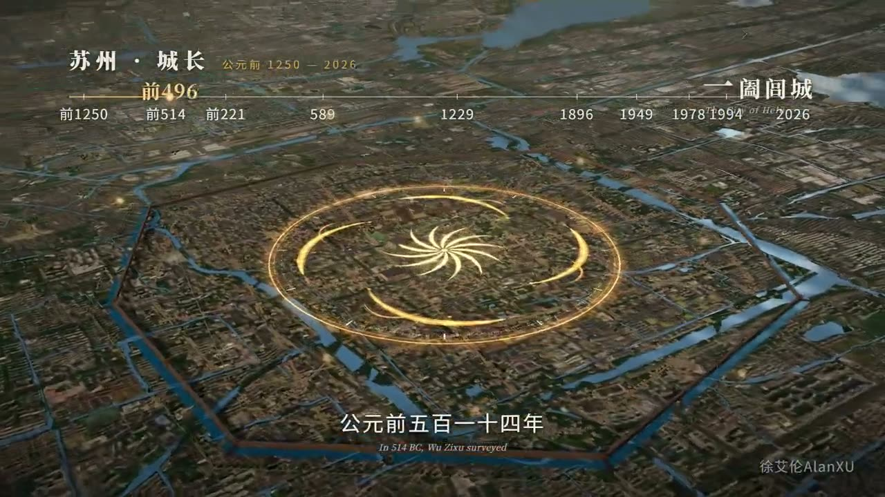

<div align="center">

# Auto-Video

**一句选题 → 165 条画法管线 → 一部能发的片**

原创口播稿 · 本地克隆音色 · 代码逐帧确定性渲染 · 字幕贴真实语音 · 发布包门禁
不调云端生图 / 生视频 API，同一稿同一版出同一帧。

[](https://github.com/DaBaoAgent/Auto-Video/stargazers)
[](https://github.com/DaBaoAgent/Auto-Video/commits/main)
[](LICENSE)


**简体中文 | [English](README-en.md)**

**[▶ 在线样片站](https://dabaoagent.github.io/Auto-Video/)** · **[166 条管线清单](docs/pipelines.md)** · [更新日志](CHANGELOG.md) · [参与贡献](CONTRIBUTING.md)


<sub>8 秒 / 2.3 MB —— 彩铅 · 漫画分格 · 水墨 · 三维城市，四段全部由本仓库代码渲出。</sub>

</div>

## 30 秒先看到东西

```bash
git clone --depth 1 https://github.com/DaBaoAgent/Auto-Video.git
cd Auto-Video
python demo/run.py            # 15 秒 720p：不配音、不下载素材、不调云端 API
```

本机没有 Python / Node / Chrome？用 Docker，镜像里已经装好 chromium + ffmpeg + 中文字体：

```bash
docker compose run --rm demo
```

产物 `demo/out/demo.mp4`。这条路径走的是「模板 + 任意行数稿子」：分幕从 `timeline.json` 长出来
（[`vendor/runtime/autoscene.js`](vendor/runtime/autoscene.js)），5 句、12 句旁白都能渲，不写死 8 句。

跑通了 demo，再挑一条真管线（`check` 先看这台机器缺什么，`plan` 看它会跑哪些命令）：

```bash
python pipelines/pencil/scripts/pencil.py check
python pipelines/pencil/scripts/pencil.py new projects/demo --title "试片"
python pipelines/pencil/scripts/pencil.py render projects/demo
```

| 你需要 | 什么时候要 |
| --- | --- |
| Python 3.10+（只用标准库） | 全部管线与工具链 |
| Node 18+ | Canvas / Remotion 逐帧那批管线 |
| Chrome / Edge / Chromium | 抓帧（`CHROME_PATH` 可覆盖，自动探测） |
| ffmpeg / ffprobe | 合流、响度归一、抽帧 |
| edge-tts（免费）或 GPT-SoVITS | 要配音时；克隆音色才需要后者 |
| 本地 ComfyUI + Wan2.2 | 只有 `tianshu` 一条 |

`python tools/validate.py` 一次性告诉你这台机器上 166 条管线、11 个工位是否对齐，入口文件和 SKILL.md 有没有脱漏。

## 它和「自动剪辑工具」的区别

这不是又一个「素材库检索 + 拼接」的自动剪辑器。区别在**画面是怎么来的**、**同一个稿子能不能出同一帧**、
以及**片子出厂前要过哪些门禁**。

| 维度 | 常见自动剪辑 / AI 视频工具 | Auto-Video |
| --- | --- | --- |
| 画面来源 | 素材库检索拼接，或调云端生图生视频 | 代码绘制、模板渲染、本地模型；不搬原片，不逐次计费 |
| 可复现性 | 每次结果带随机性 | 同稿同版 → 同像素（禁 `Date.now` / `Math.random`，按 id 播种） |
| 质量门禁 | 基本没有 | 契约校验 + 动效审计 + 字幕全量 + 频闪预算 + 响度归一 + 交付结构 |
| 规模 | 一套通用模板 | 165 条画法血统 / 11 工位，共用一套运行时与契约 |

165 条成片的实现来源分开说清楚，免得夸大：**41 条**是各自带工程与运行时的手工管线，
**77 条**共用仓库内的风格内核 [`vendor/runtime/stylekit.js`](vendor/runtime/stylekit.js)（14 个风格族），
**47 条**是自包含的本地运行时封装（31 条按 MIT 移植的画法脚本 + 10 条自研 Canvas 画帧 + 6 条本地运行时）。

<div align="center">

<a href="https://dabaoagent.github.io/Auto-Video/"></a> <a href="https://dabaoagent.github.io/Auto-Video/"></a> <a href="https://dabaoagent.github.io/Auto-Video/"></a>

<a href="https://dabaoagent.github.io/Auto-Video/"></a> <a href="https://dabaoagent.github.io/Auto-Video/"></a> <a href="https://dabaoagent.github.io/Auto-Video/"></a>

<sub>皮影 · 彩铅 · 漫画分格 · 三维城市 · 铅黄剪影 · 欧普艺术 —— 点任意一张进样片站，悬停即播。</sub>

</div>

## 工位地图：11 个工位，165 条成片

管线按**工位**分组：工位是「同一套画法血统」的一族，编号即站点与文档里的排序。
下表只列代表管线，**全部 166 条的逐条状态、引擎、入口、样片时长在 [`docs/pipelines.md`](docs/pipelines.md)**（由 `catalog/pipelines.json` 生成，不会走样）。

| 工位 | 条数 | 代表管线 | 画什么 |
| --- | --- | --- | --- |
| 01 纸本叙事 *Paper & Chronicle* | 4 | [jianying](pipelines/jianying/SKILL.md) · [lishi](pipelines/lishi/SKILL.md) · [zhidiao](pipelines/zhidiao/SKILL.md) · [minjian](pipelines/minjian/SKILL.md) | 绢本、纸本、剪影、民间绘本，用卡片运动语法讲历史，一镜 2–4 秒 |
| 02 手绘笔触 *Hand & Pencil* | 33 | [pencil](pipelines/pencil/SKILL.md) · [caiqian](pipelines/caiqian/SKILL.md) · [pingban](pipelines/pingban/SKILL.md) · [shuicai](pipelines/shuicai/SKILL.md) · [qianhuang2](pipelines/qianhuang2/SKILL.md) | 逐帧手绘、铅笔测试、彩铅排线、平板速写、湿画水彩、铅黄剪影 |
| 03 传统工艺 *Traditional Crafts* | 19 | [piying](pipelines/piying/SKILL.md) · [shuimo](pipelines/shuimo/SKILL.md) · [shadow](pipelines/shadow/SKILL.md) · [laolang](pipelines/laolang/SKILL.md) · [fushihui](pipelines/fushihui/SKILL.md) | 皮影、水墨、灯影、刺绣、上美影手绘赛璐璐、浮世绘木版 |
| 04 卡通动画 *Cartoons* | 15 | [goldenage](pipelines/goldenage/SKILL.md) · [manga](pipelines/manga/SKILL.md) · [xiangsu](pipelines/xiangsu/SKILL.md) · [tianshu](pipelines/tianshu/SKILL.md) | 美式黄金卡通、漫画分格、索引色像素、民间志怪赛璐璐 |
| 05 平面图形 *Graphic & Motion* | 27 | [shiliang](pipelines/shiliang/SKILL.md) · [lvdong](pipelines/lvdong/SKILL.md) · [huixingzhen](pipelines/huixingzhen/SKILL.md) · [zhuangshi](pipelines/zhuangshi/SKILL.md) | 扁平矢量、剪影律动、回形针图表、尺度漫游、装饰艺术 |
| 06 屏幕赛博 *Screens & Neon* | 23 | [xianshiqi](pipelines/xianshiqi/SKILL.md) · [xuni](pipelines/xuni/SKILL.md) · [dianzhen](pipelines/dianzhen/SKILL.md) | 深青霓虹 HUD、合成波 / VHS / Y2K、点阵屏与字符屏 |
| 07 三维推演 *3D & Diorama* | 11 | [tuiyan](pipelines/tuiyan/SKILL.md) · [chengshi](pipelines/chengshi/SKILL.md) · [dengju](pipelines/dengju/SKILL.md) · [isometric](pipelines/isometric/SKILL.md) | 兵棋战场、真实数据生长的城市、等轴粉彩微缩、纸片立体书 |
| 08 地图地理 *Maps & Terrain* | 10 | [map](pipelines/map/SKILL.md) · [ditu](pipelines/ditu/SKILL.md) · [weixing](pipelines/weixing/SKILL.md) | Natural Earth 贴纸地图、卫星地形与高程水面、数据地图 |
| 09 图纸说明 *Diagram & Blueprint* | 12 | [blueprint](pipelines/blueprint/SKILL.md) · [parable](pipelines/parable/SKILL.md) · [chaijie](pipelines/chaijie/SKILL.md) | 蓝晒工程图、黑白火柴人寓言、原理拆解图 |
| 10 实拍混剪 *Live Footage* | 11 | [shipai](pipelines/shipai/SKILL.md) · [jilupian](pipelines/jilupian/SKILL.md) | Pixabay 素材竖屏口播、片源清单驱动的纪录片解说 |
| 11 前端工位 *Front of House* | 1 | [peiyin](pipelines/peiyin/SKILL.md) | 选题、口播稿审计、批量克隆配音与时间轴（不出片） |

## 一条片怎么生产


| 阶段 | 输入 | 产出 | 通过条件 |
| --- | --- | --- | --- |
| 选题与口播稿 | 选题 / 对标链接、内容规约 | 原创口播稿 | 过 AI 味审计，多音字 / 外文人名读音校正 |
| 本地配音 | 口播稿、克隆音色 | 分句配音、时间轴 | 审查门禁通过（呼吸、幕间停顿、崩词） |
| 配音对齐 | 口播稿、配音 | 词级或句级时间轴 | 字幕切点贴着真实语音 |
| 分镜与组装 | 时间轴、分镜表、模板、字体 | 分段视频 | 镜数、场景数、时长一致，参数可复现 |
| 质检 | 成片、时间轴、渲染数据 | 检查结果 | 字幕、频闪、补间、抽帧、响度全过 |
| 交付 | 成片、封面、发布信息 | 可直接发布的目录 | `out/<编号_片名>/` 四件套齐全 |

## 统一契约：参数即配置

过去每条管线的 `pipeline.json` 各写各的：有的 13 个键，有的 19 个键，有的干脆没有这个文件。
现在是一份**加性契约**——老键一个不动，只补两块：

```jsonc
{
  "schema": "auto-video/pipeline@2",      // 契约版本
  "meta": {                               // 登记信息，与 catalog 逐字段相等
    "id": "lishi", "no": "02", "station": "paper",
    "name_zh": "纸本史话", "aspect": "16:9", "fps": 30,
    "status": "live", "entry": "scripts/lishi.py"
  },
  "paths": { ... }                        // 历史扁平键：原地保留，一个没动
}
```

| 文件 | 作用 |
| --- | --- |
| [`catalog/pipelines.json`](catalog/pipelines.json) | 166 条管线的登记表：id / 工位 / 中英名 / 一句话 / 引擎 / 画幅 / 帧率 / 入口 / 状态 / 样片。站点的数据从它生成 |
| [`catalog/stations.json`](catalog/stations.json) | 11 个工位：编号、中英名、说明、段末诗句 |
| [`schema/pipeline.schema.json`](schema/pipeline.schema.json) | JSON Schema（draft 2020-12）：`schema` + `meta` 必填，其余历史键合法 |
| `pipelines/*/pipeline.json` | 每条管线自己的定版参数 |

| 命令 | 干什么 |
| --- | --- |
| `python tools/validate.py` | 查契约：id 唯一、工位存在、`SKILL.md` frontmatter 对得上目录、`meta` 与 catalog 逐字段相等、入口文件存在、目录与登记表双向不脱漏 |
| `python tools/normalize_pipelines.py` | 幂等补齐 `schema` + `meta` 与 SKILL.md frontmatter |
| `python tools/build_samples.py` | 原始样片压成网页短片（片头 30 秒、管线 1280 长边）+ 抽封面 → `site/assets/samples.json` |
| `python tools/build_site.py` | catalog + samples → `site/assets/data.js` |
| `python tools/build_fonts.py` | 按站点实际用字子集化思源宋 / 黑，出 woff2 |
| `python tools/check_links.py` | 扫全仓库文档与站点的相对链接，断链即失败 |

### 加一条新管线要做的四件事

1. 建目录 `pipelines/<id>/`，写 `SKILL.md`（YAML frontmatter 里的 `name` 必须等于目录名）与 `pipeline.json`；
2. 在 `catalog/pipelines.json` 登记一条，指定 `station`（没有合适工位就新开一个并写进 `stations.json`）；
3. `python tools/normalize_pipelines.py` 让 `meta` 与登记表对齐；
4. `python tools/validate.py` 过一遍，样片丢进源目录后 `python tools/build_samples.py` + `python tools/build_site.py`，推上去站点自动更新。

每条管线一个入口，统一是 `python pipelines/<id>/scripts/<id>.py <阶段>`；`check` 查依赖、`plan` 看命令，缺什么会直接说明缺什么。

## 可选前端：一个选题走完五步

`frontend/` 是**可选**模块，不装也能单独用任何管线。它把「选题 → 文案 → 免费 TTS 配音 → 风格管线出片 → 封面 + 发布信息」串成一条命令：

```bash
python frontend/frontend.py run --pipeline laolang --topic "玄奘为什么要西行" --title "玄奘西行"
```

| 阶段 | 产出 | 依赖 |
| --- | --- | --- |
| 01 选题 | `01-选题.md` / `.json` | 无 |
| 02 文案 | `02-文案.md` / `.txt` | 无 |
| 03 配音 | `03-配音.mp3` / `03-字幕.srt` / `03-配音.json` | edge-tts（免费、无需 key）或系统 SAPI + ffmpeg |
| 04 渲染 | `04-成片/` | 目标管线的运行时 |
| 05 发布 | `05-发布/发布信息.txt` + 两张封面（4:3 / 3:4） | 出图需 `ARK_API_KEY`；没有 key 也照常出发布信息 |
| 06 清单 | `06-交付清单.md` | 无 |

某一步失败就停在那一步，前面的产出全部保留。**要诚实的一点**：166 条里目前有 **10 条**能从选题一路跑到成片
（`pencil` `shadow` `tapestry` `laolang` `goldenage` `manga` `isometric` `map` `blueprint` `parable`），
其余 156 条在 [`frontend/targets.json`](frontend/targets.json) 里逐条写明为什么接不上最后一步——
要真实素材（`shipai`、`jilupian`）、要高程与路线（`chengshi`、`ditu`）、要本地模型（`tianshu`、`zhidiao`）、
要管线内 TTS 时间轴，或者输入根本不是文案（`tuiyan` 的兵棋、`huixingzhen` 的剧本）。
`python frontend/frontend.py check` 会打印「管线覆盖 166/166；已声明渲染命令 10 条」。

## 样片

**[在线样片站](https://dabaoagent.github.io/Auto-Video/)** 上 166 张管线卡、**164 段可播短片**：162 段是本仓库自渲的
10 秒风格段，另两段取自完整成片的片头（21 秒 / 30 秒）。悬停即播，按工位分组，按横屏 / 竖屏和时长筛，点开在灯箱里带声播放。

- 短片是**风格段**，不是预告片：一段只演示这条管线的一两个镜头语言，看完就能判断它适不适合你的选题；
- **封面不是「第 2 秒截图」**：逐帧统计运动与边缘密度，排除白屏 / 黑场 / 空镜，取动作最丰富的一帧，确需人挑的
  钉在 [`tools/poster_overrides.json`](tools/poster_overrides.json)；
- 只有两张卡没有视频：`qianhuang2`（最新接入，样片还没渲）与 `peiyin`（配音前端，本来就不出片）。

完整成片（几分钟到十几分钟那种）只做本地归档，不随仓库提交：`out/<编号_片名>/` 放成片、字幕、3:4 封面、4:3 封面与发布信息，旧版下沉 `out/_archive/`。细则见 [`docs/交付规范.md`](docs/交付规范.md)。

## 仓库结构

```text
Auto-Video/
├── demo/                    # 15 秒零依赖 demo（run.py）
├── docker/                  # demo 镜像：chromium + ffmpeg + 中文字体
├── pipelines/               # 166 个目录：SKILL.md + pipeline.json + scripts/ + runtime/ + projects/
├── catalog/                 # pipelines.json（唯一事实来源）+ stations.json（11 工位）
├── schema/                  # pipeline.json 的 JSON Schema
├── vendor/runtime/          # 77 条风格管线共用的绘制内核（stylekit + 抓帧 + 合流）
├── frontend/                # 可选前端：选题 → 文案 → 配音 → 出片 → 封面
├── fengmian/                # 封面 + 发布信息 + 交付门禁（MIT 导入，规则不改）
├── site/                    # 样片站：index.html / assets / fonts / media（Pages 直出）
├── tools/                   # validate / normalize / build_samples / build_site / check_links …
├── docs/                    # 管线清单、交付规范、多机同步、接入与审查记录
├── samples-v2/              # 10 秒样片源片、字幕与制作进度
├── projects/                # 示例工程（suzhou 等）
├── out/                     # 定稿归档：成片 + 字幕 + 两张封面 + 发布信息（mp4 不入库）
├── assets/                  # 字体等公共资源
└── .github/workflows/       # 契约门禁（contract）+ 站点部署（pages）
```

## 常见问题

<details>
<summary>配音是怎么来的？</summary>

默认走 **GPT-SoVITS 本地服务**（自备模型权重），也可以切 **edge-tts**（微软在线音色，免费、无需 key）。
模型权重体积大且可再生成，一律不入库，只做安装引导。

</details>

<details>
<summary>为什么模型、字体、成片都不入库？</summary>

一贯政策是**代码与配置入库，重量级资产引导下载**：引擎、TTS 权重、字体走官方渠道，完整成片留在本地归档。
这样 `git clone --depth 1` 不被几百 MB 的媒体拖住，版本历史也不会被不可再生成的产物污染。

</details>

<details>
<summary>样片和完整成片有什么区别？</summary>

`site/media/` 里是为站点压过的**风格段**（当前 162 段是 10 秒自渲短片，另两段取完整成片的片头）；
完整成片（2 分钟到 13 分钟那种）只在本地归档或 Release 资产里，不随仓库提交。需要原片时从归档取，不必重渲染。

</details>

<details>
<summary>很多管线名字看着像同一类，有什么区别？</summary>

它们共用「确定性渲染」这一层，但画法与镜头语法不同。`isometric` 与 `dengju` 都画等距世界，前者是地块 / 路线 / 连续镜头运行时，
后者是瓦片波浪运镜；`shadow` 与 `piying` 都做皮影，前者是透光牛皮 + 操纵杆，后者是剪影 + 卡片讲解。
同类之间的取舍写在各自 `SKILL.md` 的第一节。

</details>

<details>
<summary>能商用吗？</summary>

本仓库代码以 [MIT](LICENSE) 发布。第三方引擎、画法脚本、字体遵循各自协议（MIT / SIL OFL 等），
逐条记在各管线的 `CREDITS.md`；成片里用到的素材（如 Pixabay、Natural Earth、OSM）另按各自许可使用。

</details>

## 项目状态与下一步

**现在**：166 条管线 / 11 个工位 / 164 段可播短片 / 契约校验 `OK`。CI 每次 push 都跑语法、契约、共享运行时一致性与文档断链。

**下一步**，按投入产出排：

1. 补齐还没出片的管线（`qianhuang2` 等），让 166 张卡都有片子可播；
2. 把「一条命令从选题跑到成片」从 10 条往上扩，先解决模板写死分幕的那几条；
3. 把 77 条共用的风格内核与 47 条本地运行时收敛成可安装的包，让「165 条」变成「165 个可调用能力」；
4. 站点与文档的英文面继续补齐，让工艺文档被中文圈之外看到。

## 参与贡献

最欢迎的贡献不是「加功能」，而是**让某一条管线从「作者能跑」变成「谁都能跑」**：补样片、删掉脚本里写死的盘符路径、
把只有 Windows 能跑的 Chrome 探测改成跨平台、把 `SKILL.md` 里承诺了但没做的门禁补上。

规则、最小可合并管线模板与自检命令都在 [`CONTRIBUTING.md`](CONTRIBUTING.md)；行为准则见 [`CODE_OF_CONDUCT.md`](CODE_OF_CONDUCT.md)，
安全问题请按 [`SECURITY.md`](SECURITY.md) 私下报告。改完跑一遍：

```bash
python tools/validate.py && python tools/check_links.py
```

## 鸣谢与许可

- **styles**（合成波 / 扁平矢量 / HUD / 等轴等 MG 风格引擎）：[Vincentwei1021/styles](https://github.com/Vincentwei1021/styles)，MIT
- **huashu-art-motion**（31 条自包含管线的画法与绘制库来源）：[alchaincyf/huashu-art-motion](https://github.com/alchaincyf/huashu-art-motion)，MIT
- **MoneyPrinterTurbo**（`shipai` 的底片生成）：[harry0703/MoneyPrinterTurbo](https://github.com/harry0703/MoneyPrinterTurbo)
- **GPT-SoVITS**（本地克隆配音）：[RVC-Boss/GPT-SoVITS](https://github.com/RVC-Boss/GPT-SoVITS)
- **battlefield-editor**（`tuiyan` 的 3D 兵棋渲染引擎）
- **风格模板工程**（goldenage / manga / tapestry / pencil / isometric / parable / shadow / blueprint / laolang 的运行时与渲染链），MIT，出处记在各管线 `CREDITS.md`
- **AlibabaPuHuiTi-3** 等字体：免费商用 / SIL OFL，逐条见 `assets/fonts` 与各管线 `CREDITS.md`
- 本仓库管线由 AutoUP、AutoJY、alannew 等历史项目迁移归纳而来，出处与迁移说明见各管线 `MIGRATION.md` / `CREDITS.md`

**许可**：本仓库代码以 [MIT License](LICENSE) 发布；第三方组件遵循各自协议，汇总见 [`THIRD_PARTY_NOTICES.md`](THIRD_PARTY_NOTICES.md)。

---

<sub>如果你在找 AI 视频生成、自动剪辑、历史纪录片、纸雕动画、TTS 配音、字幕对齐或 ffmpeg 自动交付的实践，可以 Star 或 Watch 这个仓库；新管线完成后会直接进入项目。</sub>
